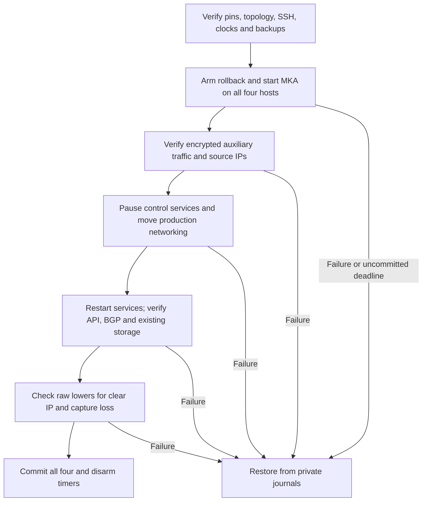

# Root deployment of the native encrypted link

Run the assembled kit on the physical gateway (`10.203.0.1`, `br-kube`).
It uses `bob`'s existing, host-key-verified SSH configuration to reach
`automation@10.203.0.11`, `.12` and `.13` with noninteractive node sudo.
The gateway command itself needs root. No registry/Kubernetes credential or
Internet download is required during deployment.

```sh
cd /path/to/assembled-kit
sha256sum -c SHA256SUMS
sudo ./deploy-root.sh deploy
```

`deploy` includes preflight and verification. Optional separate preflight
creates private staging/backup directories and copies tools, but changes no
production interface, address, service or firewall:

```sh
sudo ./deploy-root.sh preflight
sudo ./deploy-root.sh status
sudo ./deploy-root.sh rollback
```

The operator defaults to `bob` regardless of `SUDO_USER` or the root caller.
Use `--operator-user` only to select another existing local SSH account.
The initial JSON line prints the selected account. A real SSH plus
noninteractive sudo check on all three nodes runs before keys, tool copies or
node staging directories are created. SSH runs from that account's home, so a
root-only working directory cannot interfere.
No SSH key or agent is copied to a node. Auxiliary SSH uses the original host
configuration and host-key alias.

For a failed `runuser`/SSH attempt, the root-only `last-command.json` contains
the public command arguments and SSH stderr, never input/key material. Share
only those two fields and the phase, rather than the private profile or backup
files. The new connection check also reports the account/node and classifies
common authentication, host-key and connection failures directly.

The cutover briefly interrupts network/API traffic. Avoid concurrent VM
creation, deletion and migration: changing routes or storage sessions makes
the preservation checks inconclusive.

## Native configuration

[deployment-release.json](deployment-release.json) pins the tool image,
canonical archive and prepared Cilium release. The offline kit contains the
archive, launcher, coordinator and checksums. Standard MKA uses a root-generated
128-bit CAK/CKN shared only by the four native peers. No SVID or static transmit
session key is copied/configured. Link-group authentication remains separate
from application SPIFFE identities.

Production addresses, gateway, API VIP, guest IPs, iSCSI initiator/CHAP contracts
and BGP next hops stay the same. L3 moves onto `macsec0`, with MTU 1500 and
private lower/tap MTUs 1532. Node addressing becomes static at the existing
reserved IPs. Original gateway DHCP settings/reservations move to the upper.
WAN interfaces are outside the managed set.

Persistent networkd, modules-load, sysctl and systemd configuration recreates
the link on boot/restart. Raw-interface nftables ingress/egress guards permit
only MACsec (`0x88e5`) and MKA (`0x888e`). They start before MKA can create an
addressed upper and are reinstalled after native firewall service reloads.
MKA starts without Kubernetes or peer-readiness dependencies. Missing keys or
associations leave its protected datapath closed. The gateway does not wait for
its VMs to satisfy networkd's online requirement.

Kubelet and keepalived pause during the address move. The VIP device changes,
and kubelet's original command gains an explicit production `--node-ip` so the
auxiliary address cannot become a NodeInternalIP.

Cilium support is prepared separately. Every node must run the pinned image,
select `enp0s2` and `macsec0`, and set `macsec-underlay-devices=enp0s2`.
Preflight verifies this; staging checks both actual TCX hooks on the upper.
Strict Pod WireGuard stays enabled.

## Ordering and checks



Auxiliary `192.0.2.0/24` addresses exist only on encrypted uppers. Three
32 KiB TCP probes per host verify twelve directed peer paths before production
addresses move. Checks cover encryption, strict validation, replay protection,
MTU, preserved source addresses and Cilium's kernel hooks.

Staging allows a bounded retry window for MKA membership and key-server
convergence. A successful gateway-to-node connection alone does not establish
node-to-node readiness. Every direction must pass in the same complete round
before control services stop or production addresses move. Attempts and
directional failures are recorded in `staging-peer-attempts.json`; a node's
`peer-error.json` names the source, target and connect/send/receive/validation
step. Existing host access policy is not relaxed to make these probes pass.

Every prior BGP destination must retain its next hops, and peer/iSCSI connection
counts must recover. Nodes verify the API VIP's `/readyz` against the existing
Kubernetes CA. Existing kernel iSCSI block devices receive a direct read-only
4 KiB read to `/dev/null`. With no attached devices this read check has no work;
it is not proof of fresh guest I/O. The script creates no VM and reads no CHAP
passwords. Guest boot, migration, VPN and active disk-I/O acceptance follow
the native cutover.

Bounded kernel-filtered lower captures record counts/losses, write no payload,
and refuse commitment on clear IP, unexpected VLAN frames or packet drops.
All hosts must pass before commitment. Temporary echo services stop on commit;
auxiliary addresses remain for administrative recovery.

Capture sockets remain inactive while their buffer and filter are configured.
Reception starts at a filtered bind to the named lower, preventing unrelated
interfaces from queuing packets during setup. [Linux packet socket semantics](https://man7.org/linux/man-pages/man7/packet.7.html)
define this protocol-zero startup behavior. VLAN offload metadata is checked
alongside Ethernet headers, including priority tags with VID zero.

Every completed window writes `capture.json` before deciding whether to commit.
It includes the bound interface, actual duration, requested/kernel buffer sizes,
received/dropped counts, directions, foreign-interface observations and truncated
control metadata. Zero loss remains required. Truncated metadata or any real
plaintext/VLAN observation still refuses commitment; increasing buffers or
discarding an inconclusive window is not used as a substitute for verification.

## Rollback and receipts

Every participant has a persistent native timer for the same 12-minute deadline.
It needs no Kubernetes access. Commit removes its token and disables it. A
queued timer rechecks that token under the agent lock.

Ordinary errors/termination trigger node rollback before gateway rollback.
Journalled files are restored only when their content matches an owned version;
unrelated edits are reported. Firewall predicates other than explicit interface
matches are preserved. Unsupported interface-bound sets/chains or opaque
extension rules cause preflight refusal. Original bytes, owners and permissions
stay in the root-only journal.

For legacy iptables, positive exact interface rules receive an owned equivalent
for the upper while the originals stay intact. Rollback removes only unchanged
owned copies. Negated/wildcard interface and physical-bridge matches require an
explicit migration and are refused. Isolated tests cover both backends,
retained user comments, idempotency and external edits.

Rollback restores the prior network, including its previous unencrypted native
transport. A failed attempt is not a secured rollout. Stop the original
controller before invoking manual rollback.

The first JSON line prints the common state directory on all four hosts:
`/var/lib/qrab-native-link/<deployment-id>`. Backups, private diagnostics and
receipts remain there. Select an older attempt with `--state`. Repeating
`deploy` after a recorded commit does not replace keys or reset SAs.

On a deployment failure, inspect `primary-error.json` first. It snapshots the
triggering exception and remote stderr before cleanup. `last-command.json` can
instead describe a later rollback timeout: an auxiliary SSH session may lose
its reply as its own MACsec interface is removed. Cleanup failures are recorded
separately and do not replace the original error. A diagnostic write failure
does not prevent the rollback attempt.

A controller killed during partial commitment can require per-node recovery:
uncommitted hosts retain timers while committed hosts retain encryption.
From a node console or available SSH path, use its saved agent:

```sh
sudo /usr/bin/python3 -I /var/lib/qrab-native-link/<deployment-id>/deploy_root.py \
  agent --state /var/lib/qrab-native-link/<deployment-id> rollback
```

## Assemble and test

The normal release user can export the immutable image and assemble an offline
kit. Temporary registry authentication is not included in the output:

```sh
python3 contrib/network-encryption/package-deployment.py \
  --output /home/bob/operations/qrab-native-link-kit
```

`--tools-tree /path/to/exported-image` works offline and still requires the
exact archive hash. The output directory must be new.

```sh
python3 -m unittest discover -s contrib/network-encryption/tests
sudo python3 contrib/network-encryption/tests/check-nft.py \
  contrib/network-encryption/deploy_root.py /path/to/exported-image
sudo python3 contrib/network-encryption/tests/check-ssh.py \
  contrib/network-encryption/deploy_root.py automation
sudo python3 contrib/network-encryption/tests/check-topology.py \
  contrib/network-encryption/deploy_root.py /path/to/exported-image
sudo python3 contrib/network-encryption/tests/check-cilium-peer.py \
  contrib/network-encryption/deploy_root.py /path/to/exported-image \
  contrib/network-encryption/deployment-release.json
sudo python3 contrib/network-encryption/tests/check-capture.py \
  contrib/network-encryption/deploy_root.py /path/to/previous-deploy_root.py
sudo python3 contrib/network-encryption/check-macsec.py \
  --tools /path/to/exported-image \
  --deployment-agent contrib/network-encryption/deploy_root.py
```

The private-namespace fixture uses four trusted MKA peers and a wrong-key peer.
It checks staged clear primary traffic, MTU 1500, IPv4/IPv6 payloads, both
guards, replay, rekey and restart. Injection checks disable reverse-path
filtering. Static IPv6 test addresses use `nodad`; native production
configuration is IPv4-only. Namespace/configuration tests do not claim a
completed physical cutover or production reboot.

The topology fixture places the gateway's MACsec lower on the bridge master
with three node ports, then checks all twelve directed paths. It also verifies
that a deliberate default-drop policy is diagnosed without changing that
policy. A separate temporary veth/MKA peer exercises the live Cilium host
datapath, confirms preserved auxiliary source addresses and removes its test
interface/address/route afterward.

The capture stress fixture reproduces the previous setup race with busy
unrelated traffic, then checks idle-target isolation, encrypted target traffic,
actual IPv4/IPv6/tagged target packets, and deliberately induced target queue
loss. Positive isolation cases require zero drops; adverse cases must fail and
retain their counters. The bridge-master fixture also checks capture while
encrypted peer traffic is active.

[Acceptance evidence](deployment-evidence.json) includes the four-member
fixture, firewall round trips, live node preflights and temporary upper hook
attachment check. No production address was moved during preparation.

See [architecture](../../docs/node-link-encryption.md) and the
[systemd bridge option reference](https://www.freedesktop.org/software/systemd/man/latest/systemd.netdev.html#GroupForwardMask=).
Storage API client-SVID enforcement and physical SPIRE enrollment remain
separate work; this kit changes neither service's authentication configuration.
