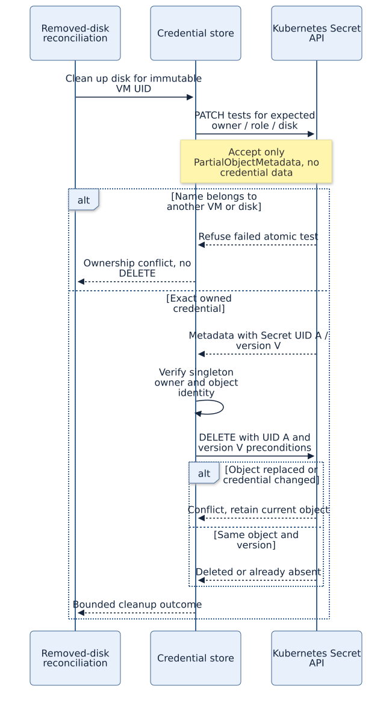
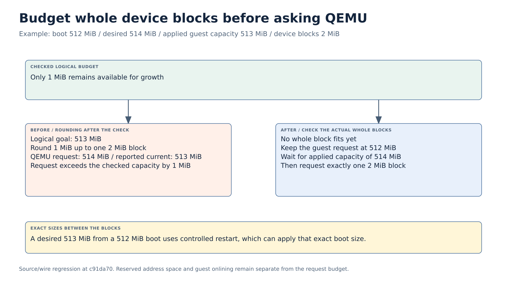
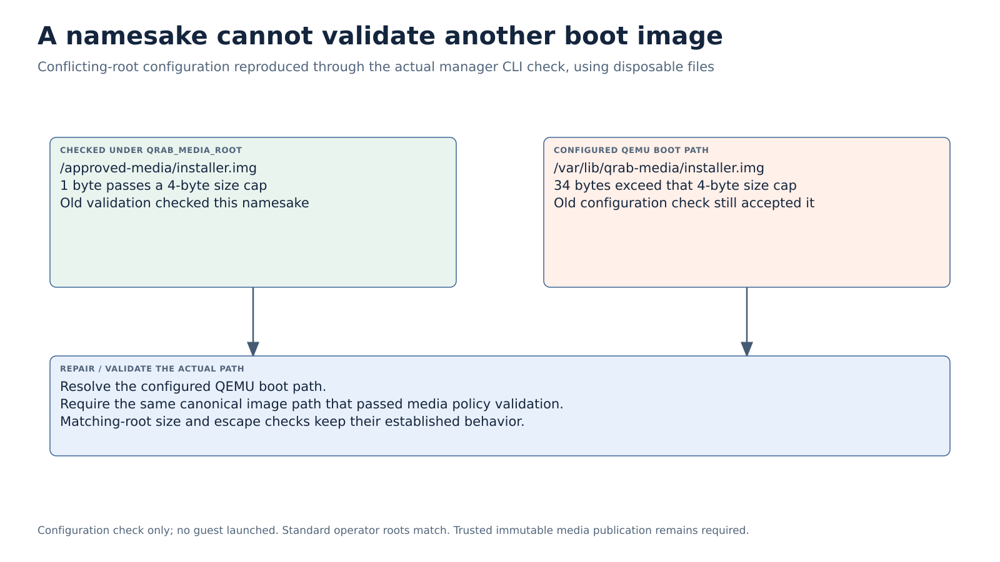
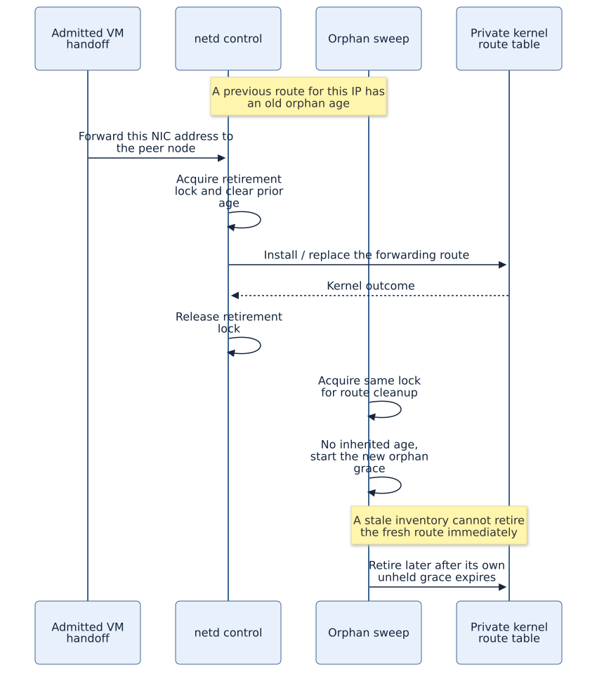
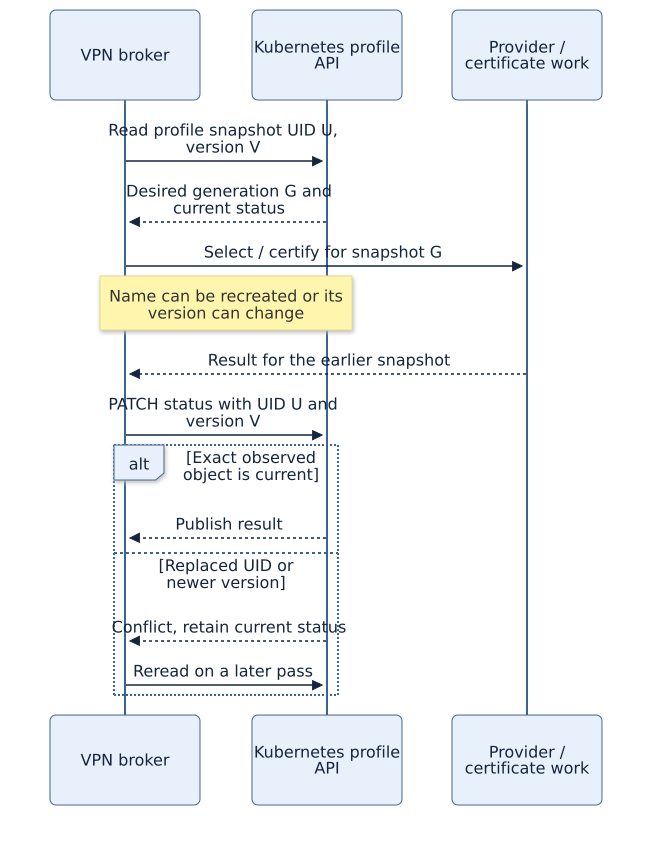
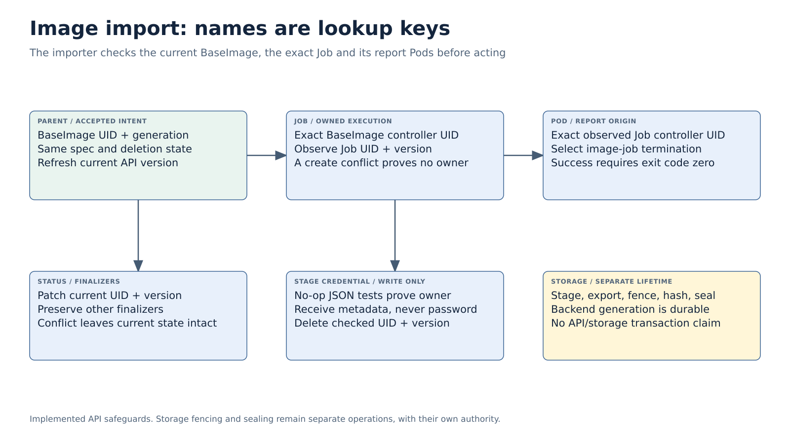
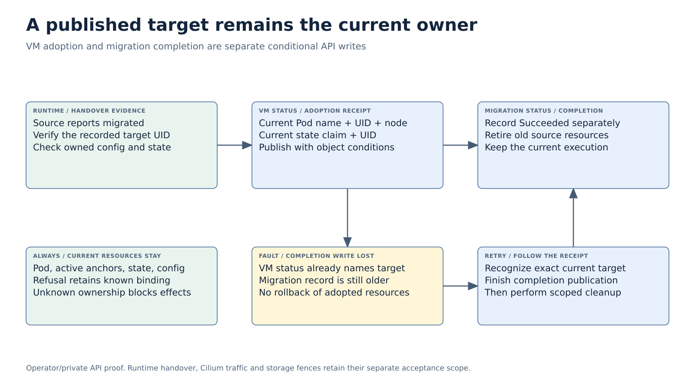
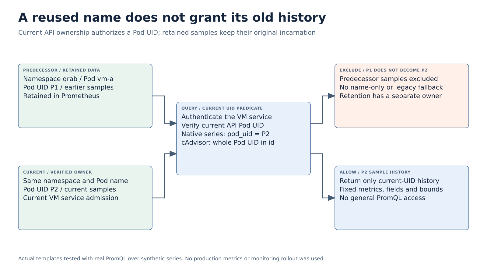

# Architecture boundary audit

This register contains source-backed findings and verified repairs from the
architecture investigation begun on 2026-11-17. Work claims, detailed progress
and operational notes live in the `qrab` project in towl. It is not a claim
that every possible violation has been found or every deployed image contains
these repairs.

## Review by boundary type

| Boundary | Repairs | Invariant |
| --- | --- | --- |
| Resource provenance and cleanup | A01, A02, A15, A21, A22, A23 | Delete/adopt the proven launch, group UUID or exact credential object |
| Local process and provider authority | A05, A06, A11, A14 | A name or numeric PID cannot replace the authorized current resource |
| Attachment and applied-state lifetime | A07, A10, A12, A13, A19 | Namespace, lease, config, endpoint and route changes retain their own incarnation |
| Stream/descriptor ownership | A08 | Bound the whole frame and own every delivered descriptor through refusal/cleanup |
| Delayed API observations | A09, A20, A21, A22, A24 | Status belongs to the observed object UID/version |
| Image/media inputs | A04, A17 | Validate the actual self-contained input selected for use |
| Resource budget and reporting scope | A16, A18 | Actual device blocks and reported counters stay within the checked boundary |

A03 corrects documentation. The HTTP-provider, trace-registry and real-freeze
entries are validation repairs/extensions, separate from production defects.
The rejected Cilium-policy concern is retained as a disproved hypothesis.

## A01 — state-PVC adoption crossed the launch ownership boundary

**Affected source:** `resources::state_claim_adoption` in the operator and
`launch::render_pvc` in the dashboard. **Baseline:** `5f361b7`.

The operator previously granted a VM controller ownership of a state claim
when the claim carried `app.kubernetes.io/managed-by: qrab-dashboard` and had
no existing controller. It did not verify the intended VM or launch. A VM
referencing another dashboard-created claim could therefore acquire
garbage-collection authority over that identity volume. The manager's later
VM-identity check did not undo this earlier ownership mutation. A name reused
after an earlier launch was another ambiguity.

The repair requires both resources to carry the dashboard label and the same
valid random launch ID; the claim must also match the VM annotation,
namespace and referenced state-claim name. Deleting resources and claims
with an existing controller are not adopted. The patch retains exact
UID/resourceVersion preconditions and preserves other non-controller owners.
New dashboard PVCs record the launch provenance. Legacy/reused claims without
the proof remain retained; established controller ownership is unchanged.

The regression reproduced the foreign-VM adoption failure before the change.
It passes after the change, covering foreign/stale/missing provenance,
namespace/name mismatch, invalid IDs, deletion and existing controllers. A
dashboard test also checks the actual rendered VM/PVC contract against the
operator adoption function. The full `contrib/check-runtime.sh` passed:
formatting, workspace tests, generated CRD/policy comparisons and strict
Clippy. These checks are hermetic; no live cluster deletion was exercised.

**Merged source:** `719335966b72ba33332f53ad8d9a36812771c965`.
**Tracking:** qrab `work/state-pvc-adoption-launch-boundary`.
The primary main checkout was synchronized. This audit performed source work
and tests; image publication and deployment have separate evidence.

The provenance annotations are public trusted Kubernetes metadata, not secrets
or cryptographic credentials. An actor with broad authority to forge or
rewrite those objects remains inside the namespace administration trust
boundary. This fix scopes normal cleanup; it does not turn a namespace with
unrestricted Pod/resource writers into a hostile multi-tenant environment.

## Documentation boundary reconciled with the agreed deletion design

Some older operator comments/guides said state PVCs were never collected,
while the implemented dashboard deletion path already adopted dashboard
claims. The user-approved deletion design recorded in qrab towl
`container/vm-deletion-cleanup` permits collection of the dashboard launch's
own claim and retains manual claims. The repair updates the operator API
description, generated CRD, crate instructions and subsystem documentation to
state this narrow exception and its provenance checks.

PVC deletion is not backing-data destruction. The documented Retain-only
storage contract leaves a Released PV/zvol for a separately owned cleanup
workflow. Guest disk exports, retained identity state and group cleanup are
different ownership domains and must stay distinct in presentations.

## A02 — access grants incorrectly determined group cleanup authority

**Affected source:** dashboard `cleanup::reconcile_vm` and `cleanup::owned`.
**Repair baseline:** `0301347` (the source advanced independently during the
investigation).

The finalizer scanned current console admin/viewer grants instead of the
group UUIDs recorded at launch. Removing an original group from those grants
left it behind at deletion. A generated group from a previous launch of the
same namespace/VM name also passed the old name/description ownership check.
Access membership had incorrectly become lifecycle ownership.

Cleanup now uses the recorded launch ID and admin/viewer UUIDs, validates the
references before deletion and checks the exact launch-derived group name,
returned UUID and namespace/VM/role description. Current console lists do not
widen or erase that authority. Pre-launch-ID VMs look up only their exact
legacy names; incomplete modern provenance does not fall back to legacy.
Missing groups are already cleaned; invalid/mismatched provenance and service
outages keep the finalizer for a safe retry or explicit correction.

The amended regression failed before the repair because the original groups
were leaked. It passes after the repair and preserves platform, other-VM and
previous same-name-launch groups. Further coverage checks corrupt/missing
metadata, foreign UUIDs, legacy cleanup and outage behavior. Full dashboard
tests and `contrib/check-runtime.sh` passed. No live Kanidm groups were deleted
by these hermetic checks.

**Merged source:** `8a30586610cc80073076859454ce2554215fb2bd`.
**Tracking:** qrab `work/access-group-cleanup-launch-boundary`.
Primary main was synchronized. The audit performed no runtime release or
cluster rollout.

As with A01, the annotations are public trusted metadata. Broad namespace/API
administrators remain trusted. The repair does not claim an immutable or
cryptographic attestation of arbitrary client-supplied annotations.

## A03 — network security guide retained a plaintext-era description

The detailed networking security section still called the node conntrack
exchange plain TCP, despite the implemented exact-node SPIFFE TLS path and
the newer connection-atlas/enrollment evidence. The atlas work corrects that
paragraph to match `peer_tls` and the existing rollout record. On-link address
checks remain additional authorization, not a substitute for peer identity.
This is a documentation repair, not a new transport implementation or rollout.

## A04 — verified image metadata could select extra unverified inputs

**Affected source:** operator `image_job::virtual_size` and the inspect/write
Job path. **Repair baseline:** `8a30586`.

The importer checked the downloaded file's digest, then allowed qemu-img to
convert qcow2 metadata that could name backing or external-data files. Those
extra local/network inputs are not covered by the top-level digest and may
cross the Job's filesystem/credential boundary. A harmless temporary marker
fixture demonstrated the conversion mechanism; no real credential or live
storage was read.

Both Job modes now run a bounded qcow2 dependency preflight before any
qemu-img invocation. It reads the fixed v2/v3 header, rejects backing
offset/length and the external-data feature, and fails on truncated or
unsupported fixed headers. Raw remains an opaque single file. This is not a
new general qcow2 parser: QEMU still performs full format validation.

Default tests require no QEMU and cover dependencies, truncated/malformed
headers, bounded reads and actual entrypoint refusal before tool launch. An
explicit fixture test passed on QEMU **11.1.3**, built locally from the pinned
`vendor/qemu` source with downloads disabled. It checks standalone v2/v3 and
extended-L2 inputs, rejects both dependency classes, and demonstrates the
unguarded baseline reading the separate benign marker. The full runtime
check also passed. This did not test live storage, libiscsi or a guest boot.

**Merged source:** `69ef4274d6ba973bb696371c97fb0716a1e4206c`.
**Tracking:** qrab `work/image-import-self-contained-qcow2`.
Primary main was synchronized. The audit performed no production image
build/publication or cluster rollout.

The legacy staging script accepts only a reviewed hardcoded CirrOS URL/digest,
not arbitrary BaseImage sources. The general inspect/write Job interface is
the repaired boundary. Prepared backing chains must be flattened in their
trusted preparation environment before import.

## A05 — host cgroup names could impersonate Pod identity

**Affected source:** netd `cgroup::pod_uid` and its use by socket-caller and
anchor-process lookup. **Repair baseline:** `93b9792`.

The old helper searched every cgroup path component for a `pod<UUID>`
substring. An unprivileged host user can create a transient user scope whose
name contains that text. A harmless local `systemd-run --user --scope`
fixture produced exactly such a kernel-reported path, and the old parser
returned its fake Pod UID. netd's caller mapping and anchor process selection
used that result as authority. A kernel-reported string still needs its
hierarchy and component semantics validated.

The repair accepts one host-view unified-cgroup-v2 `0::` record and exact Pod
components under kubelet's standard `/kubepods.slice` or `/kubepods` roots,
including their valid QoS paths. It rejects user/delegated roots, partial
names, extra records and unrooted views. The same corrected mapping protects
anchor PID selection, so a lower-numbered host lookalike cannot be chosen
instead of the real Pod process. Custom roots and cgroup-v1/multi-record
views fail closed; the node daemon requires the documented host unified view.

The regression failed before the fix and passes after it. Coverage includes
both drivers/all QoS classes, nested lookalikes, malformed/multiple records
and fake-proc caller/anchor selection. The netd suite, client-only
`--no-default-features` check and full runtime check passed. A bounded
read-only inspection confirmed the deployed netd's standard host-rooted
systemd view. No live VM descriptor grant, NIC control or namespace/network
mutation was attempted; unprivileged kernel-netns tests are not claimed as
live datapath proof.

**Merged source:** `4625eefabb3743b3ec775b4f547a6b873cd162bf`.
**Tracking:** qrab `work/netd-cgroup-hierarchy-authentication`.
Primary main was synchronized. This audit did not publish a runtime image or
roll out the repair; later release workflows require their own evidence.

## A06 — process identity checks could be separated from resource use

**Affected source:** netd caller mapping, anchor namespace selection and
resolver/VPN-file reads. **Repair baseline:** `2b601f4`.

The old paths read a numeric PID's cgroup and later reopened `/proc/<pid>`
resources. A PID/path replacement between those steps could substitute another
process, namespace or mounted file. A socket's saved numeric peer PID also
does not pin the original connector's lifetime. This was a source-identified
race; no live exploit or VM grant was attempted.

The repair captures the original Unix peer with `SO_PEERPIDFD`, checks its
readiness/liveness during admission, and rechecks membership after the bounded
request read. Process-directory descriptors are opened before validation;
subsequent namespace, resolver and bounded VPN reads use `openat` relative to
that held directory. Namespace workers, queue grants and DHCP receive opened
namespace files. Numeric PID/path authorization helpers were removed.

Default tests replace/rename private fake-proc directories and demonstrate the
old path resolving replacement data while held directory/namespace handles
retain the original resource. Bounds, relative paths, symbolic PID directories
and close-on-exec behavior are covered. An explicit supported-kernel fixture
with a private child/Unix socket ran successfully and refuses the original
peer after exit even when a claimed numeric path is replaced. The netd suite,
client-only feature check and full runtime check passed. Kernel-netns tests
that self-skip under an unprivileged user are not live datapath evidence.

The server now probes `SO_PEERPIDFD` support at startup (Linux 6.5+) and fails
closed without it. The client-only build has no new kernel/API dependency.
Current native node metadata reports 7.0 kernels; the peer fixture ran locally
on 6.18.50. This does not claim feature/rollout acceptance on the nodes.

**Merged source:** `095edadb84e4a383ab1ef55a09839d873e403227`.
**Tracking:** qrab `work/netd-stable-process-authority`.
Primary main was synchronized; this audit did not build/publish runtime
images or roll out a cluster. The [authority perspective](authority.md) generalizes the review.

## A07 — a Pod UID did not identify a replacement NIC sandbox

**Affected source:** netd's plumbed/DHCP caches, grant/probe token and manager
NIC binding. **Repair baseline:** `c10ca28`.

A Kubernetes Pod can keep its UID while CRI recreates its network namespace.
The old cache and attachment token named only the UID. QEMU queues and the
DHCP socket could retain the old namespace even after the helper prepared a
new one; manager's token comparison would see no change.

A plumbed context now holds the validated process and opened namespace. Its
opaque token combines the Pod UID with that namespace's device/inode identity.
Healthy checks verify the held process still occupies the same namespace;
stale contexts invalidate readiness and stop their DHCP workers. Grants and
probes use the same current context. An agent restart observing the same
namespace produces the same token. Failed DHCP workers can be retried rather
than remaining cached as live.

Default file/context tests cover same-UID replacement, token stability,
process reassignment/exit and worker lifetime. The actual manager reconciliation
fixture demonstrates namespace-only token changes causing device removal,
guest-release confirmation, backend removal and fresh queue attachment, with
the same configured MAC and root port. Full runtime, node suite and client-only
checks passed.

An explicit isolated user/network-namespace run exercised four kernel fixtures:
namespace replacement/descriptor lifetime, TAP queue transfer, forwarding
routes and DHCP. The old namespace remained accessible through its file after
the namespace-holding task exited; the replacement did not contain its link.
Two VPN fixtures explicitly skipped without WireGuard tools. Dummy uplinks
are not a Cilium/BGP or real-guest hot-unplug proof.

**Merged source:** `69d96eea790363d333d116c0da0a4d17ce489ecb`.
**Tracking:** qrab `work/nic-anchor-namespace-incarnation`.
The audit changed source and performed isolated local tests; cluster sandbox
replacement and release operations require their own evidence.

## A08 — stream framing could reject valid replies and leak installed FDs

**Affected source:** netd `wire` reply send/receive and connection setup.
**Repair baseline:** `69d96ee` plus an independent image-pin-only update.

Grant decoding assumed one `recvmsg` contained all JSON, and probe/handoff
control assumed one read contained the reply. Unix streams permit fragmentation.
The older conntrack-count helper read to EOF, but its per-read timeout did not
bound a peer that kept dribbling bytes. A second reproduced failure was more
subtle: on `MSG_CTRUNC`, nix 0.29 refused to expose the installed subset of
SCM_RIGHTS descriptors, so the error path leaked them.

New senders terminate a bounded JSON line and finish short writes without
sending rights twice. The shared reader accumulates fragments within total
time/byte/descriptor bounds. It owns every delivered descriptor before refusing
ancillary truncation or parsing JSON, checks queue/count consistency, and closes
rights on every failure. Complete legacy JSON replies remain accepted at EOF.
A full Unix listen queue is a prompt retryable error rather than an indefinite
connect before read timeouts apply.

Both principal regressions failed before the change and pass after it. An EOF
sentinel verifies descriptor closure without racing process-wide FD counts.
Fifteen wire tests cover early/late rights, fragmented probe/control/counts,
malformed/oversized/refused replies, legacy EOF, deadline dribble, unexpected
rights and full listen queues. They pass in both node and client-only builds.
The full runtime and netd suites pass. An explicit isolated TAP fixture passed
real descriptor transfer and packet injection with the new decoder.

**Merged source:** `9e1dd3f0c8c605923efc575940082f839cad8297`.
**Tracking:** qrab `work/netd-reply-stream-framing`.
These checks exercise the local protocol and kernel mechanism; they do not
establish a deployed endpoint handoff or cross-node traffic outcome.

## A09 — delayed status could be published onto a same-name replacement

**Affected source:** netd readiness and VPN-port condition writers.
**Repair baseline:** `9e1dd3f`.

Local work held a Pod snapshot while plumbing or renewing a mapping, then
patched status by name without UID/version conditions. A replacement Pod could
receive the old result. Two fake-API regressions reproduced this through the
actual readiness and port-report entrypoints.

Both writers now use a shared conditional strategic patch with the observed
Pod UID and resourceVersion. Missing references fail closed; a rejected patch
is not cached as success. Successful kernel context retains its summary so
fresh reconciliation retries a conflicted status write from current watch data
without repeating plumbing or waiting for the sixty-second reverify interval.

Four focused tests cover replacement identity, version conflict/retry, missing
provenance and preservation of unrelated condition types. A no-op native API
server status **dry-run** accepted the matching snapshot, rejected a wrong UID
alone as immutable and rejected a stale version as Conflict. The dry-run
persisted no resource change and did not restart a Pod or VM.

The full runtime check passed with `RUST_TEST_THREADS=4`; strict node checks
also passed. These API conditions establish observation ownership, not backend
fencing or live guest health. Kubernetes documents
[conditional PATCH and conflict retry](https://kubernetes.io/docs/reference/using-api/api-concepts/#updates-to-existing-resources).

**Merged source:** `a5373c384c5679d2cc0218930bf8ff8f730da21b`.
**Tracking:** qrab `work/netd-status-pod-incarnation`.

## A10 — DHCP could serve stale configuration or report startup before binding

**Affected source:** netd applied-plan/DHCP worker lifecycle.
**Repair baseline:** `dc5d8c2`.

A healthy namespace-bound responder retained its original copied lease even
when later plumbing applied a different VPN address/DNS/MTU. Separately,
`serve_dhcp` reported thread creation as success before namespace entry or UDP
binding ran. A setup failure could therefore coexist with reported readiness.

The responder now binds its socket in the verified namespace before returning
success. That socket carries the namespace for subsequent I/O. Each request
reads one complete shared lease snapshot; reapplying a plan updates a healthy
same-namespace responder without rebinding port 67. A process-reference refresh
invalidates grants while preserving a potentially reusable namespace socket.
A changed namespace or removed Pod retires it. Failed responders invalidate
fresh readiness and retry; the socket closes before exit is published.

The invalid-namespace startup regression failed before the change and passes
after. An isolated real-link fixture received both the original and updated
address, DNS, MTU and lease duration from the same worker. A second bind failed
synchronously with AddrInUse while the first server continued to answer.
Default worker/readiness tests, client-only compilation and the full runtime
gate passed; the explicit isolated kernel suite exercised four paths while
two optional VPN fixtures skipped for missing tools.

This updates later DHCP answers; it does not force a guest to renew or rewrite
static NoCloud configuration. No live profile, Pod or route was changed.

**Merged source:** `033746a467bebccd87627e1530ec00a306a1a6ec`.
**Tracking:** qrab `work/netd-dhcp-lease-generation`.

## A11 — an older live same-UID process could select the wrong namespace or mount

**Affected source:** netd anchor discovery, cached-context checks and VPN reads.
**Repair baseline:** `ced3234`.

Discovery selected the first process beneath a Pod UID. That did not distinguish
an older live container/sandbox from the running anchor container identified
by the current Pod snapshot. Mounted-config discovery could likewise select a
convenient older same-UID mount. The private regression selected reference 7
when the API fixture identified reference 9 as current.

Selection now joins the declared regular `anchor` container's observed Running
status and complete runtime ID to the direct container cgroup scope beneath
the trusted Pod component. Pod UID/container ID come from one bounded cgroup
read. Held process/namespace references are rechecked against that Pod snapshot;
VPN files are read through the selected process instead of rescanning by UID.
Operator and node service share the unchanged container-name constant.

A current Running container is required even when it is not Ready. Missing,
terminated, unknown or ambiguous identity waits for a usable observation.
This can wait through image pull; it has no readiness cycle because the anchor
executable only waits for termination. Same-namespace process restart preserves
the attachment token and DHCP socket. Supported conventional cgroups use full
64-hex containerd/CRI-O/Docker-style IDs; unsupported layouts fail closed.

Default tests cover current selection, stale cache, missing/terminated status,
direct scope identity and selected mount reads. The explicit kernel fixture
keeps two real namespace holders alive while private fake-proc/API entries
select the newer one; it also proves old namespace-file lifetime after task
exit. A separate native read-only sample matched containerd's API ID to its
host cgroup. Neither is a live CRI recreation/rollout. Full runtime and
client-only checks passed; two optional kernel VPN fixtures still skipped.

**Merged source:** `8b1c4f236fde3f56c2826d5ad49b4bc1477e0408`.
**Tracking:** qrab `work/netd-current-container-namespace`.

## A12 — desired bytes and late renewal results could be mistaken for applied state

**Affected source:** netd VPN snapshot, ready context and NAT-PMP cache.
**Repair baseline:** `3cbca19`.

Reconcile read a digest before plumbing independently reread/parsing the file,
then recorded the earlier digest. An A→B→A rewrite could leave B applied while
the stored A fingerprint falsely matched the restored desired file. Renewal
also reread desired gateway data rather than using the installed plan, and a
late round could repopulate the UID-only cache after a namespace/config reset.

One bounded read through the selected process now supplies both parsed tunnel
and fingerprint. The successful ready context retains only its digest/gateway,
not another private-key copy. Renewal uses that applied context. Its generation
combines the held namespace token with the applied digest; cache insertion is
conditional on the still-current generation. Reverify of unchanged state
preserves the round. Old completions are discarded, a failed report cannot
clear another generation, and disabling forwarding reports unmapped even after
cache reset. The redundant separate digest map was removed.

The late-namespace round regression failed before the change and passes after.
Controlled file snapshots cover the A→B→A case; private API/cache fixtures cover
unchanged reverify, changed config, stale completion and disabled forwarding.
Default node tests, client-only compilation and the combined full runtime gate
passed. All six explicit kernel fixtures also executed with temporary
WireGuard tooling, strengthening the separate mechanism evidence.

The digest identifies configuration bytes; it is not a credential or proof of
remote provider state. API status remains a conditional observation, not a
transaction spanning kernel commands, provider replies and Kubernetes.

**Merged source:** `3b2ea3166bcb037653a51dc4cfceee9b344ba7c3`.
**Tracking:** qrab `work/netd-applied-vpn-snapshot`.

## A13 — a reusable endpoint name could retarget a handoff effect

**Affected source:** netd control handler and local Cilium handoff API client.
**Repair baseline:** `dd2f604`.

Authorization selected an own-VM/NIC Pod snapshot, but the privileged PATCH
resolved a reusable CEP name without checking the endpoint returned by Cilium.
The private control-entrypoint regression accepted a same-name foreign VM
endpoint and recorded its mutation.

The client now looks up the name, verifies exact singleton VM/NIC, component,
application and namespace identity labels, requires the unique CNI attachment
identifier, and sends the mutation to that immutable alias. Numeric endpoint
IDs and deprecated container IDs are not fallback authority. Missing or
ambiguous ownership/attachment evidence fails closed.

The foreign-endpoint regression fails before and passes after. A separate
fixture rebinds the name to B after a valid lookup and proves only verified
attachment A is selected. Negative fixtures keep the API available and record
that no PATCH occurs. Local HTTP tests cover content-length/close framing,
truncation, header/body bounds, ambiguous framing, errors and total deadlines.
The full runtime/client gate and final strict Clippy pass.

A read-only native endpoint sample exposed all five required labels and the
unique field, matching the current fork's API model. This is prerequisite/schema
evidence, not a live handoff. The current fork must preserve these labels and
unique-ID support. No live endpoint, image, fork source or rollout was changed.

**Merged source:** `17d7d21d86f193475ec8a8884a3ccbbcf837810d`.
**Tracking:** qrab `work/netd-handoff-endpoint-incarnation`.

## A14 — process names selected the privileged conntrack tool environment

**Affected source:** netd Cilium-provider discovery and bpftool wrappers.
**Repair baseline:** `3b2ea31`.

The privileged wrapper scanned `/proc/*/comm` for `cilium-agent`, then entered
that PID's mount/PID namespaces and ran bpftool. A process name is writable
and does not authenticate a platform service. The private baseline selected a
comm-only reference with no trusted-provider evidence; later numeric namespace
lookup also separated selection from use.

The provider is now the original kernel peer of the administrator-configured,
protected Cilium API socket. netd captures its pidfd, proc directory and opened
mount/PID namespace plus root-directory handles. `nsenter` receives inherited
handle paths, an explicit held root/working directory and a fixed trusted PATH.
It performs no later `-t PID` lookup. One provider snapshot serves an export;
conntrack scope/filter/rebase and streaming-memory contracts remain separate.

The default rejection test fails before the repair and passes after. Explicit
private peer/path-replacement and namespace execution fixtures ran. The latter
launches a helper in distinct mount and PID namespaces and verifies the test
child's reported namespace IDs match that provider, even after fake-proc path
replacement. It executes only readlink/test commands, not live BPF operations.
Full runtime/client checks and final strict Clippy passed.

A read-only native observation found the Cilium directory root-owned mode755
and its socket root-owned mode660. That protected configured path remains a
platform trust prerequisite. No live-node exploit, BPF map, image or rollout
was performed by this audit.

**Merged source:** `dd2f604ea097740c59475766487589e6b84ff6b0`.
**Tracking:** qrab `work/netd-cilium-provider-process-authority`.

## A15 — a credential cleanup name could refer to another VM

**Location:** operator `provision::SecretStore::delete`. **Repair baseline:**
`e00a555`.

The name `<vm>-disk-<disk>` is not an ownership proof. Valid pairs `a` /
`b-disk-c` and `a-disk-b` / `c` produce the same name. A normal removed-disk
cleanup can delete its old Secret and then fail to record its status. If the
other VM creates its own credential before the retry, the old name-only
DELETE can remove that other VM's Secret. Generic operator admission checks
the old object's internal ownership shape, rather than the intended VM UID
of this particular reconciliation.

A private API test using the actual Secret renderer and credential store
failed before the fix with `foreign credential deleted`. No live credential
was changed. The repair sends only JSON Patch `test` operations for the
expected VM owner, role labels and disk annotation, requesting a
`PartialObjectMetadata` response with no full-object fallback. It validates
the returned single controller owner and object identity, then deletes with
both Secret UID and resourceVersion preconditions.

The operator retains no Secret GET/list/watch permission and reads no
credential data for this check. A foreign/malformed owner is refused; an
object replacement or credential update between check and deletion conflicts;
a missing object is idempotent. The implementation preserves the established
Secret naming and admission contract rather than broadening API access.

Six private API cases exercise the actual store, including the two-step
release/retry collision, changed UID/version, metadata-only negotiation and
missing/ambiguous identity. The complete runtime gate and strict Clippy pass.
These tests establish local client behavior, not a production rollout or a
storage fence: deleting a Secret still does not close an existing disk session.

**Merged source:** `506b7c4a128fc96f954887747a7ba576bb4e5c4e`.
**Tracking:** qrab `work/disk-secret-cleanup-object-authority`.

## A16 — memory block rounding could exceed the checked budget

**Location:** manager `hotplug::grow` and operator `resources::plan_resize`.
**Repair baseline:** `ed54bf0`.

The manager first bounded a logical MiB goal, then rounded the extra memory
up to a 2 MiB virtio-mem block. With a 512 MiB boot, desired 514 MiB and
applied guest capacity 513 MiB, it sent a 2 MiB QMP request while recording a
1 MiB increase. The request exceeded the checked capacity by 1 MiB. Allowed
odd logical ceilings had the same problem. The private QMP regression failed
before the repair on the actual outgoing `qom-set` path.

The request now rounds down to complete blocks within the desired, applied
and logical maximum bounds, and records the actual requested size. Reserved
address headroom may still round up because it is not plugged guest memory.
Unrepresentable desired growth reports an actionable restart state. The
operator uses controlled recreation at the exact desired boot size, checking
alignment before its Steady shortcut so an old already-applied container limit
does not hide the mismatch. Alignment is relative to the captured boot size,
including odd boot sizes.

Regressions exercise the QMP path for applied capacity, desired size and
ceiling, with even/odd boots and normal whole-block growth; operator tests
cover restart, exact aligned growth and recovery of old applied limits. The
targeted suites, full runtime gate and strict Clippy pass. No production image
or rollout is implied by this source repair.

**Merged source:** `c91da7080dc35bb359e5e9a156ceee24537fc4a5`.
**Tracking:** qrab `work/virtio-memory-growth-budget-alignment`.

## A17 — a boot-media namesake could validate another path

**Location:** manager `MediaPolicy::validate_boot_disk`.
**Repair baseline:** `1ec4cf0`.

For an operator-approved boot path, validation checked the same basename under
`QRAB_MEDIA_ROOT`, while QEMU's arguments used the original
`/var/lib/qrab-media` path. Conflicting roots could therefore validate one file
and select another. In a disposable read-only container, the actual CLI
configuration check accepted a 34-byte boot file under a four-byte policy
because a one-byte namesake passed that policy elsewhere. No guest was
launched and the files were synthetic.

The check now resolves the actual QEMU boot path and requires the same
canonical image path that passed media validation. A hermetic regression fails
before and passes after. The full CLI matrix now refuses the conflicting
roots, preserves a matching-root allowed-size case and preserves the existing
matching-root size refusal. The media suite, full runtime gate and strict
Clippy pass.

This is a conflicting-configuration repair. Standard operator rendering already
uses matching roots; no live exploit is claimed. The existing trusted media
publisher must keep approved paths immutable through QEMU's open. A per-VM
read-only mount does not make another writer's storage a snapshot, and this
patch does not add descriptor-based media transfer.

**Merged source:** `a3b5cdd2c9f0f01e661f6b4f64e33c378f85b708`.
**Tracking:** qrab `work/boot-media-exact-path-policy`.

## A18 — hierarchy-root CPU totals could be labeled as one container

**Location:** manager `resources::container_path`.
**Repair baseline:** `767cbf1`.

Container accounting required explicit opt-in and matching process membership,
but accepted `0::/` without distinguishing a private cgroup namespace root
from the real hierarchy root. In the latter case, aggregate CPU counters
could be reported as one container's usage. A hermetic kernel-interface
fixture failed before the repair. This is a reporting-scope defect, not a
change to guest allocation or resource enforcement.

The root view now requires the core `cgroup.type` interface, which Linux exposes
on non-root cgroups. This permits private namespace roots even with disabled
controllers or unlimited limits. The actual hierarchy root lacks that
interface. Process counters remain available when container scope is absent
or ambiguous. See the [kernel interface documentation](https://www.kernel.org/doc/html/latest/admin-guide/cgroup-v2.html).

Four resource tests and the full runtime/Clippy gate pass. A thin sampler
linked against the updated manager library also reported the imposed two-core
and 1 GiB limits from a real disposable rootless container. The negative case
used synthetic interfaces; no process was moved into the host hierarchy root.

**Merged source:** `f7d449f89a793aea95a061b6ae74fa64c0f34ef3`.
**Tracking:** qrab `work/container-metrics-hierarchy-root-boundary`.

## A19 — fresh forwarding could inherit an old orphan timer

**Location:** netd `Agent::control` and `sweep_forwards`.
**Repair baseline:** `f7d449f`.

Orphan forwarding-route ages were keyed by address. Installing a fresh
handoff route neither reset its prior age nor shared the sweep's effect lock.
A rapid return/handoff or an old sweep snapshot could therefore remove the
replacement using a previous route's age.

An explicit isolated kernel fixture seeded an expired earlier age, used the
actual control path to install the route, then ran the actual sweep. Before
the repair it failed after the fresh route was removed. The fixture checks
its one-user namespace mapping before effects and runs in a private network
namespace; no host routes or live cluster were involved.

Forward/unforward now clear prior orphan state and retain the sweep's mutex
through the kernel effect. The replacement gets a fresh grace observation;
an earlier inventory cannot interleave deletion with its installation/reset.
The kernel case passes after and also verifies later retirement under the
route's own expired age. A default concurrency case verifies that the lock
remains held through a blocked effect. The bin suite, full runtime gate and
strict Clippy pass.

This narrows the earlier general IP/route-ownership concern to a reproduced
lifetime defect. It does not establish every other route-reuse hypothesis or
live Cilium/BGP convergence. Peer, own-VM/NIC and on-link next-hop admission
retain their existing scope.

**Merged source:** `6de02035751d4068a7edbc9281e70b720d59f895`.
**Tracking:** qrab `work/netd-forward-route-grace-generation`.

## A20 — a delayed VPN result could overwrite another profile incarnation

**Location:** Proton broker `runner::Broker::set_status`.
**Repair baseline:** `6de0203`.

The broker lists profiles before provider/certificate work, then published
status by name with no metadata conditions. Deleting/recreating that name or
changing its object version during the work allowed an old result onto the
current profile. A private API test using the actual status method failed
before the repair with the replacement's status overwritten.

The patch now supplies the observed UID and resourceVersion. Missing/empty
identity refuses the write; conflict leaves current status intact and the
next pass rereads profiles. Three regressions cover replacements, newer
versions, matching publication and incomplete identity. The full runtime gate
and strict Clippy pass. No real provider session or cluster was used.

Existing Secret admission separately protects profile-owned updates. This
fix scopes status publication; it does not make provider, Secret, node/kernel
and profile writes one transaction. The optional VPN path remains distinct
from the core VM/network path.

**Merged source:** `9c014f1825d28e16dfbe8db689742365c2de295a`.
**Tracking:** qrab `work/vpn-profile-status-incarnation`.

## A21 — image import trusted reusable Job and credential names

**Location:** operator image importer and Kubernetes adapter.
**Repair baseline:** `9c014f1`.

The adapter read same-name Jobs without proving their BaseImage owner,
accepted every create conflict, selected report Pods by a reusable Job-name
label, and deleted Jobs/stage Secrets by name. Status/finalizer writes also
lacked object conditions. A regression through the actual adapter and
reconcile attempted to delete a foreign CronJob-owned Job before the repair.
A second regression showed that guarding only later status writes still let
a known-stale parent retire backend storage first; it failed with the recorded
`retire` call before the parent checks were moved ahead of storage effects.

The repair passes the observed BaseImage through every adapter operation.
Fresh metadata must preserve its UID, generation, spec and deletion state,
including before reconciliation and each storage mutation.
Jobs require an exact BaseImage controller relationship; report Pods require
the observed Job UID, with exit code zero for success. Consumed reports retain
the Job UID/version through deletion, while generic cleanup checks the current
owned child and deletes with UID/version conditions. Create conflicts now
require the expected owner.

Stage-credential cleanup uses only JSON ownership tests and a
PartialObjectMetadata response, followed by conditional deletion. It adds no
Secret GET/list/watch or password readback. Missing/ambiguous identity and
replacement/rotation refuse cleanup. Status and finalizer writes carry fresh
UID/version conditions; only the importer's finalizer changes, preserving
other owners. Refreshing metadata permits the importer's own multiple status
writes in a single reconcile without retrying forever on its previous write.

Private API regressions cover foreign owners, stale/failed report Pods,
same-owner Job replacement, conditional Job/Secret deletion, parent changes,
concurrent API writes, successive progress and rejection before storage effects. All 18 importer cases and the full runtime gate pass, including strict
Clippy and generated-resource comparisons. No image build, cluster import or
backend storage operation was performed for these fixtures.

An existing sealed storage generation remains intentionally adoptable by its
catalog identity. This repair does not equate that data-adoption contract with
Kubernetes child ownership, or claim an atomic Kubernetes/storage transaction.

**Merged source:** `efdc909680ce03ba85ee3be55b747a0cdb3c3fdb`.
**Tracking:** qrab `work/image-import-object-incarnations`.

## A22 — migration reuse, handover and cleanup lost object authority

**Location:** operator migration workflow and generic refusal status.
**Repair baseline:** `a4d6461`.

Twelve private API/controller regressions failed against the original source.
Target preparation trusted existing ConfigMap, state-PVC and policy names;
guard SSA could take over a foreign policy. Cleanup could delete foreign
Pods/configuration, delete a replacement between lookup and effect, and
ignore a ConfigMap deletion failure while marking cleanup complete. The
handover branch also bypassed the later target-owner check. A standing guard
for a valid VM name beginning `qrab-migration-` could be swept as an abandoned
migration window.

The repair checks VM controller ownership and object identity throughout
preparation, adoption and cleanup. Existing configuration/window intent must
match; recorded target UID cannot silently change. Patches/deletes carry
checked UID/version conditions. Deletion errors propagate; foreign resources
remain untouched. The standing guard is explicitly excluded from window GC.
Manual previous state claims keep their deliberate retention behavior.

The fault fixture also exposed a distributed retry gap: VM target status
could be published before the final Migration status write conflicted. The
old retry called the current target a replaced source, failed the migration,
and allowed failed cleanup to remove current identity/configuration. The
published VM binding now serves as the adoption receipt. Retry completes
migration publication from the exact current target. Late cleanup protects
its Pod, active anchors, state claim and configuration.

A separate regression reproduced a normal ownership refusal clearing the
current migrated Pod name/UID/node for a VM without native disks, despite
retaining its state claim. Generic refusal status now keeps the known
execution binding while reporting Blocked/not-ready; retry does not revert
to the primary Pod name. Explicit stopped/absence handling stays separate.

The API fixture now supplies versions and enforces supplied PATCH/DELETE
conditions, with replacement/failure injection. Added validation enlarged a
debug async future enough to hit the test-thread stack; boxing the migration
substeps fixed that without increasing test stack limits. All 26 migration integration cases pass, including 14 new ownership/retry
cases. The full runtime gate, generated-resource comparisons and strict
Clippy pass. Late failed cleanup retains the current target resources and
retires the old source.

These are private controller/API checks. They do not launch QEMU, mount a
PVC, move a real guest, mutate Cilium or exercise a backend fence. Runtime,
network and storage acceptance retain their own evidence. Conditional API
operations and an adoption receipt do not create a cross-system transaction.

**Merged source:** `9059b977ce9193eb4bd0a515d97e95c45bbcab00`.
**Tracking:** qrab `work/migration-child-object-ownership`.

## A23 — anchor retirement did not retain the observed object snapshot

**Location:** operator `retire_other_anchors` and shared Pod deletion helper.
**Repair baseline:** `9059b97` (the initial regression used unchanged paths at
`a4d6461`).

The operator checked an observed anchor's VM owner, then wrote `retire-after`
by name. A replacement or newer owner snapshot could receive that old timer.
The shared deletion helper checked UID alone, so a newer ownership/retirement
snapshot on the same Pod could still be deleted. Actual functions against a
private conditional API reproduced the foreign annotation and stale deletion,
including an expired observation deleting a renewed timer. Missing identity
also permitted an unconditioned effect.

Both timer patches and Pod deletes now require nonempty observed UID and
resourceVersion and carry those conditions through the API effect. The next
reconcile reads fresh metadata after conflict. Five regressions cover
replacement/update refusal, renewed expiry, missing/empty identity before any
RPC, and matching annotation/deletion behavior. The complete runtime gate,
generated-resource comparisons and strict Clippy pass.

This is the operator's Kubernetes-object retirement clock. A19 separately
repairs netd's kernel forwarding-orphan clock. Both currently use 20 seconds;
that does not establish BGP convergence or make them one lifetime contract.
No kernel route, cluster object or guest was changed by the private fixtures.

**Merged source:** `28c1e6040a7b86da516d28c67f2667af1239857a`.
**Tracking:** qrab `work/anchor-retirement-object-incarnation`.

## A24 — current names could select a previous Pod's metric history

**Location:** Redfish history templates, observability inventory/admission,
operator downward metadata and monitoring target relabeling.
**Repair baseline:** `bf0f949`.

The current API inventory bound a certificate's VM to owned Pod names/IPs,
but historical selectors used namespace/name alone. A new Pod or VM can reuse
those names while Prometheus retains predecessor data. Actual templates,
evaluated by official promtool 3.16.0 over synthetic series, returned old data
before the current Pod existed and mixed unlabelled legacy/native samples.
The initial real-engine fixture failed all six metric isolation expectations.

Templates now carry current Pod UID. Native series require `pod_uid` from
trusted discovery target labels; cAdvisor requires a whole UID component in
its cgroup `id`, including cgroupfs and systemd forms. API inventory retains
UID and admits only matching templates. Scrape descriptors include UID too,
so stale discovery cannot relabel a replacement response under an old UID.
A private regression reproduced acceptance of an old descriptor before that
additional check. The operator supplies UID through downward metadata, and
the maintained diagnostic resolves it without exporting service credentials.

Missing downward UID disables history while keeping management alive.
Missing sample identity has no name-only fallback. The renderer/client,
bridge and PodMonitor label contract require coordinated release; this
investigation does not apply manifests or publish/deploy images. Existing
unlabelled data is excluded rather than retroactively attributed.

The maintained explicit fixture evaluates actual query strings with real
PromQL: predecessor times return no samples, current times return exact
expected values, both cgroup forms work, and UID-prefix lookalikes/legacy
samples are excluded. Default scope/TLS cases additionally cover current UID
replacement, missing metadata and old/unscoped query refusal. The explicit real PromQL fixture, focused component tests, shell syntax,
full runtime gate, generated-resource comparisons and strict Clippy pass.

No live Prometheus data or other cluster was queried. This repair scopes
current-Pod history; a VM-wide history product across former incarnations
would need its own proven provenance and authorization contract.

**Merged source:** `225b4aa0892cee0c375898804723df3266e1c00f`.
**Tracking:** qrab `work/metric-history-pod-incarnation`.

## Validation repair: the HTTP power fixture depended on test order

A full gate exposed a deterministic isolated-test failure: the operator's
plain-HTTP power fixture built a default reqwest backend under
`rustls-no-provider` without initializing a provider. Another test's global
initialization could hide it. The fixture now initializes Ring explicitly and
reuses its client; production continues to supply its SPIFFE TLS configuration.
The isolated test and strict Clippy pass, followed by the combined full gate.

**Merged test repair:** `265afecf4327985086ae8c676f7ca0b2c7eb757c`.
**Tracking:** qrab `work/operator-power-http-provider-initialization`.
This is test isolation, not another production authorization defect.

The final combined gate used four test threads on the busy host. Timing
variance, isolated reruns and complete check logs are recorded in towl.

## Validation repair: trace capture needed an isolated registry

The dashboard privacy case intermittently missed its positive `VM launch`
marker under parallel tracing callsite-cache changes. Its captured failure had
neither synthetic secret marker; the same test passed alone. The test now
runs its original assertions under a fresh child registry, verifies that
exactly one case executed, and retains all form, storage, UI and log assertions.
The dashboard suite, strict Clippy and combined full gate pass. Production
logging code is unchanged; this is not a claimed payload-leak repair.

**Merged test repair:** `0642b5999aead05daeac7ee2d2f375880a77b0fc`.
**Tracking:** qrab `work/dashboard-trace-capture-isolation`.

## Validation extension: freeze a real guest filesystem

An explicit real guest-agent run passed with zero frozen filesystems, which
the old RAM-only fixture documentation allowed. It exercised RPC/status/gating
but did not prove `FIFREEZE` on a filesystem. A positive assertion demonstrated
that limitation by failing against the old input.

The ignored launcher test now formats only its own private 64 MiB regular
file on the host. A reserved argument, UUID, label, ext4 type and size opt into
the fixture guest's mount before agent startup. The guest never formats an
ordinary disk. The test selects that exact mount and requires one frozen
filesystem, matching thaw, frozen update refusal and a successful later update.

The explicit 11.1.3 TCG run passes with `froze 1 filesystem(s)`. The normal
runtime gate and strict Clippy pass. A local verification initramfs replaced
only `init` among 114 records from the pinned cached image; all other payloads
and metadata were unchanged. This strengthens the test evidence, rather than
repairing a claimed production data leak or providing a backup product.

**Merged test/fixture extension:** `3f1ac7c2704e55736f3e91f42ff1b5721965e31d`.
**Tracking:** qrab `work/guest-freeze-positive-live-fixture`.

## Investigated concern rejected by the real policy contract

The audit initially suspected two `ingress: [{}]` CiliumNetworkPolicy examples
allowed unrelated ingress. Tests of the exact importer manifest and NIC
baseline through the local Cilium production policy repository denied that
traffic. The examples were preserved. The auxiliary simulator disagreed for
those inputs and was not used as the sole oracle. This is a rejected
hypothesis, not another repaired boundary bug; see [verification](verification.md)
and qrab `work/cilium-default-deny-ingress-policy` for the distinction.

## Checks and limits

The initial `5f361b7` runtime baseline passed before the repair. Future
findings must include a source location, a concrete boundary crossing or
failure mode, a regression or other appropriate proof, and the verified
change. Desired capability gaps are not automatically bugs: document them in
the capability ledger rather than silently expanding the platform's scope.
