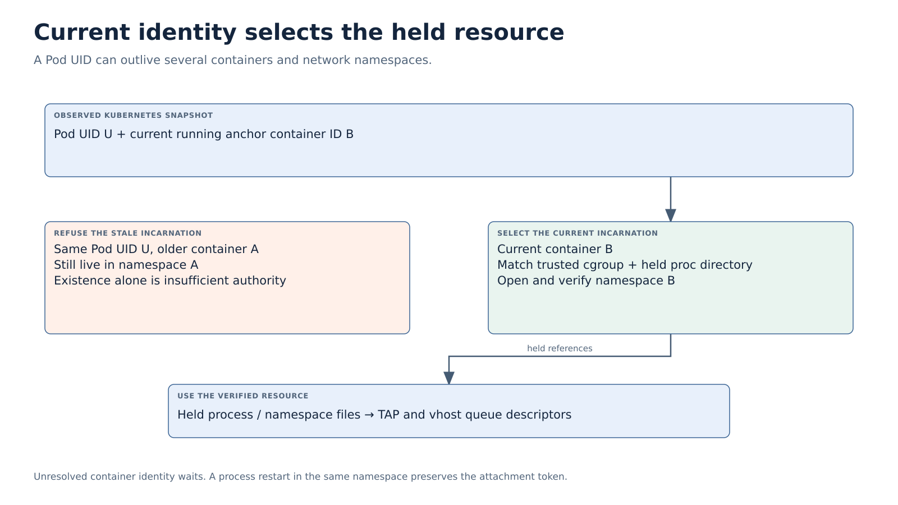
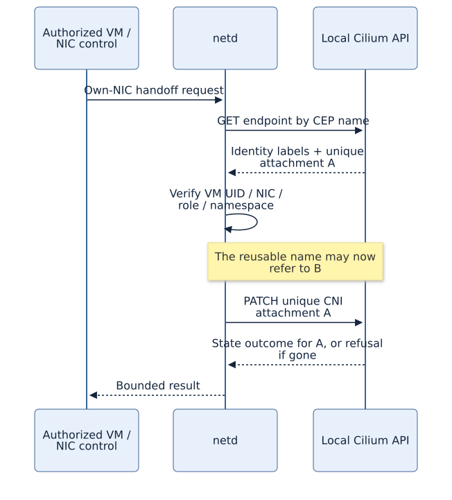

# Authority across resource lifetimes

A VM operation crosses several owners: human identity, declarative intent,
runtime process, kernel resource and storage export. Each crossing needs a
reference that still identifies the intended resource when the effect occurs.
This is a useful architecture-review perspective alongside the service map.

## Match the reference to the responsibility

| Entry / name | Authority used for the effect | Lifetime / recovery boundary |
| --- | --- | --- |
| Human login | Verified issuer/audience/subject plus VM action role | Token/session expiry and application authorization |
| VM name | Immutable CR UID and accepted spec | A new same-name VM gets a new identity |
| Pod name | Exact Pod UID/controller relationship and current API state | Conditional patch/delete must not affect a replacement object |
| State claim name | PVC UID, VM-bound initialized state, lease and driver attachment contract | Retain/recover the intended identity rather than silently initializing another |
| Dashboard launch label | Recorded launch/VM/claim/group provenance under protected API writers | Cleanup of created resources is separate from current access grants |
| Local socket PID | Original connector pidfd, validated cgroup/Pod and held proc directory | Dead/reused numeric processes cannot substitute another actor |
| Current anchor process | Observed Running container ID joined to Pod UID and direct trusted cgroup | An older live same-UID process cannot substitute its namespace or mount |
| Namespace path | Already-open namespace descriptor from the validated current anchor process | Entry/FD grants use that resource through completion |
| Ready anchor Pod UID | Current namespace token backed by a held resource | A same-UID sandbox replacement invalidates stale readiness and queue binding |
| Descriptor-bearing reply | Complete bounded frame plus owned SCM_RIGHTS resources | Fragmentation, parse errors and truncation cannot lose track of installed FDs |
| Mounted VPN file | Read relative to the validated current process, with a bound | A later PID path cannot select another mount/root |
| Applied VPN generation | Digest and parsed plan from the same captured bytes | New desired bytes and late round results cannot retag an older applied effect |
| Local Cilium provider | Original protected-socket peer and held mount/PID/root handles | A writable process name or later PID path cannot choose privileged tool execution |
| Cilium endpoint name | Verified VM/NIC labels and unique CNI attachment ID | Name reuse after lookup cannot retarget mutation to a new attachment |
| Guest address | Owned pool/endpoint and controlled route/handoff state | Standby/active authority and route retirement are explicit |
| CHAP login | Exact export generation plus required hard fencing | Authentication does not establish that an old writer is gone |
| Downloaded image digest | Verified standalone source and independently sealed raw generation | Metadata cannot extend integrity to unverified backing/data inputs |
| Image-import Job name | Current BaseImage UID, exact observed Job UID/version and Job-owned report Pod | Name reuse cannot supply another report or retarget cleanup |
| Image-stage Secret name | Atomic owner tests, metadata-only response and UID/version delete conditions | Cleanup keeps credentials write-only and preserves a replacement/rotation |
| Event sequence | Manager epoch plus sequence/gap/drop information | Bounded observations have restart/retention limits |

The references here are not all credentials. A launch ID is public provenance;
a namespace descriptor is an OS capability; a storage generation participates
in a durable backend protocol. Their enforcement owners are different.
Source: [boundary contracts](boundaries.md), [evidence](evidence.md) and
[the audited repairs](audit.md).

## Follow the local attachment case

The caller connects to a Unix socket. The kernel supplies its original peer
process handle. netd opens that process's proc directory, validates the host
unified cgroup and checks the API-owned VM relationship. It authorizes only
the VM's own NIC. The anchor's process and namespace are separately selected
and held; the helper enters that already-open namespace on a worker and grants
the resulting queues. Guest packets then use the kernel datapath independently
of this control connection.

The audit found both a classification error (a host scope's name looked like
a Pod UID) and a lifetime gap (a numeric PID/path could change between check
and use). Exact cgroup parsing addresses the former; held process/namespace
descriptors and the original peer pidfd address the latter. These are local
kernel/Pod authority checks, separate from the node-to-node SPIFFE conntrack
connection and the human's OIDC management role.

The [recovery perspective](recovery.md) follows same-UID namespace changes and
local descriptor-bearing frame failures. A07/A08 record those repairs.

A11 binds resource discovery to the observed running anchor container. Running
and Ready answer different questions; see [Kubernetes Pod lifecycle](https://kubernetes.io/docs/concepts/workloads/pods/pod-lifecycle/#container-states).
The separate namespace token changes only when the actual kernel namespace
changes, so a process refresh in the same namespace need not replug a NIC.

## Apply the same review to cleanup and images

State-PVC adoption and access-group deletion must follow the resources the
launch created, even when current grants change. Object UID/resourceVersion
preconditions bind a write to what was checked. Image metadata must stay
inside the integrity boundary of the verified input. Storage replacement
requires backend evidence about the old writer, not just a missing API object.
Those source repairs are recorded as A01/A02/A04; local process repairs are
A05/A06 in the audit.

## Use this perspective in the OpenStack comparison

The target moves responsibilities to Kubernetes, manager, Cilium/netd and a
scoped storage service. Those owners still have to preserve identity and
authority across retries, restarts, migrations and deletion. Removing Nova,
libvirt, Neutron or Keystone does not complete those contracts by itself.
The comparison should show both the simpler ownership map and the concrete
seams that make it work. No claim about the other cluster's internal process
handling or identity federation is inferred from this source review.

## Keep desired input separate from applied observations

A mutable desired file may advance while a local operation is applying a
captured snapshot. Parse and fingerprint the same bounded bytes, then record
the generation whose operation succeeded. Dependent work such as port renewal
uses that applied generation. A12 covers the source repair and its private
late-completion/snapshot regressions.

This fingerprint is a generation reference, not authentication. The API's
conditional status write separately identifies the observed Pod; it does not
make the OS, remote provider and API one transaction.

## Authenticate the provider as well as the requester

Exact-node TLS authorizes the network conntrack peer. It does not establish
which local process supplies the privileged tool environment. A14 uses the
protected local Cilium socket's original peer and held namespace/root handles
for that second question. It preserves the scoped conntrack parser and its
streaming-memory bounds.

## Verify a logical owner, then address its immutable attachment

A13 separates lookup from effect: a CEP name locates an endpoint, while the
verified unique attachment identifies the mutation target. Caller admission
and resource ownership checks both remain necessary.

