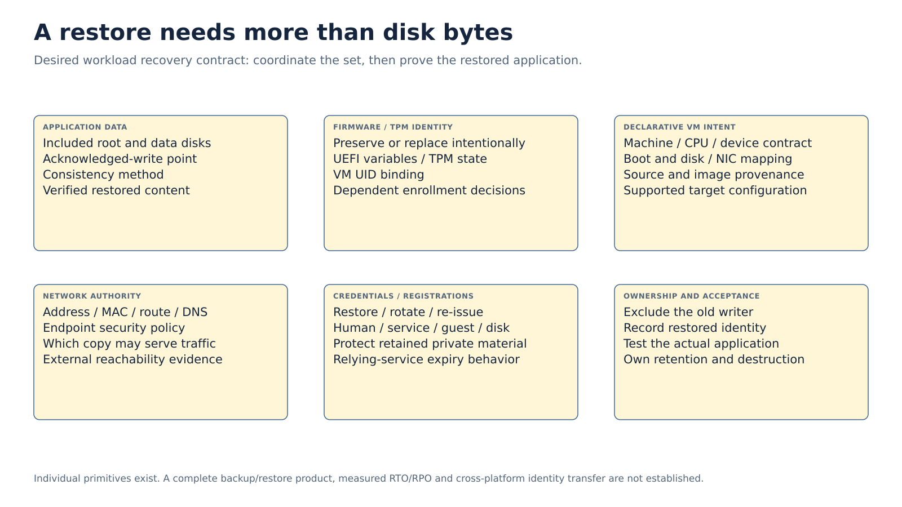
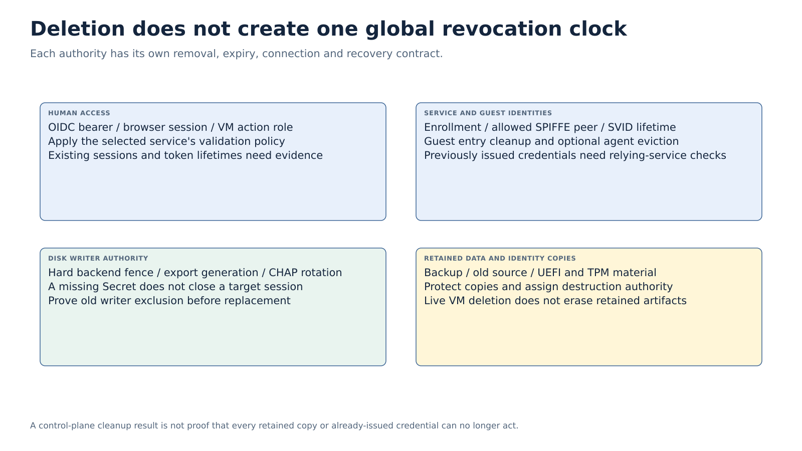
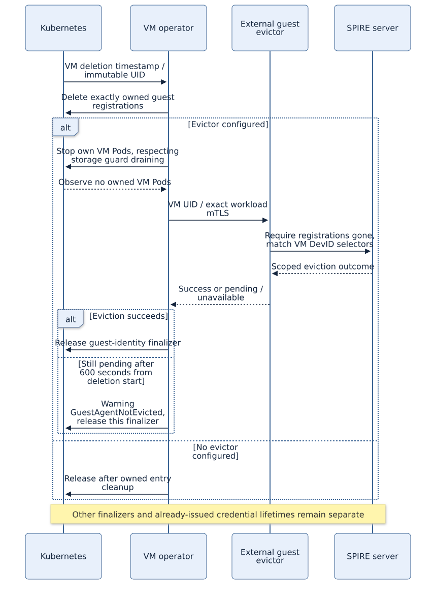

# Continuity: what survives a restart, restore or deletion?

A useful recovery unit is larger than a root disk. The target needs an
explicit contract for application data, VM identity, declarative intent,
network ownership and credentials. Current source implements several pieces;
a complete workload backup/restore product remains work to finish.

## Preserve the right state for the intended operation

| Operation | Intended continuity | New incarnation / separate decision |
| --- | --- | --- |
| In-place power cycle | Same VM UID, intended retained UEFI/vTPM identity and disk bindings | New QEMU/swtpm children; guest application restarts |
| Container or Pod replacement | Same VM intent and proven durable state, subject to safe ownership | Process/Pod incarnations change; old writer exclusion must be established |
| NIC sandbox replacement | Same configured guest NIC identity and address intent | Held namespace/queue incarnation changes; guest hot-unplug cooperation is required |
| Same-VM live migration | Same VM UID, transferred supported identity/runtime state and shared disks | Exact target adoption and network ownership transfer |
| Restore into a new VM | Recovery behavior must be specified | New UID cannot casually adopt another VM's bound identity claim |
| VM deletion | Retention/destruction follows each resource's owner | API object disappearance is neither universal erasure nor universal credential revocation |

The [recovery view](recovery.md) traces the implemented process/namespace
mechanisms. The [storage view](storage.md) distinguishes guest LUNs from the
small firmware/vTPM state PVC. Neither a lease on that PVC nor Kubernetes
object deletion is a hard backend fence.

## Design the backup artifact as a coordinated set

This is the desired recovery contract, not a new implemented export format.

| Part | What a usable restore procedure must establish |
| --- | --- |
| Application data | Included disks, acknowledged-write point, consistency method and verified restore |
| Firmware / TPM state | Intentional preservation or replacement of identity, boot variables and dependent enrollments |
| VM intent | Supported machine, CPU/device/boot settings, disk/NIC mapping and source/image provenance |
| Network | Addresses, MACs, policy and which environment may advertise/serve them |
| Credentials / registrations | Which must be restored, rotated, re-issued or removed; recovery copies remain protected |
| Ownership record | Old writer exclusion, exact restored identity and authority to destroy retained copies |

The guest agent provides bounded freeze/thaw and other allowed operations.
It does not coordinate an entire application or make a cross-disk snapshot
atomic. The storage service provides scoped disk/image primitives and hard
fences, rather than a complete application backup workflow. (S13–S15, S22.)

Define recovery time and data-loss objectives for the actual workload, then
measure them with restore drills. This investigation supplies no RTO/RPO,
availability or performance numbers.

## Deletion has several revocation clocks

| Authority | Relevant lifecycle | What removal alone does not establish |
| --- | --- | --- |
| Human browser session / OIDC bearer | Session and token lifetime, role verification and application policy | All existing remote sessions or tokens instantly cease to exist |
| Calling service SVID | Workload enrollment, rotation/expiry and exact peer admission | A role change is a universal service-certificate revocation |
| Guest registration / agent | Entry reconciliation, guest stop, agent eviction and certificate expiry | Deleting an API entry retroactively invalidates every already-issued credential |
| Disk export | Hard fence and new generation/CHAP on recovery | A missing Kubernetes Secret closes an existing target session |
| Retained backup | Protected copies and explicit destruction authority | Deleting the live VM destroys copied data or private identity material |

These are different mechanisms, not one global logout operation. Claims about
an already-issued credential need the relying service's actual validation and
connection-lifetime behavior, not just a control-plane deletion event.

Credential cleanup must also preserve object ownership. A15 in
[the audit](audit.md) repaired a retry that could delete another VM's colliding
Secret name. The store now tests the expected VM/disk metadata and deletes
only the checked UID/version, without Secret GET or password readback. This
API cleanup still remains separate from hard-fencing a disk session.

## Optional guest identity: follow the real deletion chain

For a VM with the guest-identity finalizer, the operator deletes its owned
ClusterStaticEntries. With configured evictors it waits for the VM's Pods to
go, leaving storage-guard draining to that owner, then calls the exact allowed
SPIFFE-authenticated evictor. The external evictor service lives outside this
repository. Its documented contract scopes eviction to the VM's TPM DevID
selectors and refuses while the related registrations remain.

The source retries while pending. After 600 seconds from deletion start,
the guest-identity finalizer can release with a `GuestAgentNotEvicted` Warning.
Without configured evictors, only the entry cleanup is performed. That
finalizer's release is not a successful-eviction claim, and other finalizers
still retain their independent responsibilities. (S23,
[the subsystem guide](../spire-vm.md).)

The dated native-cluster record in [the guest identity guide](../spire-vm.md)
reports a 2026-11-17 test in which the selected test agent disappeared within
ten seconds and two unrelated agents stayed unchanged. That is evidence for
that named rollout/test. It is not evidence of instantaneous revocation of
every previously issued workload SVID or acceptance on another cluster.

## Present the continuity decision explicitly

When retiring Glance/Cinder or replacing Keystone duties, show both the live
workflow and the retained recovery obligations. The target can have a much
smaller service surface while retaining disciplined data, identity and
revocation operations. Use [the task translator](operator-translation.md)
for daily work and [the cutover story](cutover-story.md) for moving between
clusters.
