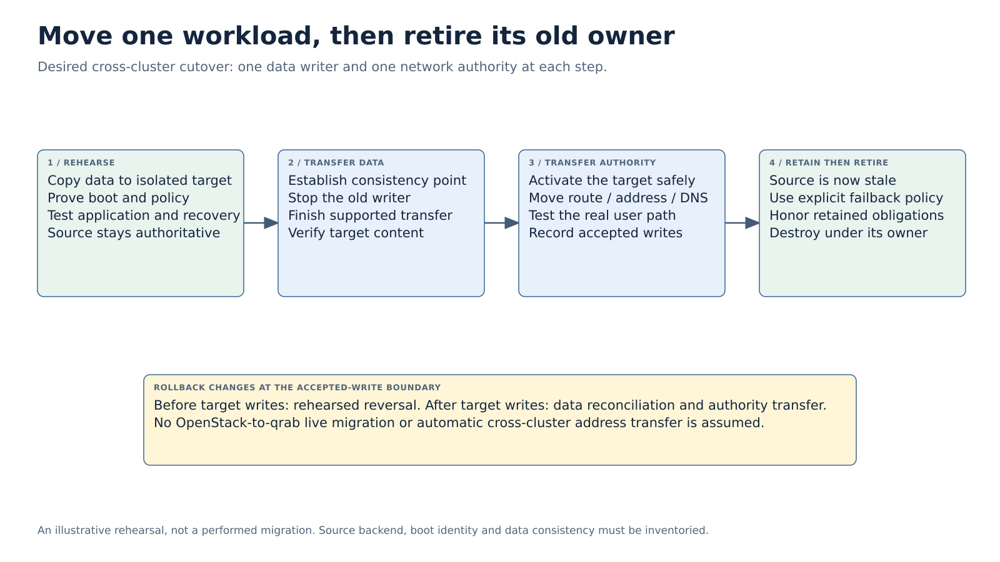
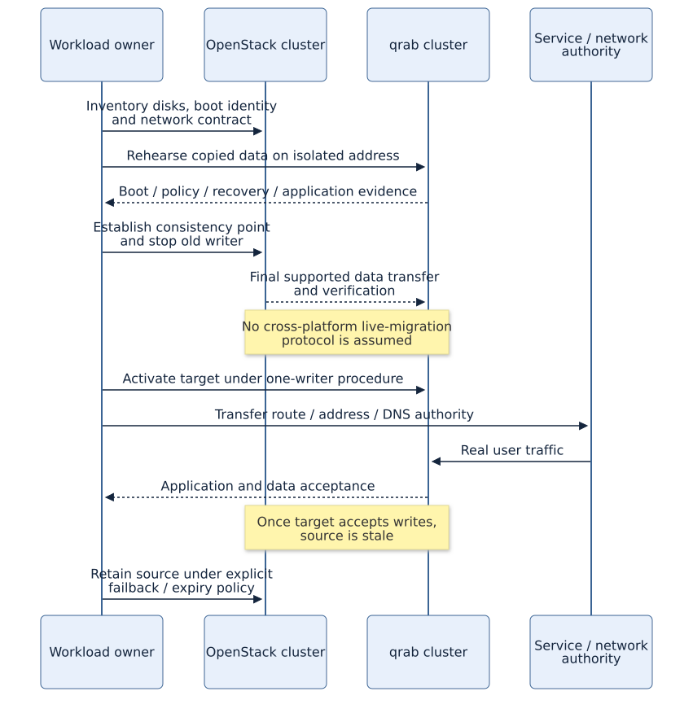

# One workload, two clusters: a cutover storyboard

This is a desired rehearsal for moving one workload from the supplied
OpenStack environment to qrab. It is not a performed migration, a claim about
the old storage backend, or a promise of cross-platform live migration.
The [transition plan](transition.md) describes the broader service retirement;
this story follows one application's data and authority.

## Scene 1: write the workload's contract

Call the workload **Ledger**. The name is illustrative; no actual VM is
identified. Its owner records the root and data disks, application consistency
method, firmware/CPU/device requirements, network addresses and policy,
identity/enrollment, management automation, acceptable downtime and rollback
point. OpenStack UUIDs and qrab UIDs belong to different identity systems.
Record both rather than treating an equal display name as continuity.

Unknowns in this investigation include the OpenStack release, image/volume
backends, firmware/TPM configuration and the application's data contract.
Resolve those from the old environment before choosing a conversion method.
The codebase cannot answer them by inference.

## Scene 2: build a rehearsal without competing authority

Prepare the required target cluster primitives, image generation, disk
capacity, VM specification, management roles and guest policy. Use an isolated
test address and copied data for rehearsal. If boot requires a converted disk,
prove its format, provenance, boot mode and driver compatibility.

The current importer accepts an explicit raw/qcow2 single-file source. It
rejects qcow2 backing files and external data dependencies before conversion.
An old root disk with a backing chain needs a separately supported flattening
or export step; dropping it into the importer does not make the dependencies
disappear. A storage backend snapshot also needs a defined way to produce the
supported transfer representation. (S15, A04 in [the audit](audit.md).)

Rehearse the guest's application, console/power roles, NIC policy/routes,
resource growth, data recovery and any required guest-agent behavior. A
successful manager readiness probe is one observation; it is not the
application's acceptance result.

## Scene 3: define the consistency point and stop the source writer

Choose the application's consistency method: for example, its own clean
shutdown or a proven coordinated backup workflow. Define which writes are
included and which acknowledged transactions the target must contain. A
filesystem freeze primitive alone is not a full multi-disk or distributed
application backup contract.

Complete the final supported transfer and verify content. Establish that the
old VM cannot continue writing to the authoritative data. Preserve its
retained recovery copy under an explicit policy. Shared storage, copied
storage and application-level replication need different proofs; no one
backend is assumed here.

Boot identity is another decision. qrab binds its retained UEFI/vTPM state to
the immutable qrab VM UID. Copying an old libvirt TPM directory into a new
state claim is not an established transfer procedure. Either provision a new
identity and re-enroll dependent consumers, or implement and verify the exact
continuity procedure required by the workload. (S05, S23.)

## Scene 4: transfer network and application authority

Activate the target only through the chosen data ownership procedure. Move
the public service's route, address, DNS or upstream forwarding according to
the explicit network plan. Two clusters can each run Cilium and FRR without
sharing an address-ownership protocol. A qrab stable /32 does not transfer an
OpenStack address by itself.

Verify the actual user path, data correctness, policy and observation from
the required origins. Record the old/new VM identities, disk generations,
image/source digests, network ownership and acceptance time. Management
reachability, an endpoint Ready bit and an established BGP session are useful
parts of that evidence, rather than substitutes for an application check.

## Scene 5: cross the rollback boundary deliberately

Before the target accepts authoritative writes, returning to the unchanged
source may be a simple ownership/route reversal under the rehearsed plan.
After the target accepts writes, the source is stale. Returning requires
data reconciliation or an application-specific failback that preserves the
accepted writes. Starting both copies risks two writers and two network
authorities.

State the rollback policy in the same record as the cutover. Include who may
restart the retained source, what prevents an accidental start, the maximum
retention window and the final destruction procedure. A retained snapshot
without those ownership rules is incomplete rollback documentation.

## Scene 6: retire the old dependency after its consumers move

Delete the old workload only under its agreed data/identity retention policy.
Retire Nova/libvirt, Neutron/OVN, Keystone, Glance/Cinder or their databases
and message services when their last actual consumer and retained obligation
has an owner in the target. One migrated guest does not establish that every
service can leave the old cluster.

For Ledger, keep a short evidence record:

| Record | Example of the information to capture |
| --- | --- |
| Identity | Old UUID; new immutable VM UID; intentional new or preserved guest identity |
| Data | Consistency point; disk mapping; transfer checks; authoritative writer; restore evidence |
| Network | Old/new address authority; route/DNS change; allow/deny and user-path observations |
| Control | Management roles; service enrollment; exact tested images and configuration |
| Acceptance | Application outcome, accepted-write boundary and responsible workload owner |
| Rollback | Last simple reversal point; later failback procedure; retained source and destruction date |

This record is a desired workload acceptance artifact. Source tests in
[verification](verification.md) support individual mechanisms; they do not
populate an unperformed cutover record.
