# Diagram catalog

Every diagram has editable Mermaid or SVG-layout source, a caption and evidence references.
Rendered SVGs are reusable in documents and slides; PNGs are convenient for
presentation software. Color is a reading style, not a capability/status code.

Choose **light** for ordinary slides, **dark** for a dark presentation, or
**print** for monochrome handouts. Evidence/status text stays the same.

Source baseline: `5f361b7`. See the [evidence register](evidence.md)
and [audit](audit.md) for scope and later fixes. These diagrams omit details
deliberately; the caption says which boundary or flow each one explains.

## 00-openstack-overview: OpenStack: simple boundary overview

**Scope:** supplied baseline / target disposition. **Evidence:** U01, U02.

The simplest presentation view: cloud services run in Pods, libvirt still owns host-cgroup guests, and OVN owns their fabric. Text labels identify what the qrab target keeps, replaces and still needs to finish. Arrows are selected control and guest paths, not a complete service call graph.

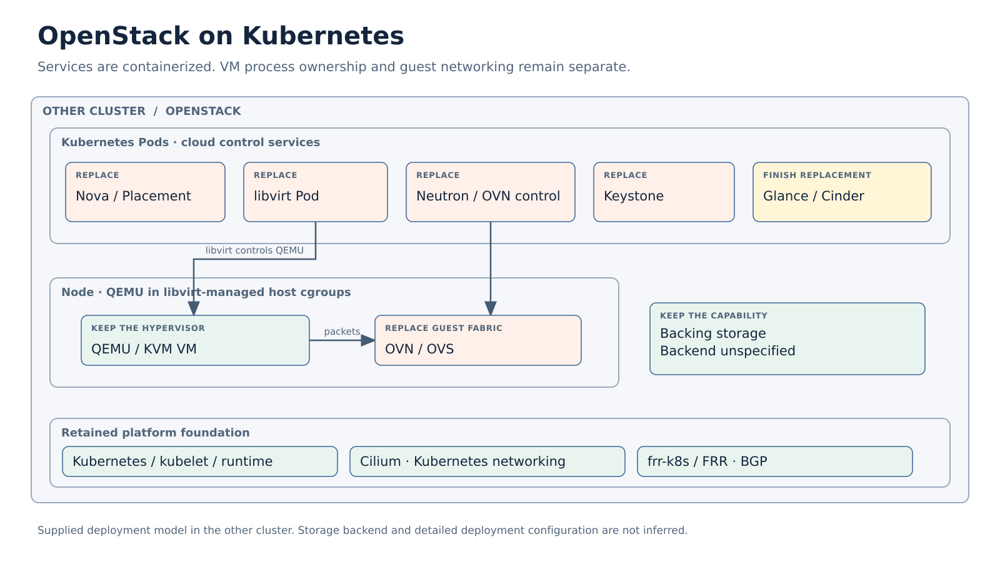

[Editable source](diagrams/00-openstack-overview.json) · [Light SVG](diagrams/rendered/light/00-openstack-overview.svg) · [Dark SVG](diagrams/rendered/dark/00-openstack-overview.svg) · [Print SVG](diagrams/rendered/print/00-openstack-overview.svg) · [PNG](diagrams/rendered/png/00-openstack-overview.png)

## 00-qrab-overview: qrab: simple target boundary overview

**Scope:** implemented ownership + desired replacement scope. **Evidence:** S02, S04, S08, S13, S15, S20.

The matching presentation view: Kubernetes owns intent, manager owns QEMU inside its container, and a separate anchor gives each NIC a Cilium identity. The shared platform remains. The overview omits detailed storage/control paths and does not claim all replacement capabilities are complete.

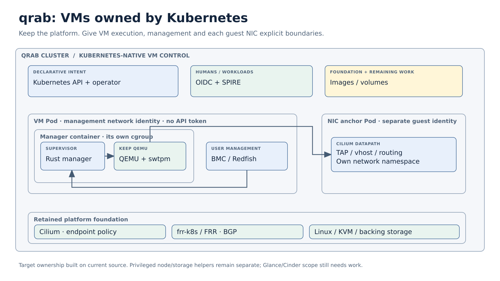

[Editable source](diagrams/00-qrab-overview.json) · [Light SVG](diagrams/rendered/light/00-qrab-overview.svg) · [Dark SVG](diagrams/rendered/dark/00-qrab-overview.svg) · [Print SVG](diagrams/rendered/print/00-qrab-overview.svg) · [PNG](diagrams/rendered/png/00-qrab-overview.png)

## 00-migration-overview: Migration: simple ownership and stream overview

**Scope:** implemented / conceptual presentation model. **Evidence:** S11, S12, S14.

A slide-sized view of VM-state, switch-control and node-conntrack boundaries. Source and target managers represent the same immutable VM; node peers have separate node identities. This omits detailed preparation, route forwarding and cleanup; use the sequence/state diagrams for those.

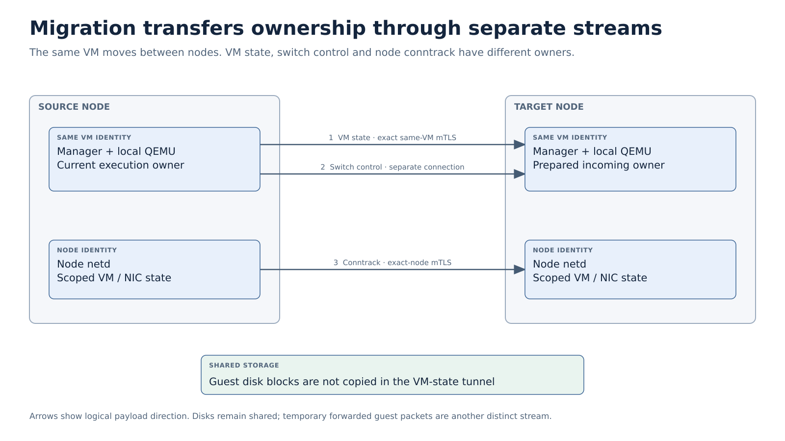

[Editable source](diagrams/00-migration-overview.json) · [Light SVG](diagrams/rendered/light/00-migration-overview.svg) · [Dark SVG](diagrams/rendered/dark/00-migration-overview.svg) · [Print SVG](diagrams/rendered/print/00-migration-overview.svg) · [PNG](diagrams/rendered/png/00-migration-overview.png)

## 00-storage-overview: Storage: simple control and I/O overview

**Scope:** implemented responsibility model. **Evidence:** S05, S13, S14.

A slide-sized split of scoped provisioning and native guest disk I/O. The root helper owns exports/fences; guest block bytes flow directly through QEMU libiscsi. UEFI/vTPM state remains a separate filesystem volume.

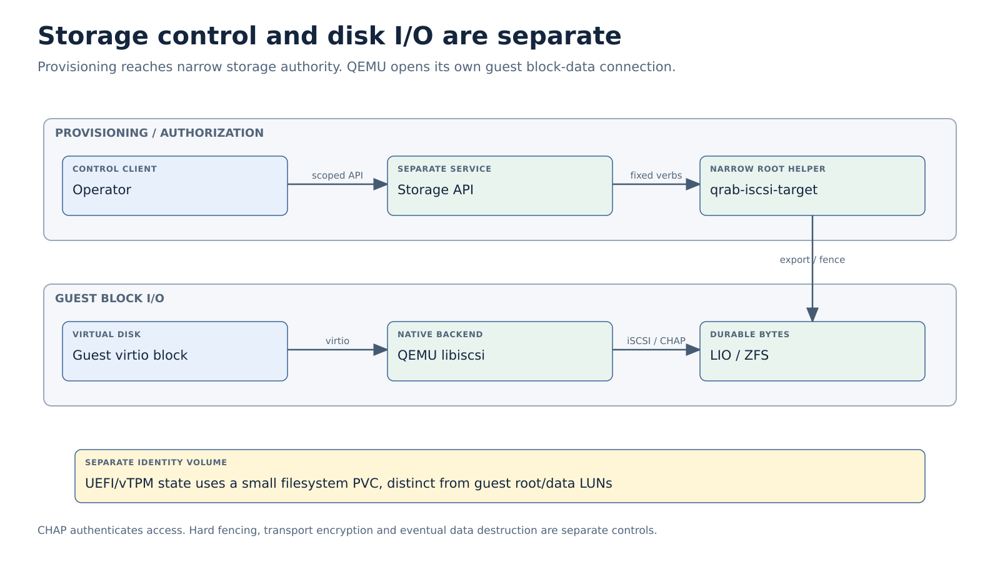

[Editable source](diagrams/00-storage-overview.json) · [Light SVG](diagrams/rendered/light/00-storage-overview.svg) · [Dark SVG](diagrams/rendered/dark/00-storage-overview.svg) · [Print SVG](diagrams/rendered/print/00-storage-overview.svg) · [PNG](diagrams/rendered/png/00-storage-overview.png)

## 01-openstack-boundaries: OpenStack: current deployment boundaries

**Scope:** supplied baseline. **Evidence:** U01, U02.

The operator-supplied model: Kubernetes hosts the services; libvirt still owns host-cgroup VMs, and OVN owns guest networking. Cilium and FRR are shared platform foundations.


[Editable source](diagrams/01-openstack-boundaries.mmd) · [Light SVG](diagrams/rendered/light/01-openstack-boundaries.svg) · [Dark SVG](diagrams/rendered/dark/01-openstack-boundaries.svg) · [Print SVG](diagrams/rendered/print/01-openstack-boundaries.svg) · [PNG](diagrams/rendered/png/01-openstack-boundaries.png)

## 02-qrab-boundaries: qrab: target ownership on the current source

**Scope:** implemented + desired. **Evidence:** S02, S03, S04, S08, S13.

Kubernetes owns declarative intent; a manager owns QEMU inside its container, and separate NIC anchors connect guests to Cilium. Storage provisioning and guest I/O are different paths.


[Editable source](diagrams/02-qrab-boundaries.mmd) · [Light SVG](diagrams/rendered/light/02-qrab-boundaries.svg) · [Dark SVG](diagrams/rendered/dark/02-qrab-boundaries.svg) · [Print SVG](diagrams/rendered/print/02-qrab-boundaries.svg) · [PNG](diagrams/rendered/png/02-qrab-boundaries.png)

## 03-service-replacements: Where OpenStack responsibilities move

**Scope:** comparison. **Evidence:** S02, S08, S13, S15, U01, U02, U03, U04.

Replace the service control planes, preserve their required work. Image and volume replacements are constrained foundations with remaining scope.


[Editable source](diagrams/03-service-replacements.mmd) · [Light SVG](diagrams/rendered/light/03-service-replacements.svg) · [Dark SVG](diagrams/rendered/dark/03-service-replacements.svg) · [Print SVG](diagrams/rendered/print/03-service-replacements.svg) · [PNG](diagrams/rendered/png/03-service-replacements.png)

## 04-process-containment: Processes, containers and privileged helpers

**Scope:** implemented. **Evidence:** S02, S04, S06, S21.

QEMU and swtpm are manager children. Restricted VM/anchor Pods rely on separate privileged device and network helpers; privilege does not disappear.


[Editable source](diagrams/04-process-containment.mmd) · [Light SVG](diagrams/rendered/light/04-process-containment.svg) · [Dark SVG](diagrams/rendered/dark/04-process-containment.svg) · [Print SVG](diagrams/rendered/print/04-process-containment.svg) · [PNG](diagrams/rendered/png/04-process-containment.png)

## 05-cgroup-comparison: Containerized libvirt versus a container-owned VM

**Scope:** comparison. **Evidence:** S02, S04.

The OpenStack side is the supplied deployment model. The qrab side shows direct QEMU supervision within the manager container cgroup.


[Editable source](diagrams/05-cgroup-comparison.mmd) · [Light SVG](diagrams/rendered/light/05-cgroup-comparison.svg) · [Dark SVG](diagrams/rendered/dark/05-cgroup-comparison.svg) · [Print SVG](diagrams/rendered/print/05-cgroup-comparison.svg) · [PNG](diagrams/rendered/png/05-cgroup-comparison.png)

## 06-two-networks-to-one: Two network planes become one Cilium fabric

**Scope:** comparison. **Evidence:** S08, S09, U02.

Reusing Cilium removes the OVN guest fabric while preserving distinct endpoint identities for management and every guest NIC.


[Editable source](diagrams/06-two-networks-to-one.mmd) · [Light SVG](diagrams/rendered/light/06-two-networks-to-one.svg) · [Dark SVG](diagrams/rendered/dark/06-two-networks-to-one.svg) · [Print SVG](diagrams/rendered/print/06-two-networks-to-one.svg) · [PNG](diagrams/rendered/png/06-two-networks-to-one.png)

## 07-control-vs-data: Control messages and guest payloads

**Scope:** implemented. **Evidence:** S03, S06, S10, S11, S14.

Kubernetes config and private QMP control the VM. Packets and block I/O do not pass through the operator; VM migration has its own payload tunnel.


[Editable source](diagrams/07-control-vs-data.mmd) · [Light SVG](diagrams/rendered/light/07-control-vs-data.svg) · [Dark SVG](diagrams/rendered/dark/07-control-vs-data.svg) · [Print SVG](diagrams/rendered/print/07-control-vs-data.svg) · [PNG](diagrams/rendered/png/07-control-vs-data.png)

## 08-identity-questions: Five identity questions with different answers

**Scope:** implemented + desired. **Evidence:** S18, S19, S20, S23, S14.

A human subject, an action grant, a service SVID, a guest workload and a CHAP export are different scopes. None is a universal credential.


[Editable source](diagrams/08-identity-questions.mmd) · [Light SVG](diagrams/rendered/light/08-identity-questions.svg) · [Dark SVG](diagrams/rendered/dark/08-identity-questions.svg) · [Print SVG](diagrams/rendered/print/08-identity-questions.svg) · [PNG](diagrams/rendered/png/08-identity-questions.png)

## 09-launch-sequence: A VM launch crosses explicit owners

**Scope:** implemented. **Evidence:** S02, S03, S04, S09, S10, S13.

A conditional storage owner gate protects native disks. The kubelet starts the manager; the manager requests local NIC descriptors and publishes no API updates itself.

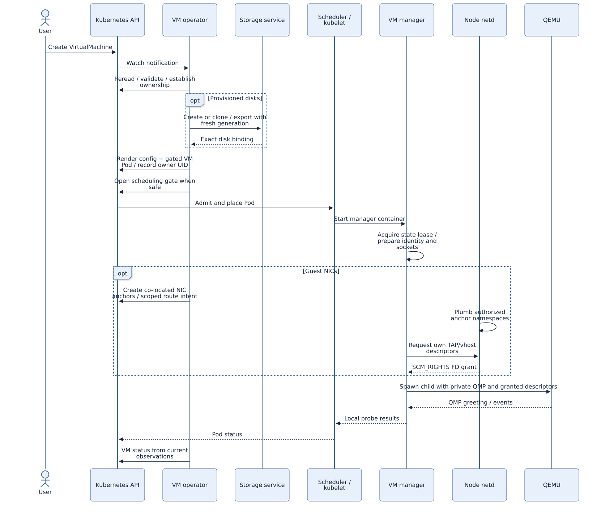

[Editable source](diagrams/09-launch-sequence.mmd) · [Light SVG](diagrams/rendered/light/09-launch-sequence.svg) · [Dark SVG](diagrams/rendered/dark/09-launch-sequence.svg) · [Print SVG](diagrams/rendered/print/09-launch-sequence.svg) · [PNG](diagrams/rendered/png/09-launch-sequence.png)

## 10-power-state: Power off is not Pod deletion

**Scope:** implemented. **Evidence:** S04, S05, S06.

The manager survives an in-place power off. A fresh power-on cycle starts new QEMU/swtpm children while retaining the intended VM identity.


[Editable source](diagrams/10-power-state.mmd) · [Light SVG](diagrams/rendered/light/10-power-state.svg) · [Dark SVG](diagrams/rendered/dark/10-power-state.svg) · [Print SVG](diagrams/rendered/print/10-power-state.svg) · [PNG](diagrams/rendered/png/10-power-state.png)

## 11-guest-packet-path: A guest packet through its NIC identity

**Scope:** implemented. **Evidence:** S08, S09, S10.

Kernel TAP/vhost queues carry packets through the anchor netns. netd grants descriptors and plumbs resources; its Unix control stream does not relay packets.


[Editable source](diagrams/11-guest-packet-path.mmd) · [Light SVG](diagrams/rendered/light/11-guest-packet-path.svg) · [Dark SVG](diagrams/rendered/dark/11-guest-packet-path.svg) · [Print SVG](diagrams/rendered/print/11-guest-packet-path.svg) · [PNG](diagrams/rendered/png/11-guest-packet-path.png)

## 12-storage-control-data: Storage provisioning versus disk I/O

**Scope:** implemented. **Evidence:** S13, S14.

Delegated API authorization reaches narrow root storage verbs. QEMU independently opens its CHAP-authorized LIO session for guest block I/O.


[Editable source](diagrams/12-storage-control-data.mmd) · [Light SVG](diagrams/rendered/light/12-storage-control-data.svg) · [Dark SVG](diagrams/rendered/dark/12-storage-control-data.svg) · [Print SVG](diagrams/rendered/print/12-storage-control-data.svg) · [PNG](diagrams/rendered/png/12-storage-control-data.png)

## 13-image-import: From verified source to a sealed clone origin

**Scope:** implemented. **Evidence:** S13, S14, S15.

The image controller orchestrates token-free inspect/write Jobs and separately authorized storage stages. Retirement prevents new clones; it does not erase existing guest disks.


[Editable source](diagrams/13-image-import.mmd) · [Light SVG](diagrams/rendered/light/13-image-import.svg) · [Dark SVG](diagrams/rendered/dark/13-image-import.svg) · [Print SVG](diagrams/rendered/print/13-image-import.svg) · [PNG](diagrams/rendered/png/13-image-import.png)

## 14-disk-fencing: Disk export ownership and hard fencing

**Scope:** conceptual contract. **Evidence:** S13, S14.

Conceptual lifecycle, not a verbatim enumeration of API phases. Fencing is complete only after backend barriers; irreversible destruction has separate authority.


[Editable source](diagrams/14-disk-fencing.mmd) · [Light SVG](diagrams/rendered/light/14-disk-fencing.svg) · [Dark SVG](diagrams/rendered/dark/14-disk-fencing.svg) · [Print SVG](diagrams/rendered/print/14-disk-fencing.svg) · [PNG](diagrams/rendered/png/14-disk-fencing.png)

## 15-migration-streams: Migration moves more than RAM

**Scope:** implemented. **Evidence:** S11, S12, S14.

VM state, switchover control, node conntrack and forwarded guest packets are separate streams. Shared guest disk blocks are not copied through the manager tunnel.


[Editable source](diagrams/15-migration-streams.mmd) · [Light SVG](diagrams/rendered/light/15-migration-streams.svg) · [Dark SVG](diagrams/rendered/dark/15-migration-streams.svg) · [Print SVG](diagrams/rendered/print/15-migration-streams.svg) · [PNG](diagrams/rendered/png/15-migration-streams.png)

## 16-migration-sequence: Prepare, transfer, switch and adopt

**Scope:** implemented. **Evidence:** S08, S09, S11, S12.

Target anchors are prepared as fenced standbys. The final pause transfers endpoint authority; operator adoption follows the documented migrated source outcome.

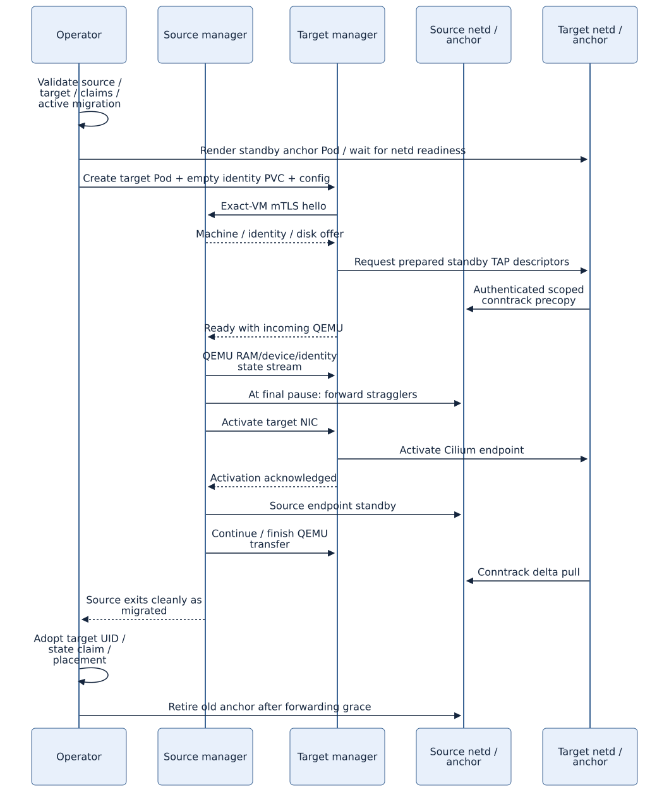

[Editable source](diagrams/16-migration-sequence.mmd) · [Light SVG](diagrams/rendered/light/16-migration-sequence.svg) · [Dark SVG](diagrams/rendered/dark/16-migration-sequence.svg) · [Print SVG](diagrams/rendered/print/16-migration-sequence.svg) · [PNG](diagrams/rendered/png/16-migration-sequence.png)

## 17-migration-state: A single-use migration lifecycle

**Scope:** implemented. **Evidence:** S11.

Unsupported claims or a powered-off source refuse admission. Failure cleanup must preserve safe ownership; success adopts the exact target.


[Editable source](diagrams/17-migration-state.mmd) · [Light SVG](diagrams/rendered/light/17-migration-state.svg) · [Dark SVG](diagrams/rendered/dark/17-migration-state.svg) · [Print SVG](diagrams/rendered/print/17-migration-state.svg) · [PNG](diagrams/rendered/png/17-migration-state.png)

## 18-management-request: A user action across two authorization layers

**Scope:** implemented. **Evidence:** S06, S17, S19, S20.

Workload mTLS identifies service peers; the stored user token and VM role authorize the action. Manager then controls private QMP through a bounded local API.

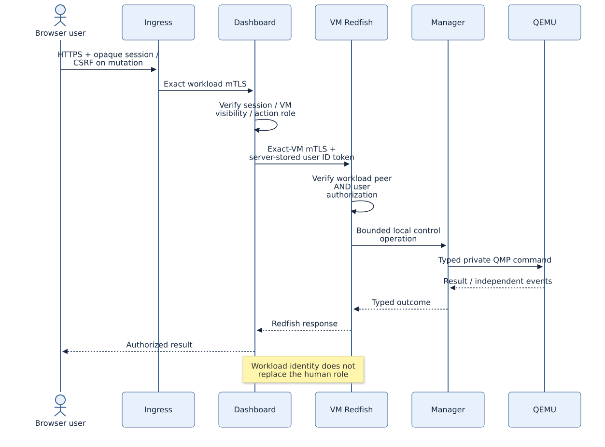

[Editable source](diagrams/18-management-request.mmd) · [Light SVG](diagrams/rendered/light/18-management-request.svg) · [Dark SVG](diagrams/rendered/dark/18-management-request.svg) · [Print SVG](diagrams/rendered/print/18-management-request.svg) · [PNG](diagrams/rendered/png/18-management-request.png)

## 19-console-request: The authenticated graphical console chain

**Scope:** implemented. **Evidence:** S06, S17, S18.

Console access is admin-scoped. Private VNC is reached through the manager control socket, BMC admission and exact-VM authenticated proxy hops.


[Editable source](diagrams/19-console-request.mmd) · [Light SVG](diagrams/rendered/light/19-console-request.svg) · [Dark SVG](diagrams/rendered/dark/19-console-request.svg) · [Print SVG](diagrams/rendered/print/19-console-request.svg) · [PNG](diagrams/rendered/png/19-console-request.png)

## 20-guest-identity: A guest identity is not the manager identity

**Scope:** implemented / optional. **Evidence:** S20, S23, S24.

The optional guest SPIRE agent uses VM-bound software-TPM credentials. The relay carries opaque agent/server TLS bytes and does not issue identities.


[Editable source](diagrams/20-guest-identity.mmd) · [Light SVG](diagrams/rendered/light/20-guest-identity.svg) · [Dark SVG](diagrams/rendered/dark/20-guest-identity.svg) · [Print SVG](diagrams/rendered/print/20-guest-identity.svg) · [PNG](diagrams/rendered/png/20-guest-identity.png)

## 21-deletion-ownership: Deletion, retention and destruction have different owners

**Scope:** implemented + audited contract. **Evidence:** S03, S05, S13, S14, S16, S23.

A VM may collect only its proven owned resources. Manual/foreign/unproven state stays retained, and backing bytes follow a separate storage reclaim contract.


[Editable source](diagrams/21-deletion-ownership.mmd) · [Light SVG](diagrams/rendered/light/21-deletion-ownership.svg) · [Dark SVG](diagrams/rendered/dark/21-deletion-ownership.svg) · [Print SVG](diagrams/rendered/print/21-deletion-ownership.svg) · [PNG](diagrams/rendered/png/21-deletion-ownership.png)

## 22-resource-resize: Admit capacity before QEMU hotplug

**Scope:** implemented. **Evidence:** S02, S03, S04.

Kubelet Applied describes container resources; manager checks effective cgroups before QMP growth. Guest CPU/memory onlining remains a separate step.

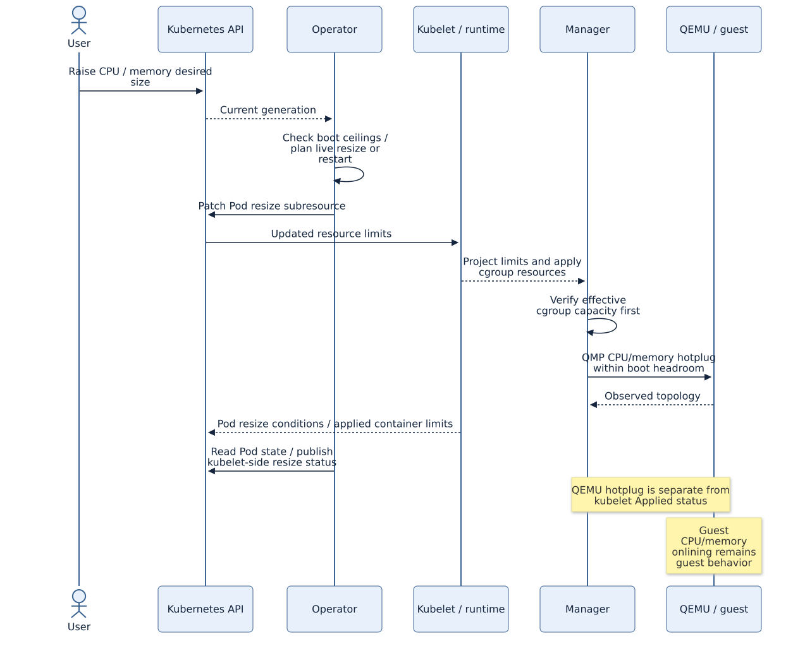

[Editable source](diagrams/22-resource-resize.mmd) · [Light SVG](diagrams/rendered/light/22-resource-resize.svg) · [Dark SVG](diagrams/rendered/dark/22-resource-resize.svg) · [Print SVG](diagrams/rendered/print/22-resource-resize.svg) · [PNG](diagrams/rendered/png/22-resource-resize.png)

## 23-failure-domains: Which outage affects which operation

**Scope:** source-derived expectations. **Evidence:** S03, S04, S09, S13, S20.

These are architectural expectations, not availability guarantees. Established kernel resources can outlive their daemon; new changes still need their control-plane owners.


[Editable source](diagrams/23-failure-domains.mmd) · [Light SVG](diagrams/rendered/light/23-failure-domains.svg) · [Dark SVG](diagrams/rendered/dark/23-failure-domains.svg) · [Print SVG](diagrams/rendered/print/23-failure-domains.svg) · [PNG](diagrams/rendered/png/23-failure-domains.png)

## 24-release-boundaries: Source, images and rollout are separate operations

**Scope:** maintenance contract. **Evidence:** M02, T01.

A validated source merge does not publish images or deploy a cluster. Release and live verification remain separately authorized steps.


[Editable source](diagrams/24-release-boundaries.mmd) · [Light SVG](diagrams/rendered/light/24-release-boundaries.svg) · [Dark SVG](diagrams/rendered/dark/24-release-boundaries.svg) · [Print SVG](diagrams/rendered/print/24-release-boundaries.svg) · [PNG](diagrams/rendered/png/24-release-boundaries.png)

## 25-image-single-file: A digest does not authenticate extra image dependencies

**Scope:** audited import contract. **Evidence:** S15.

The image source digest covers one downloaded file. Backing-file and external-data declarations must be refused before parsing/conversion can select extra inputs. QEMU still owns full image-format validation.


[Editable source](diagrams/25-image-single-file.mmd) · [Light SVG](diagrams/rendered/light/25-image-single-file.svg) · [Dark SVG](diagrams/rendered/dark/25-image-single-file.svg) · [Print SVG](diagrams/rendered/print/25-image-single-file.svg) · [PNG](diagrams/rendered/png/25-image-single-file.png)

## 26-declarative-vs-action: Desired state and a VM action are different paths

**Scope:** implemented. **Evidence:** S02, S03, S06, S19.

A spec change is reconciled through Kubernetes. A bounded Redfish action reaches local QMP/QGA through the manager; powering off in place is not equivalent to deleting the Pod.


[Editable source](diagrams/26-declarative-vs-action.mmd) · [Light SVG](diagrams/rendered/light/26-declarative-vs-action.svg) · [Dark SVG](diagrams/rendered/dark/26-declarative-vs-action.svg) · [Print SVG](diagrams/rendered/print/26-declarative-vs-action.svg) · [PNG](diagrams/rendered/png/26-declarative-vs-action.png)

## 27-network-handoff-state: Endpoint authority during a live move

**Scope:** conceptual source-derived state model. **Evidence:** S08, S09, S11, S12.

The target is prepared but fenced. Activation/source standby occurs in the final pause, followed by adoption and a routing/forwarding grace period. This is a conceptual ownership model, not a new API enum or guarantee for every failure.


[Editable source](diagrams/27-network-handoff-state.mmd) · [Light SVG](diagrams/rendered/light/27-network-handoff-state.svg) · [Dark SVG](diagrams/rendered/dark/27-network-handoff-state.svg) · [Print SVG](diagrams/rendered/print/27-network-handoff-state.svg) · [PNG](diagrams/rendered/png/27-network-handoff-state.png)

## 28-auth-is-not-a-role: Service admission and user authorization are both required

**Scope:** implemented workload management mode. **Evidence:** S17, S18, S19, S20.

Exact workload identity admits the calling service. The user credential and VM role independently authorize management. This diagram excludes standalone development/alternative native credential entrypoints.


[Editable source](diagrams/28-auth-is-not-a-role.mmd) · [Light SVG](diagrams/rendered/light/28-auth-is-not-a-role.svg) · [Dark SVG](diagrams/rendered/dark/28-auth-is-not-a-role.svg) · [Print SVG](diagrams/rendered/print/28-auth-is-not-a-role.svg) · [PNG](diagrams/rendered/png/28-auth-is-not-a-role.png)

## 29-local-pod-authority: Local attachment authority starts with a real Pod hierarchy

**Scope:** audited local authorization contract. **Evidence:** S09, S10.

A kernel peer PID is mapped through a validated host unified cgroup and the API-owned Pod to its own VM/NIC. An arbitrary host scope with a Pod-looking UUID does not establish authority. This omits process-lifetime and FD-transfer implementation details.


[Editable source](diagrams/29-local-pod-authority.mmd) · [Light SVG](diagrams/rendered/light/29-local-pod-authority.svg) · [Dark SVG](diagrams/rendered/dark/29-local-pod-authority.svg) · [Print SVG](diagrams/rendered/print/29-local-pod-authority.svg) · [PNG](diagrams/rendered/png/29-local-pod-authority.png)

## 30-process-resource-handles: Bind process authority through resource use

**Scope:** audited process/resource lifetime contract. **Evidence:** S09, S10.

Socket-caller identity and anchor-resource selection are separate checks. The original connector pidfd, held proc directories and opened namespace/file descriptors prevent a later numeric PID/path from substituting another resource. API ownership and own-NIC authorization remain required.


[Editable source](diagrams/30-process-resource-handles.mmd) · [Light SVG](diagrams/rendered/light/30-process-resource-handles.svg) · [Dark SVG](diagrams/rendered/dark/30-process-resource-handles.svg) · [Print SVG](diagrams/rendered/print/30-process-resource-handles.svg) · [PNG](diagrams/rendered/png/30-process-resource-handles.png)

## 31-namespace-incarnation: Same Pod UID, new network namespace

**Scope:** audited attachment recovery. **Evidence:** S09, S10.

The node helper prepares a new namespace generation and manager releases the old backend before requesting fresh queues. Recovery requires guest hot-unplug cooperation; a netd restart observing the same namespace retains its token.

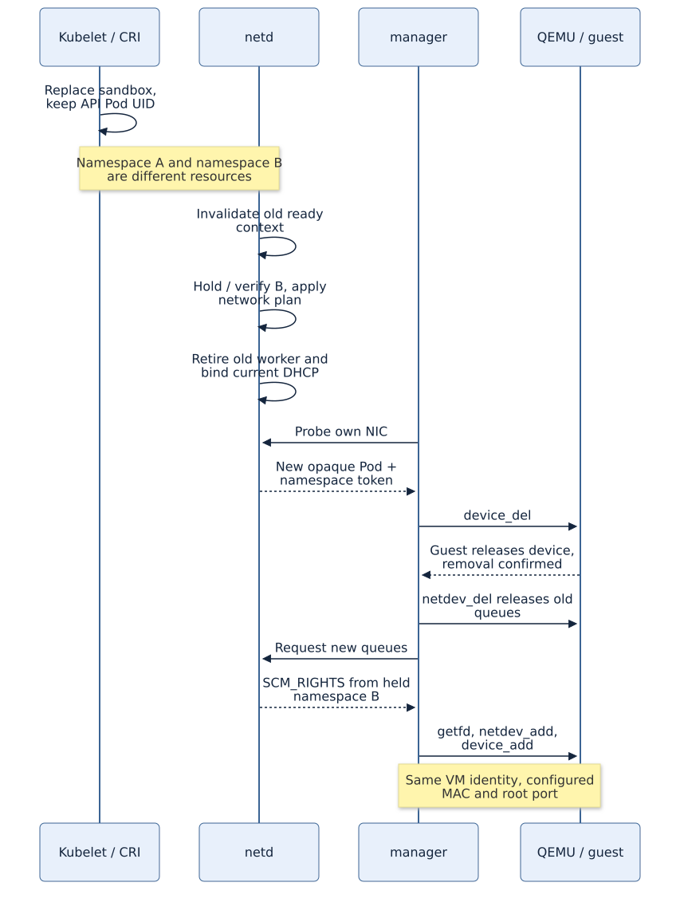

[Editable source](diagrams/31-namespace-incarnation.mmd) · [Light SVG](diagrams/rendered/light/31-namespace-incarnation.svg) · [Dark SVG](diagrams/rendered/dark/31-namespace-incarnation.svg) · [Print SVG](diagrams/rendered/print/31-namespace-incarnation.svg) · [PNG](diagrams/rendered/png/31-namespace-incarnation.png)

## 32-descriptor-frame: A bounded control frame carries kernel resources

**Scope:** audited local protocol contract. **Evidence:** S09, S10.

Unix stream fragmentation and SCM_RIGHTS ownership are independent. Every installed descriptor is owned before parse or truncation refusal. The stream grants queues; it does not relay guest packets.


[Editable source](diagrams/32-descriptor-frame.mmd) · [Light SVG](diagrams/rendered/light/32-descriptor-frame.svg) · [Dark SVG](diagrams/rendered/dark/32-descriptor-frame.svg) · [Print SVG](diagrams/rendered/print/32-descriptor-frame.svg) · [PNG](diagrams/rendered/png/32-descriptor-frame.png)

## 33-library-runtime-views: Linked code and runtime ownership are different maps

**Scope:** implemented / selected projections. **Evidence:** S01, S04, S06, S07, S18, S19.

Selected dependency and runtime relationships. A shared Rust control type is not another service and does not grant a management service ownership of private QMP. This is not a complete dependency/deployment graph.


[Editable source](diagrams/33-library-runtime-views.mmd) · [Light SVG](diagrams/rendered/light/33-library-runtime-views.svg) · [Dark SVG](diagrams/rendered/dark/33-library-runtime-views.svg) · [Print SVG](diagrams/rendered/print/33-library-runtime-views.svg) · [PNG](diagrams/rendered/png/33-library-runtime-views.png)

## 34-evidence-classes: Four different kinds of evidence

**Scope:** review method / selected evidence classes. **Evidence:** T01, M01, L01.

Source, manifest, local real-peer fixture and named live observation answer different questions. Desired state and the user-supplied OpenStack baseline remain separately labeled. No progression to deployed acceptance is implied.

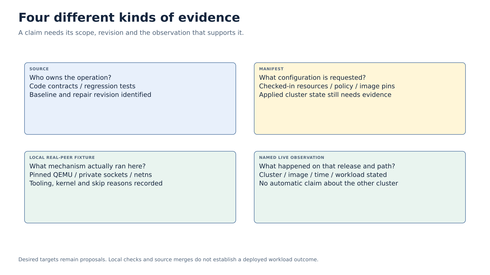

[Editable source](diagrams/34-evidence-classes.json) · [Light SVG](diagrams/rendered/light/34-evidence-classes.svg) · [Dark SVG](diagrams/rendered/dark/34-evidence-classes.svg) · [Print SVG](diagrams/rendered/print/34-evidence-classes.svg) · [PNG](diagrams/rendered/png/34-evidence-classes.png)

## 35-current-container-authority: Current container identity selects the held resource

**Scope:** audited current-container/resource contract. **Evidence:** S08, S09, S10, U10.

A still-live older same-UID process is not the current anchor container. The API-observed running container, trusted direct cgroup and held process/namespace resources must agree. Same-namespace process refresh preserves the attachment token; unresolved startup waits.

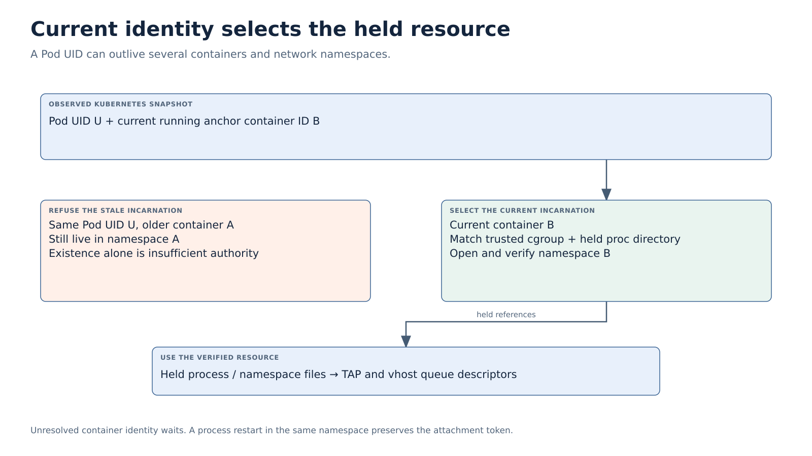

[Editable source](diagrams/35-current-container-authority.json) · [Light SVG](diagrams/rendered/light/35-current-container-authority.svg) · [Dark SVG](diagrams/rendered/dark/35-current-container-authority.svg) · [Print SVG](diagrams/rendered/print/35-current-container-authority.svg) · [PNG](diagrams/rendered/png/35-current-container-authority.png)
