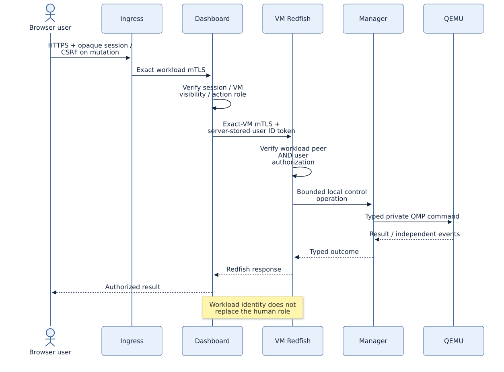

# Identity architect's view: remove Keystone, retain explicit authorization

The target has no Keystone dependency. It still needs an identity provider,
human action policy, workload admission, guest identity and storage access
credentials. Kubernetes auth, OIDC and SPIRE solve different parts of that
problem; they are not interchangeable alternatives for every connection.

## Entry points and their principals

| Entry point | Identity established by | Action authority established by |
| --- | --- | --- |
| `kubectl` / automation writing VM CRs | Kubernetes authentication, possibly federated OIDC | Kubernetes RBAC and admission |
| Browser dashboard/BMC | OIDC login and server-side session | App role/creator/group checks, with Origin/CSRF for ambient-cookie mutations |
| Native Redfish request | Configured accepted user credential/session or verified OIDC bearer | Redfish VM role and operation policy |
| Dashboard → Redfish/BMC | Exact selected-VM workload mTLS plus user's stored ID token | Service admission **and** separately verified user authorization |
| Manager migration peer | Exact same-VM manager SVID | Migration protocol eligibility and temporary source/target reachability policy |
| Node conntrack peer | Exact current node SVID | Same VM/NIC/address, node and bounded-export policy |
| Operator → Kubernetes | ServiceAccount projected token | RBAC/admission; this is not the browser user's token |
| Operator → storage control | SVID at exchange, then delegated bearer | Fixed storage verbs and scopes |
| QEMU → LIO | VM-derived initiator and per-export CHAP | Export ACL; hard fencing remains separate |
| Guest workload → relying service | Optional in-guest SPIRE SVID | Registered workload selectors and relying-service policy |

Source: S13, S17–S20, S23, S24 and the full
[credential boundary guide](../connections/identity.md).

## A browser action is a chain of scoped decisions

The browser receives an opaque session cookie; the raw user ID token stays
server-side. The dashboard checks VM visibility and role, resolves the current
controlled Pod and connects to its exact service SVID. Redfish/BMC then verify
the user bearer and their own operation policy. A valid dashboard workload
certificate does not grant a user console-admin access.

The dashboard uses its ServiceAccount for Kubernetes, so it is a trusted
application deputy. It does not impersonate each browser user at the API
server. Creator annotation admission and narrow update policy constrain that
authority; the application still must perform its own checks. Similarly,
Kubernetes RBAC does not automatically authorize a native Redfish action.
Upstream Kubernetes explicitly separates authentication, authorization and
admission ([API access control](https://kubernetes.io/docs/concepts/security/controlling-access/)).

## Container identity is deliberately finer than Pod identity

Manager, BMC and Redfish have distinct service identities/enrollment even
when they share a Pod. Management workloads verify exact VM-UID-bound service
IDs; the source and migration target managers intentionally share the same
VM manager identity during handoff. That SVID proves the registered VM
workload, not which human requested an action or an independently authorized
migration UUID. Temporary policies and protocol state provide additional
confinement. (S11, S20.)

SVID validity/rotation, user-token expiry and local session lifetime are
independent controls. A signed OIDC token is not encrypted. A mounted Workload
API socket does not prove every listener uses mTLS. The connection atlas
records each transport and its actual authentication boundary.

## Guest identity is another principal

The optional guest path provisions VM-bound software-vTPM credentials, attaches
read-only identity media and starts an in-guest SPIRE agent/relay. Registered
selectors identify code inside that guest. The relay is a bounded opaque byte
transport to a fixed upstream; it does not terminate the agent/server TLS or
lend the manager's SVID to guest processes. (S23, S24.)

A software TPM provides a stable interface and identity lifecycle. It does
not hide secrets from the node, QEMU, manager or privileged storage
administrator. The retired SVSM/confidential-computing experiments are not the
security model of this active path.

## Name reuse is an identity event

VM names are human handles; immutable VM UIDs and random launch IDs scope
runtime identity and created resources. Access grants are not cleanup
ownership. Removing a group from a VM's current console grants must not lose
the authority/evidence needed to clean up the group actually created by that
launch. Conversely, an added grant must not authorize deletion of an existing
platform/other-launch group. The [audit](audit.md) records the verified fixes
as they land.

Authorization metadata is public. Protect its writers with API policy; do
not present a label or launch annotation as a cryptographic credential.
Revocation and finalization must also account for already issued credentials
and the availability/expiry semantics of the issuing service.
