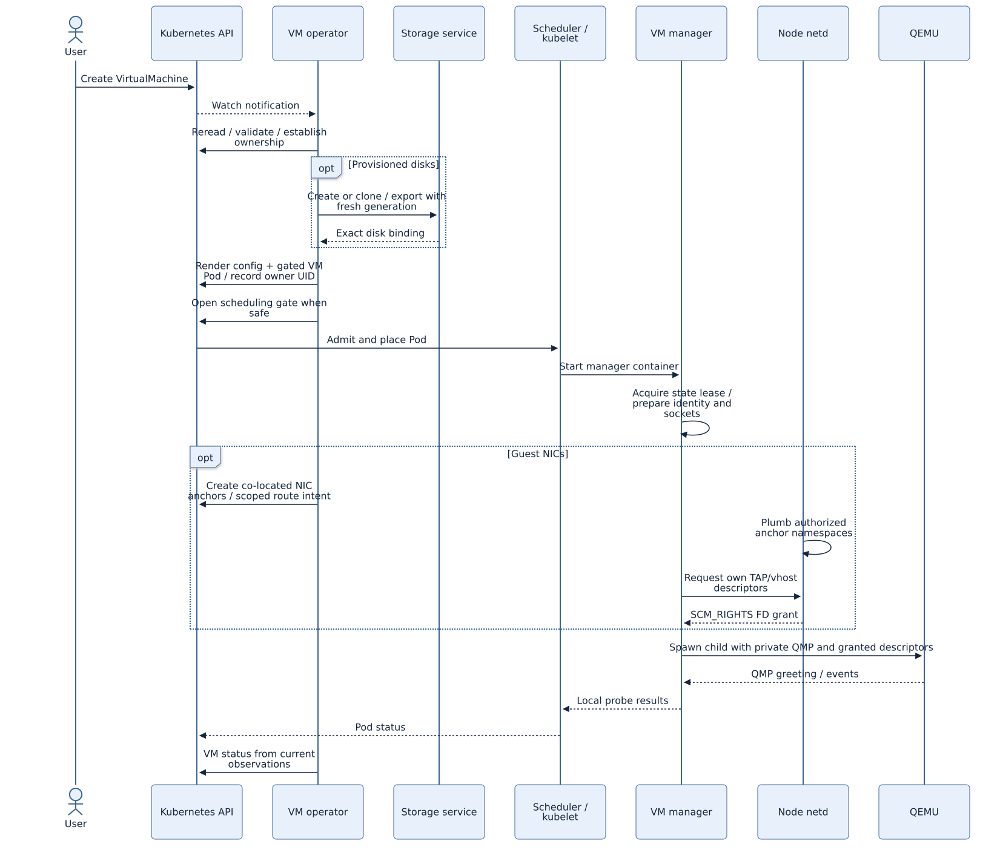
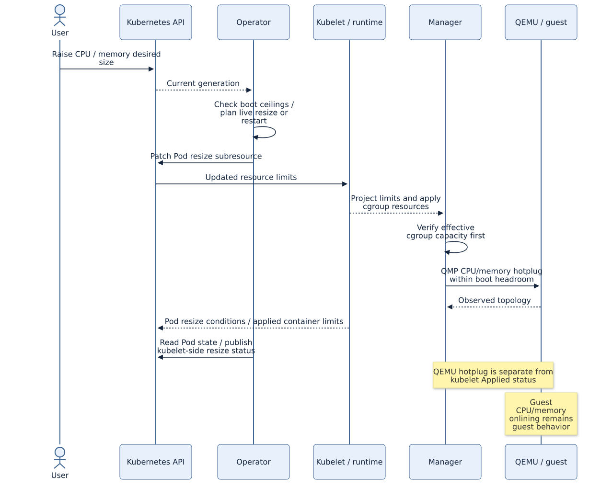
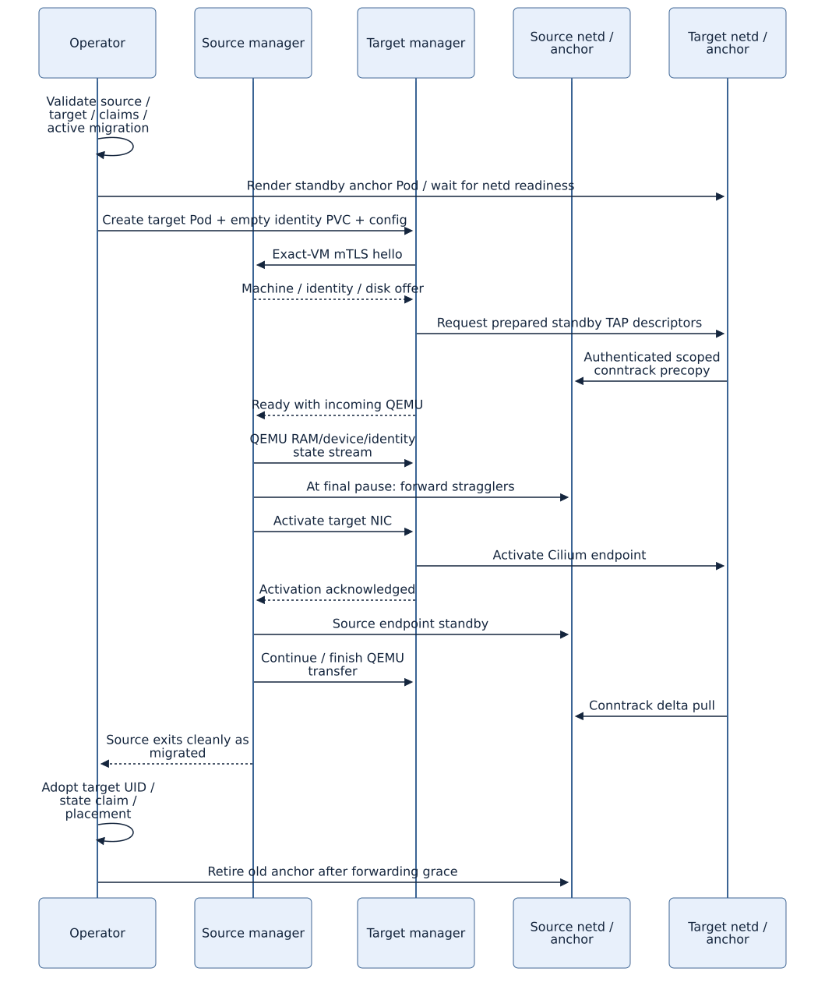
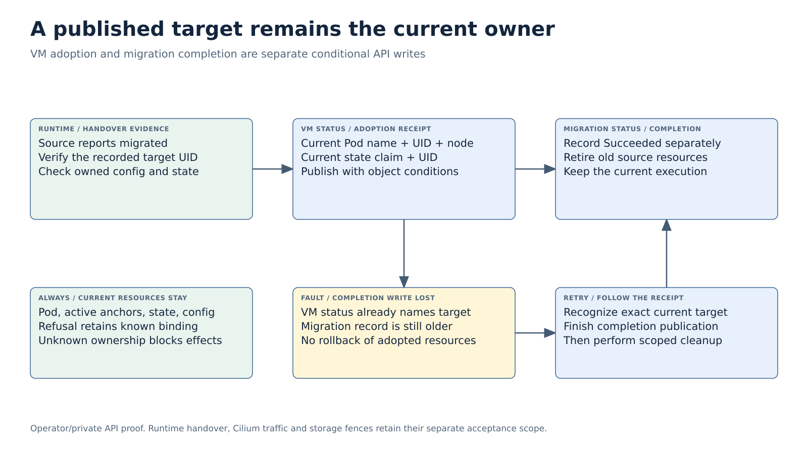

# Lifecycle view: follow one VM across its owners

The same VM has several independent states: declarative Kubernetes intent,
Pod lifecycle, manager/QEMU power, disk export ownership, NIC endpoint
ownership and user sessions. Presenting all of them as one "running" bit
hides the recovery boundaries.

## Launch

The API accepts a VM resource under auth/RBAC/admission. The operator rereads
the current VM, validates it and establishes controlled resource bindings.
For native disks, storage exports and an owner scheduling gate prevent an
untracked QEMU from starting. Kubernetes places and starts the manager Pod;
co-located anchors are created once its node is known. netd plumbs the NICs,
manager obtains their queue descriptors, acquires the identity lease and
starts swtpm/QEMU. Private QMP becomes the runtime control channel.

This is a compressed ordering, not a single atomic transaction. Projected
configuration, watches and retries can be delayed. A Pod with successful
probes proves manager/process liveness, not that the guest application has
finished booting. (S02–S06, S08–S10, S13.)

## Off, stopped, paused and failed

| State | QEMU | Manager/Pod | What changes it |
| --- | --- | --- | --- |
| Powered off in place | Absent | Manager waits; management remains reachable | Redfish `On` starts a new QEMU cycle |
| Declaratively stopped | Absent | Operator removes VM Pod | `spec.running: true` recreates it |
| Paused | Present, not running vCPUs | Manager remains live | Authorized resume |
| Failed runtime | Failed/lost process or control | Manager fails; operator evaluates safe replacement | Clean ownership evidence or required backend fence |
| Migrated source | Ownership transferred | Source manager exits with migrated outcome | Operator adopts exact target |

Power-cycle and restart operations must retain the intended identity while
starting new child processes. Native-disk QEMU termination that needed a hard
kill is not silently reported as clean release. State authority remains held
through child reaping. (S04, S05, S13.)

## Grow resources

The operator plans growth against boot-time ceilings. Kubernetes must admit
and apply the manager container resources first. Manager reads projected
limits and effective cgroup capacity before QMP hotplug. The operator's
`resize.phase=Applied` reflects kubelet-side container resize, not a proof
that the guest has onlined every CPU or byte of RAM. Shrink, growth beyond the
supported ceiling and memory increments that cannot fit whole 2 MiB blocks
relative to boot use a restart path. The block-budget repair is A16 in
[the audit](audit.md). (S02–S04.)

The [dated local KVM growth check](verification.md#follow-resource-growth-through-four-observations)
exercises the cgroup/QMP/guest portion of this sequence, including an odd
applied budget. It uses projected-file stand-ins and local container updates,
rather than the Kubernetes API/kubelet portion.

Disk growth has another chain: grow LIO/zvol capacity, project capacity intent,
perform QMP block resize, then let the guest grow its own partition/filesystem.
The operator does not open a network QMP endpoint for either workflow.

## Move to another node

A migration resource is immutable and single-use. The operator validates
eligibility, target and auxiliary claims, prepares fenced target anchors,
empty identity state and target configuration. The target authenticates the
same VM source, prepares incoming QEMU and receives the state stream. The
final pause coordinates network ownership handoff. Exact target adoption
follows source completion evidence; cleanup does not fence the newly adopted
owner. (S11, S12.)

The operator publishes the target binding in VM status before it separately
marks the migration complete. That VM binding is an adoption receipt: a lost
completion write retries from the current target, preserving its Pod, active
anchors, identity PVC and configuration. Existing children must prove their
owner/intent, and mutations/deletes retain UID/version conditions. Refusal
status keeps the known execution binding. [A22](audit.md) records the private
API regressions and repair; these checks do not establish a runtime/network
or storage transaction.

The verified target UID is first persisted in a separate status step, even
when an ungated target finishes before its first controller observation.
[A25](audit.md) verifies this fast-handover ordering and completion retry.

Shared disks are not copied. Unsupported firmware/management state and
auxiliary PVC sharing requirements remain admission limits. A powered-off
VM has no running guest state to live-migrate; there is no implicit cold-move
workflow. OpenStack-to-qrab workload transfer is a separate transition plan,
not this same-VM qrab live-migration protocol.

## Delete

Deletion coordinates multiple finalizers. Native exports are fenced before
their credentials/resources disappear. Access groups and guest registrations
have their own owners. Only proven VM-owned state claims may be collected;
manual/unproven identity claims remain outside adoption. Source now supports
retiring deleted VM guest disks and a separate host reaper grace period.
Backing state-PV reclamation is a different storage-driver workflow.

Do not summarize this as "delete VM = destroy all data" or "delete VM = keep
everything forever." State the actual object, its proven owner, its retention
policy and its destruction authority. See [storage](storage.md),
[the audit](audit.md) and [subsystem runbooks](../operator.md).
