# Network engineer's view: reuse Cilium, keep the guest boundary

The change is from two network planes in the supplied OpenStack deployment
to one Cilium fabric with separate endpoint identities. Cilium already exists
in both clusters. The proposal removes Neutron/OVN from the qrab guest path;
it does not remove address allocation, guest attachment, policy, routing or
migration work.

## Compare the ownership chains

| Concern | Supplied OpenStack model | qrab source / target owner |
| --- | --- | --- |
| Kubernetes Pod networking | Cilium | Cilium remains |
| Guest-facing network API | Neutron | `VirtualMachine.spec.nics` plus explicit platform policy |
| Guest fabric | OVN/OVS | Kernel TAP/vhost and anchor routing into Cilium |
| Endpoint identity | OVN logical ports / policy | Separate anchor Pod/Cilium endpoint per NIC |
| Security-group intent | Neutron security groups mapped into OVN | Anchor labels selected by CiliumNetworkPolicies |
| Guest addresses | OpenStack configuration not inspected | Operator claims one-address Cilium pools, stable IPv4 /32 per NIC |
| Guest boot network config | OpenStack configuration not inspected | NoCloud static network config plus netd DHCP compatibility |
| Physical route distribution | frr-k8s/BGP is present; exact route wiring unknown | Operator writes scoped FRRConfiguration; FRR speaks BGP |
| Live guest endpoint move | OpenStack/OVN path depends on deployment | Fenced standby endpoint and explicit activation via local Cilium fork |
| Optional VPN | Not specified | Anchor-terminated WireGuard; Proton broker is optional |

Upstream's [OVN reference architecture](https://docs.openstack.org/neutron/2026.1/admin/ovn/refarch/refarch.html)
explains the control databases, controllers and OVS datapath. It is a generic
comparison reference; its physical topology and floating-IP modes are not
assumed to match the other cluster.

## A packet's actual boundary

QEMU holds TAP/vhost queue descriptors granted by netd. The guest's virtio-net
queues reach a TAP inside the NIC anchor's network namespace. Anchor routing
and Cilium then process that NIC's address and identity. The manager and netd
control sockets are not per-packet relays. The VM Pod's management network
namespace is not on the guest packet path. (S08–S10.)

The separately privileged node daemon creates the kernel resources. VM and
anchor Pods stay restricted. A local netd request is authorized through peer
PID/cgroup/Pod resolution and the VM's own NIC relationship. This depends on
controlled Pod metadata/API writers in the management namespace; labels are
not authentication credentials against an arbitrary namespace administrator.

## Stable identity requires control, not another overlay

Each plain NIC uses a stable /32, deterministic guest MAC and fixed link-local
gateway. The operator atomically claims its address with a named Cilium pool,
pins the anchor to that pool and scopes FRR intent to the holding node.
The address follows an authorized move; route withdrawal/release follows
confirmed lifecycle cleanup. The required guest address range, Cilium IPAM
configuration, FRR base configurations and route acceptance are platform
contracts. Cilium's upstream BGP control plane is a different route-advertising
option, not evidence that this implementation uses it.
([Cilium BGP scope](https://docs.cilium.io/en/stable/network/bgp-control-plane/bgp-control-plane/))

Plain NIC pools opt out of masquerading, so external routing must know the
guest range. This is not a generic floating-IP implementation. An unselected
anchor is default-allow: security-group labels have no effect unless policies
select them. Install and validate the intended baseline and explicit allows.
([Cilium policy enforcement](https://docs.cilium.io/en/stable/security/policy/intro/))

## Migration is the integration seam

Ordinary attachment uses the Cilium datapath; duplicate-address standby/active
handoff relies on the local fork. During the final QEMU pause, the managers
coordinate target activation and source standby through node-local netd.
Temporary forwarding and overlapping old/new route advertisements allow
stragglers to reach the new node while routing converges. Node netd peers
exchange bounded scoped conntrack over exact-node SPIFFE mTLS. Managers never
carry raw conntrack entries. (S11, S12.)

This is real integration code to maintain, not a free feature inherited from
installing upstream Cilium. Its limits include IPv4-only per-NIC addressing,
four NICs per VM and bounded/best-effort conntrack transfer; service-translated
flows are not equivalent to every direct connection. See the current
[networking guide](../networking.md#limits) for exact limits and dated tests.

## Keep the paths separate

Guest iSCSI disks use QEMU's backend on the VM management Pod network, not a
guest NIC. Management HTTPS, migration state, conntrack exchange, BGP routing
and guest application packets have distinct owners and capture locations.
Cilium WireGuard, native MACsec and a VPN NIC protect different segments;
none should be presented as universal end-to-end guest encryption.

The current interface does not establish overlapping tenant CIDRs, general
L2 networks, arbitrary Neutron routers/floating IPs or general Neutron API
compatibility. Treat any such requirement as an explicit capability decision.
Implementation detail and capture mappings remain in
[networking.md](../networking.md) and [the connection atlas](../connections.md).
