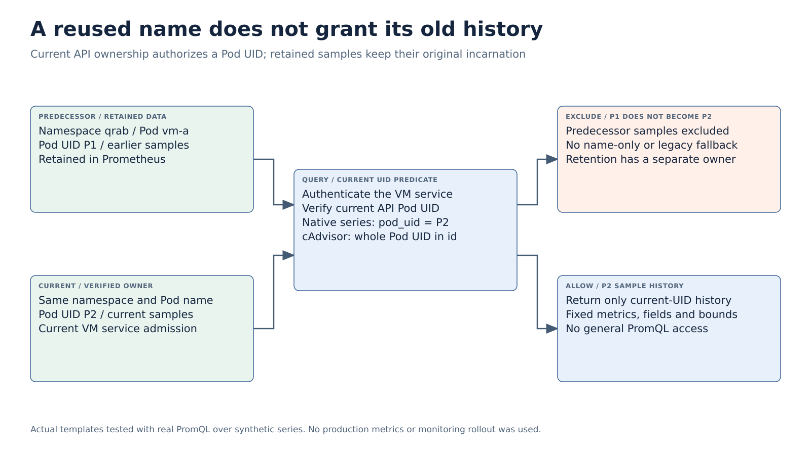

# SRE view: current state, retained history and authority

The manager's current state, Redfish's bounded observations and Prometheus's
retained series answer different questions. A successful scrape is not a
complete audit trail, and current ownership of a reused name does not grant
the previous incarnation's history.

## Follow each observation to its owner

| Observation | Owner / source | Identity and lifetime |
| --- | --- | --- |
| QEMU/process/guest state | Manager, private QMP/QGA and local kernel counters | Current execution and sample timestamp; guest cooperation is separate |
| Redfish inventory, events and live metrics | Authenticated management surface and bounded manager API | VM role checks, manager epoch/sequence, bounded buffers and explicit gaps |
| Native metric scrape | Pod-local telemetry adapter to exact VM Redfish SVID | Fresh API VM ownership, Pod UID and address; fixed port/path |
| Historical container metrics | Prometheus cAdvisor series | Namespace/name plus the complete Pod-UID cgroup component |
| Historical guest block/NIC metrics | Prometheus native VM series | Namespace/name plus `pod_uid` from trusted discovery metadata |
| History request | Redfish fixed templates through workload-authenticated adapter | Current certificate VM's API-owned Pod UIDs; no general PromQL access |

The adapter refreshes API discovery every five seconds and expires authority
after fifteen seconds without a successful refresh. This bounds a discovery
lease; it does not make API, TLS and monitoring one transaction. Human VM
roles and service-peer admission remain separate checks. Configuration,
limits and transport details remain in [the observability guide](../observability.md).

## A reused name creates a historical boundary

A new VM can reuse `namespace/Pod-name` while Prometheus still retains the old
series. Name-only selectors then read or aggregate predecessor data, even
when today's API inventory proves that the new Pod belongs to the caller.
A24 reproduced that behavior with the real PromQL engine and synthetic data.

The repaired templates require the current Pod UID. Native samples carry
the `pod_uid` target label. cAdvisor selectors match a whole UID component in
`id`, including cgroupfs and systemd's underscore form. The scrape descriptor
also carries UID, so stale discovery cannot retag a replacement under an old
label. The bridge rejects old/unscoped templates after inventory changes.

Missing metadata disables history without disabling management. Missing
sample identity produces no authorized data; legacy unlabelled samples are
not attributed to the current Pod. A VM-wide history product spanning former
incarnations would need its own proven provenance/authorization model.
Existing retained data remains available to appropriately authorized
monitoring administrators under their separate policy.

## Distinguish a query result from its evidence

The maintained fixture evaluates all six actual templates with official
Prometheus `promtool`. It requires no predecessor samples before the current
Pod existed, exact current values afterward, both cgroup naming forms and
refusal of UID-prefix lookalikes/unlabelled native series. This is real
synthetic PromQL evaluation, not a query against production data.

Private API/TLS cases separately verify current inventory, fixed-query
admission, identity rotation and denial of other scopes. The default runtime
gate remains independent of a Prometheus installation. Reproduction and the
confirmed repair are in [verification](verification.md) and [A24](audit.md).

## Release the label contract deliberately

The rendered Redfish environment, client/bridge and PodMonitor must agree on
UID. cAdvisor ingestion must retain its `id` label. These are coordinated
source/configuration requirements; this audit does not apply a monitoring
manifest or deploy new images. Missing labels fail closed rather than
reverting to a reusable-name selector.

For the OpenStack presentation, retain the monitoring responsibilities even
when control services leave the target. The supplied OpenStack description
does not identify its telemetry stack. Container metrics cover qrab's QEMU
child through the manager container boundary; the supplied libvirt VMs live
in host cgroups. That is an ownership/accounting distinction, not a measured
performance or monitoring-product parity claim.
