# One system, several architecture maps

A service replacement table, a Rust dependency graph and a Pod diagram answer
different questions. Read them together when explaining how qrab replaces
OpenStack responsibilities.

## Start with the question the diagram answers

| View | Useful question | Example | Common mistaken inference |
| --- | --- | --- | --- |
| Responsibility | Who must make the operation correct? | Kubernetes places; operator reconciles; manager owns local QEMU | A small manager alone replaces every Nova duty |
| Deployment | Where does a process run? | QEMU is inside the manager container; a NIC anchor is another Pod | Every Rust crate is a deployed daemon |
| Dependency | Which code contract is reused? | QAPI types/protocol feed manager; management services reuse its bounded API | Importing a Rust type grants access to production QMP |
| Authority | Who can act on the resource? | Exact-VM service admission and a human role are separate checks | A workload certificate grants every user action |
| Payload | Where do bytes flow? | Guest block I/O goes from QEMU libiscsi to LIO | The operator proxies disk or packet payloads |
| Recovery | Which incarnation still owns it? | Pod UID, namespace token and disk export generation | A name or Ready flag proves current ownership |
| Evidence | What was actually established? | Source, manifest, local peer fixture, named live observation | A passing local test proves deployed guest health |

The [code map](code-map.md) inventories all workspace crates. Generated QAPI
types and transport libraries are linked code, not additional cloud services.
The operator renders the manager's configuration contract without depending
on the manager crate. BMC/Redfish reuse control types and call the bounded
manager API; manager retains the private QMP session.

## Assign operational ownership explicitly

These are responsibility categories for a team to assign, rather than an
assertion about the organization's current staffing.

| Operational owner | Remains responsible for | qrab integration boundary |
| --- | --- | --- |
| Kubernetes platform | API availability, admission/RBAC, scheduling, kubelet/runtime and container resources | VM CRDs, rendered Pods, device injection, watch/retry semantics |
| VM runtime | QEMU release/machine contract, child lifecycle, firmware/vTPM identity, QMP/QGA and bounded management | Per-VM manager and its authenticated management services |
| Network platform | Cilium endpoint/policy behavior, FRR/BGP, reachability and supported handoff integration | Per-NIC address/label intent and node-local TAP/FD operations |
| Storage platform | Durable bytes, exports, hard fences, retained identity volumes, backup/restore and destruction policy | Scoped storage verbs, generations, CHAP and reclaim records |
| Identity platform | OIDC directory/keys, SPIRE enrollment/rotation and trust-domain policy | Human verification, exact service peer admission and VM roles |
| Workload owner | Guest configuration, application consistency, guest-agent cooperation and recovery acceptance | Guest NIC/seed contract, approved agent operations and application tests |
| Release owner | Source provenance, immutable images, identity pins and rollout evidence | Source merge, image publication and cluster rollout remain separate steps |

The same person can hold several responsibilities. The boundaries still need
to be explicit so an incident or change has a clear owner.

## Explain the OpenStack change as a reassignment

Nova's orchestration and placement responsibilities move across Kubernetes,
the operator and manager. Local libvirt supervision moves to manager.
Neutron/OVN responsibilities move across API intent, address/anchor lifecycle,
netd, Cilium policies and FRR route distribution. Existing human and workload
identity systems take their respective roles when Keystone leaves the target.

Glance/Cinder replacement work has an implemented foundation and an explicit
remaining workload contract. The storage platform still owns durability and
fencing; a smaller API surface does not implement those guarantees by itself.
Use [the replacement map](replacement-map.md) for the service-by-service view.

## Keep the two clusters distinct

The user's OpenStack services are containerized in another Kubernetes cluster.
That cluster's Cilium, frr-k8s/BGP, host-cgroup libvirt VMs and OVN guest fabric
are the supplied baseline. The qrab source and native-cluster records describe
the other side. A common component name does not establish identical release,
configuration, policy or performance in the two clusters.

No direct OpenStack cluster inventory, storage backend discovery or workload
measurement is implied by these maps. The [transition plan](transition.md)
lists the evidence needed before retiring a component for a particular
workload.
