# Operator's view: failure domains and recovery evidence

qrab removes OpenStack-specific control services from the target, but
Kubernetes, QEMU, Cilium, FRR, storage and identity still fail independently.
The operational benefit to test is clearer ownership and fewer duplicated
control planes; lower incident rate or cost has not been measured here.

## What an outage means

| Failure | Likely architectural effect | Evidence to collect | Unsafe inference |
| --- | --- | --- | --- |
| Kubernetes API or operator unavailable | New reconciliation, placement and lifecycle changes pause | API reachability, operator logs/status age, current Pods | Every existing QEMU must have stopped |
| One manager/QEMU/swtpm fails | One VM loses execution/control; native storage guard may block replacement | Child exit, private manager status, exact Pod UID, storage state | A replacement Pod can attach just because the old object disappeared |
| netd restarts/unavailable | New attachment and handoff fail/wait; held kernel FDs may keep an existing datapath alive | FD holder, anchor UID/netns, readiness gate, daemon logs | Userspace control-daemon outage equals loss of every packet |
| Cilium endpoint/node datapath fails | Guest/management traffic can be impaired independently of QEMU liveness | Endpoint identity/policy/handoff status, route and packet observations | Guest NIC failure is a manager/QMP failure |
| FRR/BGP convergence fails | Guest reachability can differ by origin and node | Advertised /32s, old/new announcements, forwarding table, peer routes | BGP session up proves every guest path works |
| Storage API unavailable | Provision/fence/retire operations wait or report bounded failure | API verb outcome, export generation, journal phase | Existing disk I/O necessarily fails too |
| LIO/storage data path fails | Dependent guests can stall/error on I/O | QEMU block errors, target sessions, storage health, transport path | Operator reconciliation can repair missing durable bytes |
| IdP unavailable | New human login/key refresh may fail; existing sessions follow their expiry | Login/JWKS/session errors without logging tokens | Cached sessions grant indefinite access |
| SPIRE unavailable | New SVID acquisition/renewal and new authenticated connections may fail | Workload identity age/expiry and exact enrollment | A mounted Workload API socket proves healthy mTLS |
| Node lost/partitioned | Safe VM recovery depends on process/state/export ownership | Exact old UID, node status, hard-fence outcome | Node `NotReady`, lease expiry or force deletion proves old writers are gone |
| Prometheus/history bridge unavailable | Management and guest execution can survive without history | Scoped bridge discovery freshness, scrape/history status | Missing graph data means the VM is off |

These are source-derived expectations, not an availability SLA. The
[connection atlas](../connections.md) and [capture guide](../connections/capture.md)
identify the streams needed to distinguish control, packet, block and
identity failures.

## Read-only triage order

1. Identify the immutable VM UID, active Pod UID/node, observed generation,
   current `phase`, `reason`, power and migration status. Separate stale
   observations from a fresh outcome.
2. Check manager process/probe evidence and whether QEMU exists. A live
   powered-off management Pod is expected, not a stuck boot.
3. For a network symptom, identify the exact NIC anchor/endpoint/address and
   traffic origin. Compare guest packets, management traffic and backend I/O;
   they do not share one namespace or one encryption stream.
4. For storage replacement, read the export generation and old-owner state.
   Preserve unknown ownership until clean exit or a hard backend fence is
   established. Follow the existing [storage recovery runbook](../iscsi.md#ownership-and-recovery).
5. For authentication failures, distinguish human-token/session expiry,
   service SVID admission and API RBAC/admission. Do not test with an unrelated
   privileged credential and call the user path proven.
6. For deletion, identify which finalizer still owns work. Do not strip it
   merely to make the object disappear. Capture the corresponding external
   cleanup/fence outcome first.

## Acceptance after a repair

Verify the failed operation through its real entrypoint, then verify the
identity and ownership invariants it could have affected. A successful
Redfish power operation should preserve the Pod/identity when it is an
in-place cycle. A migration should preserve the VM UID, intended disks and
NIC addresses and leave no unintended active source endpoint. A storage
recovery should prove the old writer/export generation cannot still act.

Local unit tests, kernel netns tests, real-QEMU tests and live cluster tests
are different evidence classes. Tests that skip because privileges/tools are
missing are not live datapath proofs. Prefer the maintained check scripts and
record their actual scope, source revision and release digests.

## Release boundary

Source checks and merges do not build images, enroll new workload identities
or roll a cluster. The image lock records source/digest pins; live inspection
and dated acceptance establish what is deployed. This architecture task does
not automatically authorize applying example VM bundles or recreating deleted
test VMs. Durable investigation and operational notes belong in qrab towl.
