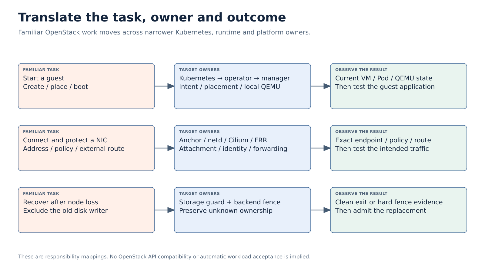

# An OpenStack operator's task translator

The useful replacement for an OpenStack command is a task, its new owner and
the evidence that the task completed. qrab exposes Kubernetes resources and
VM-scoped management services. It does not expose a Nova, Neutron, Glance or
Cinder compatibility endpoint.

The OpenStack task names below follow the [2026.1 client reference](https://docs.openstack.org/python-openstackclient/2026.1/cli/command-objects/server.html).
They are vocabulary for the comparison, not a discovery of the separate
cluster's enabled features or API microversions.

## Create, inspect and operate a VM

| Familiar task | qrab entrypoint and owner | Completion evidence / important limit |
| --- | --- | --- |
| Create server | Dashboard launch or an authorized `VirtualMachine` API request; operator renders controlled resources | Current VM UID/generation, storage binding, manager/QEMU state, NIC readiness and a guest/application check |
| Choose flavor | VM CPU/memory specification, boot ceilings and Kubernetes resource admission | Scheduled resources and effective container capacity; required NUMA/pinning/hugepage policy needs its own contract |
| Show server | VM status plus selected-VM dashboard/Redfish and manager-derived inventory | Separate desired generation, Pod incarnation, power state and guest-agent freshness |
| Console | Dashboard/BMC's authenticated, VM-scoped graphical console path | The human has the required console role and reaches the selected VM's private VNC stream |
| Stop/start | In-place Redfish power operation through the per-VM service | Off leaves manager available; On starts new QEMU/swtpm children using retained identity |
| Declaratively stop | Set `spec.running: false` through the authorized API | Operator removes the VM Pod; this is a different lifecycle from in-place Off |
| Reboot or power cycle | The requested Redfish reset action, bounded manager command, private QMP/guest cooperation | Check the selected action's outcome; a hard reset, guest shutdown and a new QEMU process are different events |
| Pause/resume | Authorized VM power/control action | Paused QEMU still exists and retains resources; application progress has stopped |
| Resize | Update the supported VM resource intent; operator/kubelet admit container growth before manager hotplug | `resize.phase=Applied` is kubelet-side evidence; guest CPU/memory onlining needs guest evidence |
| Live migrate | Immutable, single-use qrab migration resource | Exact target adoption, one intended network owner and preserved disk/state identity; eligibility is constrained |
| Rebuild, rescue, shelve or cold move | No general equivalent is established by this atlas | Define the required recovery/data/identity behavior before promising this workflow |

Source owners are S02–S07, S11, S16–S19 and S22 in [the evidence register](evidence.md).
The [lifecycle view](lifecycle.md) gives the sequences. Use the actual dashboard,
Redfish and CRD documentation for parameters; a mapping table should not become
an untested second command reference.

## Connect and protect a guest

| Familiar task | qrab entrypoint and owner | Completion evidence / important limit |
| --- | --- | --- |
| Port/address assignment | VM NIC intent, address claims, co-located anchor Pods and netd | Exact VM UID/NIC/anchor incarnation, applied endpoint labels and guest address |
| Security-group membership | NIC security-group labels plus the platform's Cilium policies | Inspect the resulting policy and test the intended allowed/denied flow; a label alone does not enforce it |
| External reachability | Stable guest IPv4 /32, FRRConfiguration/frr-k8s and the upstream network | Accepted route and packets from the required origins; a BGP session alone is insufficient |
| Floating IP, tenant router, overlapping subnet or IPv6 | Required semantics must be specified separately | The current stable-/32 model does not establish broad Neutron parity |
| Migrate an active NIC | Manager/netd and the supported local Cilium handoff fork | Attachment identity, transfer outcome, old/new routes and actual traffic; source support is not a lossless-flow guarantee |

The management Pod and each guest NIC have different endpoint identities.
Guest packets flow through kernel TAP/vhost and Cilium; the netd socket grants
descriptors and carries control, rather than relaying packet payloads. See
[networking](network.md) and [recovery](recovery.md). (S08–S12.)

## Images, disks and failed nodes

| Familiar task | qrab owner today | Completion evidence / important limit |
| --- | --- | --- |
| Register an image | BaseImage/import controller, bounded inspect/write Jobs and the storage service | Verified source, explicit format, capacity and sealed immutable generation |
| Create disk from image | Provisioner and scoped storage clone/export verbs | Recorded origin/GUID, export generation and exact VM/disk CHAP Secret |
| Grow volume | Storage capacity first, projected intent, manager QMP block resize | Backend and QEMU capacities, then guest partition/filesystem growth |
| Attach/detach arbitrary volumes | No general interface is established here | Decide required attachment lifecycle, writer exclusion and retention semantics |
| Backup/restore | A complete workload product remains work to finish | Disks, firmware/vTPM identity, configuration, registrations and application consistency must be coordinated |
| Recover from node loss | Storage guard plus clean-exit evidence or a hard backend fence | Old writer exclusion before replacement; an unreachable node is not that proof |
| Delete VM | Separate access, guest-identity, storage and proven state-claim owners | Finalizer outcomes, fenced/retired disks and explicit state-PV reclaim policy |
| Destroy retained disk bytes | Separate administrator-only reaper after its grace period | Exact retired journal/GUID, absent export objects and successful backend destruction |

[Nova's evacuation procedure](https://docs.openstack.org/nova/2026.1/admin/evacuate.html)
also requires establishing that the old host is not operational. qrab's
corresponding safety question is explicit disk-writer exclusion, not merely
Kubernetes rescheduling. Automatic general evacuation is not established.
(S05, S13–S15.)

## Replace the credential for the right question

Keystone's [scoped tokens](https://docs.openstack.org/keystone/2026.1/admin/tokens-overview.html)
carry authorization context for OpenStack APIs. The target distributes the
questions across existing systems:

| Question | qrab authority |
| --- | --- |
| Who may change Kubernetes VM intent? | API authentication, RBAC and admission |
| Who is this browser user? | Verified OIDC identity and server-side session |
| May that user perform this VM action? | VM application roles enforced by the selected service |
| Which service is calling? | Exact allowed SPIFFE identity and rotating workload mTLS |
| Which workload is inside this guest? | Optional VM-bound guest SPIRE enrollment and selectors |
| May this QEMU access this disk export? | Scoped CHAP/export generation; separate from user login |

The dashboard uses its own ServiceAccount for Kubernetes operations. It is
not per-user API impersonation. A valid SVID does not grant every human role.
See [identity](identity.md), [authority](authority.md) and the
[capability ledger](capabilities.md) for the remaining acceptance scope.

## An operator's closing question

For each familiar command, ask: which object expresses intent, which owner
performs the effect, and which observation proves the workload result? If one
answer is missing, record the required contract. Do not hide it behind the
name of the service being removed.
