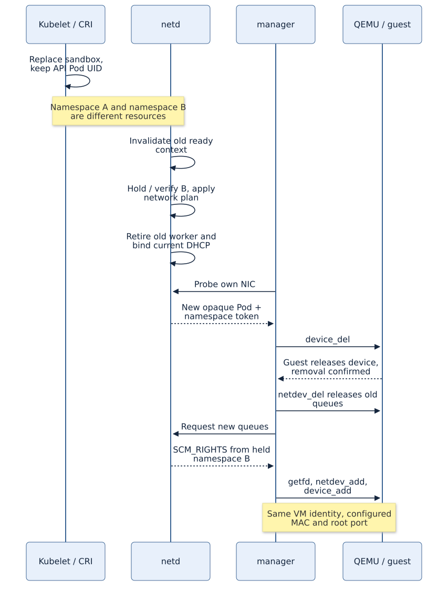

# Recovery: follow the owner, resource and incarnation

The useful recovery question is which owner can still act on which resource.
A name, a Ready condition, a controller restart and a missing Pod each answer
only part of it. This perspective follows the boundaries repaired during the
audit and connects them to the larger VM lifecycle.

## Keep these lifetimes separate

| Resource | Stable reference | What can change independently |
| --- | --- | --- |
| VM intent | Immutable VirtualMachine UID | Name reuse creates another VM; generation changes its desired spec |
| VM Pod | Pod UID and node binding | Container restart; manager/QEMU process restart |
| Manager session | Local process/session and event epoch | A later session can reuse a path or socket name |
| NIC anchor | Pod UID plus held network namespace identity | CRI can recreate the sandbox while preserving the API Pod |
| TAP queues | Open kernel descriptors | API objects, daemon processes and namespace paths can disappear |
| Firmware/vTPM state | VM-bound initialized state and its lease | A guest power cycle replaces child processes while retaining identity |
| Guest disk export | Backend export generation and fencing state | API deletion or node observation does not establish writer exclusion |
| Status | Exact object UID/version and observation time | The resource can change before a delayed observation is published |

The [authority view](authority.md) explains how these references authorize
effects. The [storage view](storage.md) explains why a state lease and a hard
disk fence remain different contracts.

## Case 1: a NIC sandbox changes beneath a running VM

Discovery uses the current running anchor container identified by the Pod
snapshot, rather than the lowest live PID under its UID. It waits through
unresolved container startup without requiring the Pod readiness gate first.

QEMU holds queue descriptors for a particular kernel namespace. Keeping the
same API Pod UID does not move those descriptors into a replacement sandbox.
netd therefore identifies a plumbed attachment with an opaque token containing
the Pod UID and the held namespace's device/inode identity. Its open namespace
file pins that resource while the ready context refers to it.

When the held process no longer occupies that namespace, netd invalidates its
cached readiness and resolves the replacement. A healthy DHCP socket is reused
if the namespace stays the same; a changed namespace retires the old worker. Grant and probe use the same verified context. A netd restart
observing the same namespace produces the same token, avoiding an unnecessary
VM-wide unplug cycle.

The manager compares tokens. On a change it requests device removal, waits
for guest release, removes the old QEMU backend, obtains new descriptors and
attaches the NIC with the same configured MAC and root port. This is NIC
recovery with guest hot-unplug cooperation; it is not a promise of lossless
traffic during a sandbox failure. The VM process does not need to restart.

The source and regression evidence are A07 in [the audit](audit.md). The
kernel fixture exercises real throwaway namespaces and held files. The manager
fixture exercises QMP ordering against a stand-in; neither proves a particular
guest OS's hot-unplug behavior or a live Cilium/BGP path.

A10 also separates lease changes from namespace changes. A healthy responder
reads the latest complete applied lease without rebinding its socket. Setup
must successfully bind before readiness is published; worker exit invalidates
that readiness. These changes affect subsequent DHCP answers, not a forced
guest renewal or static network configuration.

## Case 2: the local attachment service becomes unavailable

An established queue can outlive the process that originally granted it.
netd's restart does not itself revoke QEMU's existing descriptors. New grants,
endpoint handoff and other node control still need the service to recover.

The Unix socket carries bounded control frames and descriptor grants. It
does not carry guest packet payloads. A reply can arrive in several stream
reads, and its descriptors can accompany an early or later fragment. The
receiver must own every delivered descriptor before parsing or refusing the
frame, including the retained subset of a truncated ancillary message.

The repaired reader enforces a total read deadline and byte/descriptor bounds.
A full local listen queue fails promptly for retry. Parse errors, refusal,
truncation and count disagreement close received descriptors. Earlier agents
that close after a complete unterminated JSON reply remain readable; new
senders terminate the frame explicitly. A08 records the failing-before and
passing-after private-socket fixtures.

## Case 3: the manager is healthy and the guest is off

An in-place Redfish Off stops the guest's QEMU/swtpm run while manager stays
reachable. Power On creates new children using the intended retained identity.
That healthy management state differs from setting `spec.running: false`,
which removes the VM Pod, and from an unexpected runtime failure.

Use the manager's power/process evidence and current VM status together.
Container readiness alone does not prove that guest code is executing.
See [the power lifecycle](lifecycle.md) and [operations matrix](operations.md).

## Case 4: the old node cannot be reached

The API can stop observing a process while that process can still write to a
disk. Native-disk recovery preserves the old ownership binding until the
documented clean-exit evidence or a hard backend fence permits replacement.
Force-deleting a Pod, expiring a local lease or changing a desired node does
not substitute for that backend barrier.

The small firmware/vTPM filesystem volume has its own attachment and retained
identity contract. Recovering that volume and fencing a guest LUN need their
respective owners. A migration uses its explicit source/target adoption
protocol rather than treating two visible Pods as two independent VMs.

## Case 5: an observation arrives after its object changed

A delayed result can be accurate about the resource it inspected and wrong
for the resource now occupying the same name. Conditional API writes must bind
the result to its observed object. On conflict, use current state to decide
whether to retry; do not publish the old result onto a replacement.

The node condition writers now carry the observed Pod UID/resourceVersion.
A rejected status write is retried from fresh watch state without repeating
successful kernel plumbing. A09 records the source, fake-API regressions and
non-persisting server dry-run verification.

This is the same review pattern as PVC adoption, external-group cleanup and
local process handles. The matching resource reference changes by domain;
the requirement to preserve its meaning through the effect remains.

## Compare the operating models

In the supplied OpenStack deployment, Nova/libvirt coordinate VM ownership
outside a VM-specific Pod cgroup, and OVN owns guest attachment. In qrab,
Kubernetes/operator, manager, netd/Cilium and storage each own narrower parts
of recovery. The comparison should identify these owners and the evidence
they require, rather than imply that removing a service removes the failure
mode it previously handled.
