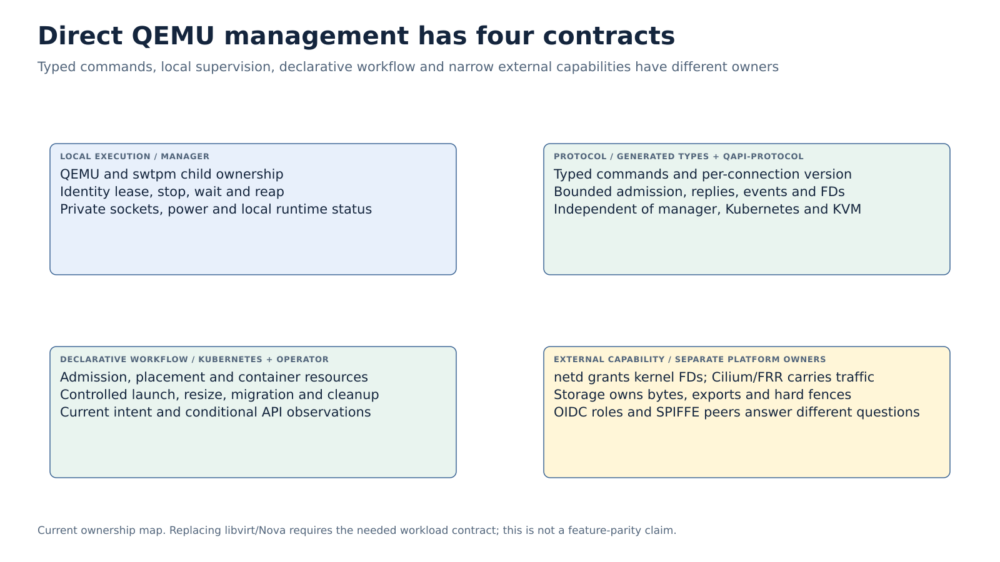
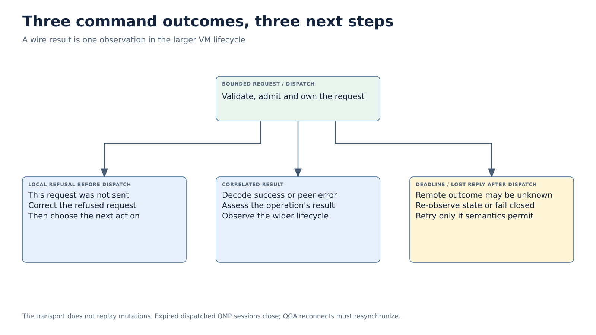

# Runtime engineer's view: what replaces libvirt

The target removes libvirt's domain supervisor and gives one manager ownership
of each QEMU execution instance. Typed QMP calls are one part of that work.
The complete boundary also includes child cleanup, persistent identity,
resource admission, guest cooperation and distributed storage/network owners.
This perspective explains the implementation rather than claiming libvirt or
Nova feature parity.

## Follow one management operation

A user reaches Redfish/BMC through an admitted service connection and a
separate VM role check. The management service calls the manager's bounded
local API. The manager owns the private QMP session and correlates the
command result with its local runtime state. Kubernetes intent and Pod
lifecycle remain another control path. A power action can leave management
running; requesting `spec.running: false` asks the operator to remove the VM
Pod. ([Management flow](lifecycle.md), S03, S04, S06, S18–S20.)

The protocol library is linked code, not a QMP gateway deployed beside every
service. The manager's control directory is shared with trusted sidecars;
the QMP/QGA/session directory is private. A Rust dependency does not grant a
sidecar access to those private sockets.

## Separate the four contracts

| Contract | Concrete owner | What it contributes | What it leaves to another owner |
| --- | --- | --- | --- |
| Protocol | QAPI parser/IR/generator/macros, generated types and qapi-protocol | Command shape/flags, per-connection version, framing, correlated replies, events, cancellation and descriptor lifetime | Starting QEMU, choosing a tenant role, admitting a Pod or fencing a disk |
| Local execution | Manager supervisor, persistent state, bounded control and guest-agent worker | QEMU/swtpm children, identity lease, private sockets, power, hotplug, local status and migration state | Global placement, Cilium policy, backend durability or human login |
| Declarative workflow | Kubernetes and operator | Admission/placement, controlled resources, current intent, resize/migration orchestration and conditional status | Implementing QMP framing or carrying disk/packet payloads |
| External capability | netd/Cilium/FRR, storage service/helper and identity services | Narrow kernel grants, endpoint/policy/routing, export generations/fences and authentication/authorization | Becoming a second QEMU supervisor |

The [code map](code-map.md) gives the crate inventory. The
[operating model](operating-model.md) assigns operational responsibilities.
Those maps answer different questions from a process/container diagram.

## A command has a wire outcome and a wider lifecycle outcome

QMP validates requests before dispatch, assigns IDs, bounds admission and
owns each sent request through its reply/deadline. Cancellation of a caller
does not make a sent request disappear from QEMU's unanswered-command budget.
The default in-band budget is eight, with separate negotiated out-of-band
admission. Events have bounded queues and never block command replies.
([QMP client](../../projects/qapi-protocol/src/qmp.rs),
[concurrency regressions](../../projects/qapi-protocol/tests/concurrent.rs).)

A local refusal before dispatch establishes that this request was not sent.
A correlated reply establishes the command's reported result. A deadline or
lost connection after dispatch can leave the remote outcome unknown; the
driver closes an expired dispatched session and wakes its pending callers.
It does not transparently replay mutations. Runtime logic must use the
operation's own state/ownership rules when deciding what can be retried.
Even successful QMP hotplug is distinct from a guest actually onlining a
device; the [resource-growth evidence](verification.md#follow-resource-growth-through-four-observations)
records those observations separately.

The transport defaults are five seconds to connect, ten for handshake and
thirty for a command, covering admission/writes/reply. They are library
defaults, not a universal VM operation SLA. The manager configures tighter
startup/control settings and separate operation-specific budgets. QGA is
sequential: timeout/cancellation closes its uncertain session; reconnect
performs sentinel/nonce synchronization before another operation.
([Options](../../projects/qapi-protocol/src/lib.rs),
[QGA](../../projects/qapi-protocol/src/qga.rs),
[guest-agent regressions](../../projects/qapi-protocol/tests/guest_agent.rs).)

## Process ownership lasts through reaping

The manager starts QEMU as its child in the manager container's cgroup.
Ordinary shutdown can request guest powerdown, wait for its configured grace,
then use QMP quit and finally kill/wait when needed. Process exit, a QMP
acknowledgement and guest cooperation are separate observations.

The managed-child guard keeps the persistent-state lease until the actual
child is reaped, including exceptional cancellation/runtime shutdown. Unknown
wait outcomes retain the lease. Dropping an async caller cannot simply
release identity state while the old child might still run.
([Supervisor](../../projects/manager/src/pod/supervisor.rs),
[child ownership](../../projects/manager/src/pod/process.rs), S04–S05.)

That lease protects local identity-state ownership. It does not prove a
partitioned guest-disk writer is fenced. Backend export/session fencing is a
separate storage contract. Likewise, holding a TAP FD preserves a kernel
resource; it does not establish that its Cilium endpoint is still the current
authorized migration target.

## Compare the operational responsibility, then choose acceptance

| Supplied OpenStack model | qrab implementation / target | Evidence needed for a workload |
| --- | --- | --- |
| Containerized libvirt supervises host-cgroup QEMU | Manager supervises container-child QEMU/swtpm | Start/stop/reap, resource accounting and device access in the actual runtime |
| Nova coordinates lifecycle and placement | Kubernetes plus operator and manager divide those duties | Placement/CPU compatibility, reconciliation, restart/fencing and required migration cases |
| Neutron/OVN owns guest attachment/fabric | Anchor/netd/Cilium/FRR owns separate guest identities and routing | Policy/packet reachability, endpoint handoff, convergence and failure recovery |
| Glance/Cinder supply image/volume workflows | Existing sealed-image/disk foundation plus explicit remaining product scope | Import/publish, quota, backup/restore, fence and destruction acceptance |

The local real-peer, launcher, KVM/container, guest-freeze and two-manager
migration checks strengthen particular rows; their limits remain in
[verification](verification.md). The other OpenStack cluster was not
inspected. Production workload acceptance, release compatibility and
operational recovery remain explicit work even when the source is compact.
