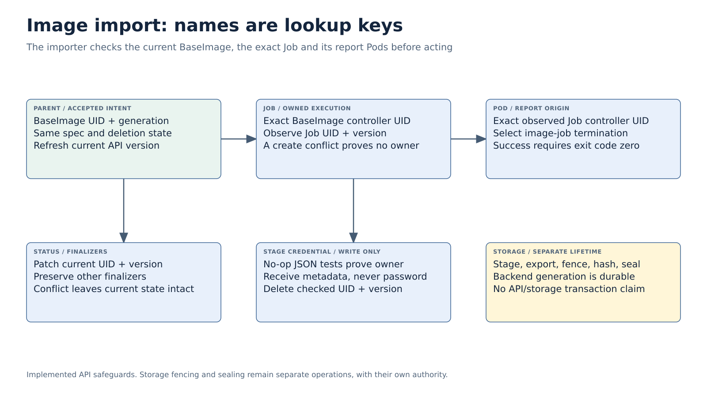

# Storage engineer's view: image, volume, identity and destruction

Glance and Cinder can be removed from the target only after their required
responsibilities have replacement owners. qrab already implements a useful
subset: verified image imports, sealed generations, CoW VM disks, export
credentials, online growth and fencing. The remaining scope is a deliberate
product/recovery decision, not just another QMP command.

## Four objects that must not be conflated

| Object | Implementation owner | Lifecycle / authority |
| --- | --- | --- |
| Base-image generation | BaseImage controller + storage image verbs | Verified source, staged write, backend hash/seal, retirement; clones preserve the origin relationship |
| Guest root/data disk | Disk reconciler + storage service + ZFS/LIO helper | Provision/clone, export, grow, fence and retain/retire under a VM-UID/disk-ID binding |
| UEFI/vTPM identity state | Manager + small filesystem PVC | Retained VM identity and runtime lease; provenance controls GC authority |
| Container/firmware/media artifact | Image release system or explicit approved catalog | Immutable image/CODE/media selection; not a writable guest data volume |

The backing storage service, exchange shim and native host are separately
owned platform integrations. The qrab root helper implements narrow reviewed
verbs; the manager does not acquire general ZFS/LIO authority. CSI remains in
the filesystem state path. Current guest disks are QEMU libiscsi LUNs, not a
generic CSI block-device attachment. (S05, S13–S15, M02.)

## Control and I/O are different connections

The operator authenticates to the exchange/storage API for scoped operations.
The storage service invokes the privileged helper to manage exports and
journals. QEMU independently opens a CHAP-authorized iSCSI session and presents
a virtio block device to the guest. Neither the operator nor the manager
control API proxies block payloads.

CHAP and initiator ACLs authenticate access; they do not enforce one writer or
encrypt disk data. The documented native MACsec segment protects the physical
node/storage link, not all local stacks or data at rest. Other storage portals
need their own transport design. See [iSCSI transport security](../iscsi.md#transport-security).

## The existing Glance subset

An image admin creates an immutable `BaseImage` generation with source URL,
digest and raw/qcow2 format. A token-free inspect Job verifies the download
before parsing and reports size. The controller creates an authorized storage
stage, a write Job fills it, and storage fences/hashes/seals the generation.
Only a launchable sealed entry becomes a clone source; retirement stops new
clones without deleting existing VM disks. (S15.)

The audit also repaired a source-integrity boundary: a top-level qcow2 digest
does not authenticate backing files or external data files. Both Job modes now
preflight and refuse those dependencies before qemu-img runs; import only a
standalone image. See [A04](audit.md).

The importer also binds execution and cleanup to object identity. A same-name
Job is usable only when its controller is the current BaseImage UID. Its
report must come from a Pod controlled by that exact Job UID; a successful
Job cannot select a failed container's report. A consumed report carries the
observed Job UID/version through deletion. Cleanup uses conditional deletes,
including metadata-only ownership tests for the write-only stage Secret.
Status/finalizer writes refresh current metadata while refusing parent
recreation, spec/generation changes or a changed deletion state. The parent
is checked before reconciliation and storage mutations as well, rather than
waiting for a later status failure after changing the backend. Other
controllers' finalizers are preserved. See [A21](audit.md).

These API safeguards do not make Kubernetes and backend storage one
transaction. An existing sealed backend generation remains intentionally
adoptable; adopting that data is separate from claiming a foreign Job or
credential object.

Upstream [Glance](https://docs.openstack.org/glance/2026.1/) has a broader image
metadata/discovery/retrieval role. The required replacement still needs an
accepted publication/sharing policy, distribution/caching scope, import
capacity limits, provenance policy and recovery workflow. A sealed generation
is a useful integrity primitive, not the whole image product.

## The existing Cinder subset

`spec.disks` asks the operator to create/clone, export and grow a VM-bound disk.
It writes a new per-export CHAP Secret before export and records the generation.
Growth reaches the backend first, then the Pod annotation, then manager QMP
`block_resize`; guest filesystem growth remains a guest operation. Removing a
disk from the spec fences it but retains it for possible reattachment.

An unknown old process does not become safe because its Pod disappeared.
The guard requires clean release or a completed hard storage fence. Fully
provisioned-disk VMs can use automatic backend fencing; hand-declared native
disks require the documented administrator recovery. The runtime state lease
and RWOP identity volume do not replace the LIO fence. (S13, S14.)

Upstream [Cinder](https://docs.openstack.org/cinder/2026.1/install/get-started-block-storage.html)
also owns broader volume/snapshot/type/backup concerns. The target must define
the required backup/restore, attachment, quota, retention and backend-support
subset. Shared disks for live migration are not a general supported
application multi-writer volume interface.

## Deletion is a series of authorities

The baseline investigation found and repaired overly broad state-PVC adoption
([A01](audit.md)). A new dashboard launch can make only its proven own state
claim GC-owned; manual/unproven claims stay retained. PVC removal does not
imply its backing PV/zvol was destroyed.

Source advanced during this investigation: commit `0301347` adds deletion-time
guest-disk retirement and a root-only reaper/timer with a seven-day grace
period. The operator first fences, then attempts scoped retirement. A refused
retirement leaves the disk fenced/retained with a warning. The separate host
reaper verifies ownership/GUID/state and absence of LIO objects before data
destruction and clone-hold/journal cleanup. This is source/unit-file support,
not a new deployment assertion. Removed-from-spec disks are not automatically
retired. See [the authoritative retirement guide](../iscsi.md#destroying-retained-data).

The required recovery unit is larger than a disk snapshot: pair the guest
disks with the intended VM identity state, firmware/catalog expectations,
credentials/export state and access/guest-identity registrations. This atlas
does not assert that an application-consistent backup/recovery product is
already complete.
