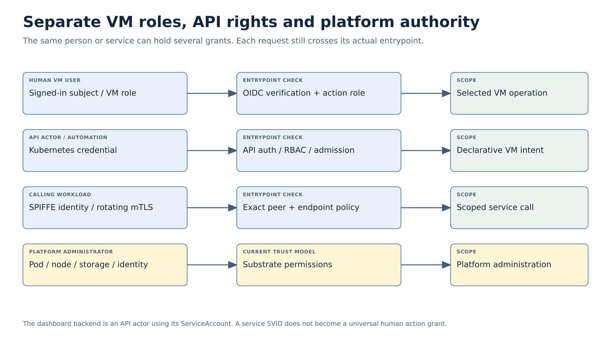
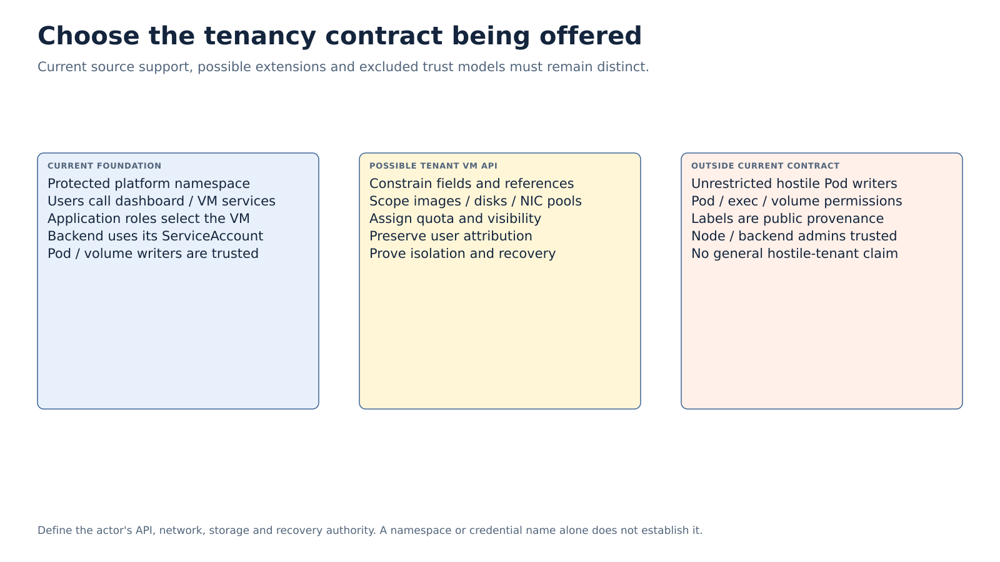

# Tenancy: separate VM roles, API rights and platform authority

Dropping Keystone moves authentication and authorization responsibilities to
other owners. Define who a tenant is and which interfaces that tenant can
use. A person operating one guest, an automation account changing VM intent
and a namespace administrator have different powers.

Keystone's [project/domain/system token scopes](https://docs.openstack.org/keystone/2026.1/admin/tokens-overview.html)
describe OpenStack API authorization context. Kubernetes namespaces group API
resources and policies; a tenant design also needs control and data-plane
isolation. Its [multi-tenancy guide](https://kubernetes.io/docs/concepts/security/multi-tenancy/)
explicitly distinguishes users who touch Kubernetes from customers using an
application in front of it. This comparison should state which model qrab
is implementing, rather than rename a project to a namespace.

## The current source and checked-in deployment model

The checked-in operator deployment uses a protected management namespace.
The dashboard offers VM-scoped browser workflows and uses its own
ServiceAccount for Kubernetes calls. It does not impersonate the signed-in
human at the API server. Its application authorization must therefore decide
what that human may launch, inspect, power or delete before the backend uses
its broader API rights. (S16, M01.)

Per-VM services verify the human's OIDC token and action role. Workload mTLS
separately admits the calling service. Native service endpoints can have
their own narrow service-only permissions; there is no universal rule that
one certificate or one bearer authorizes every route. Manager keeps private
QMP authority behind bounded local operations. (S06, S17–S20.)

The [security model](security.md) treats arbitrary Pod/exec/volume writers in
that management namespace, and node/storage administrators, as trusted.
Public labels and annotations support ownership under protected write rights.
They do not prove isolation from an administrator who can rewrite those
resources or mount their state. Software vTPM also retains the node trust
assumption.

## Read the role at its actual entrypoint

| Actor / grant | Current scope | What does not follow automatically |
| --- | --- | --- |
| VM viewer | Authorized VM reads, redacted configuration, bounded QMP log/SSE data, metrics/history | Console, guest serial, power or guest mutation rights |
| VM admin | The VM's allowed power, console/serial, guest operations and approved media/firmware workflows | Pod creation/exec, node administration or arbitrary storage destruction |
| Kubernetes API actor | Resource verbs allowed by auth/RBAC/admission | A VM application role, or safe unrestricted storage/network references in a tenant-facing API |
| Calling workload | Its exact service identity and the endpoint's peer policy | Every human action or another service's resource scope |
| Platform administrator | The granted namespace, node, storage or identity authority | Protection of those resources from that same administrator under the current trust model |

The source makes a useful data distinction: every guest serial route is
admin-only because serial can contain credentials. Authenticated VM readers
receive bounded QMP log/SSE payloads; push subscriptions omit raw QMP data.
These are explicit policies for different consumers. Read-only does not mean
that all data has the same sensitivity. (S18, S19, S27.)

## Three operating models, with different remaining work

| Model | Position in this codebase | Contract to establish |
| --- | --- | --- |
| Application users operate VMs through the dashboard/services | Current foundation | Keep backend API powers bounded, preserve exact selected-VM roles/destinations, assign application quotas and lifecycle policies |
| Tenants directly create VM resources through Kubernetes | A possible extension, not a complete product claim | Constrain image/storage/NIC references and profiles, ownership, visibility, quota, deletion and user attribution through the actual API/admission model |
| Mutually untrusted users create arbitrary Pods or exec/mount resources in the management namespace | Outside the current stated trust contract | Design the platform isolation boundary and administration model before making this claim |

A namespace per tenant is not a drop-in configuration promise for qrab.
Operator/service policies, identity enrollment, address pools, route ownership,
image naming/sharing and storage-service scope must agree across deployment
boundaries. Current per-VM UID and disk/export ownership contracts remain
necessary in any model. This atlas does not establish a general multi-namespace
tenant product.

Kubernetes quota in a shared management namespace accounts for that
namespace's Kubernetes resources. It does not by itself assign a per-user VM
allowance. Decide whether limits belong to an application user, team, namespace
or another business unit, and account for manager/sidecar/anchor overhead as
well as nominal guest resources. The current source's resource safety and
growth checks do not answer that product-policy question.

## Keep network membership and policy authority separate

A NIC's security-group label selects platform Cilium policy. Membership,
permission to assign membership and permission to change the policy are
different grants. Per-NIC identities also remain separate from the management
Pod. A common Cilium installation or namespace name does not establish an
equivalent tenant policy in both clusters. (S08–S10, M01.)

Likewise, selecting a disk or image reference is not authority to fence,
retire or destroy every backend object. The storage service's scoped verbs,
immutable VM/disk binding and generation checks remain relevant when Cinder
leaves the target. The [authority view](authority.md) follows these resource
references through their effects.

## State the desired contract in the presentation

Use the current protected-platform model for source-backed claims. Present
broader tenant self-service as an explicit scope decision with named API,
network, storage, identity and recovery owners. The goal is a smaller set of
control planes whose required policies remain understandable and testable.
It is not an assertion that Kubernetes auth, OIDC and SPIRE are interchangeable
or that removing Keystone supplies all cloud project semantics.
