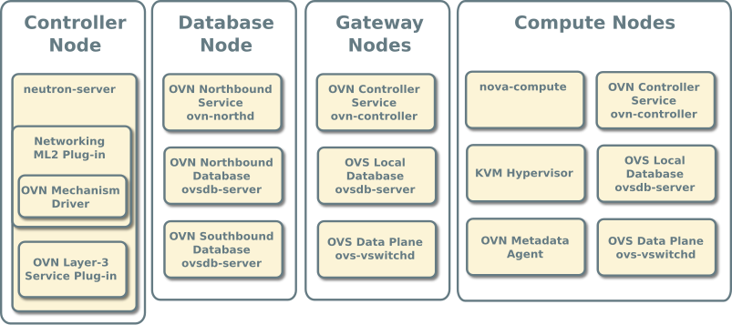
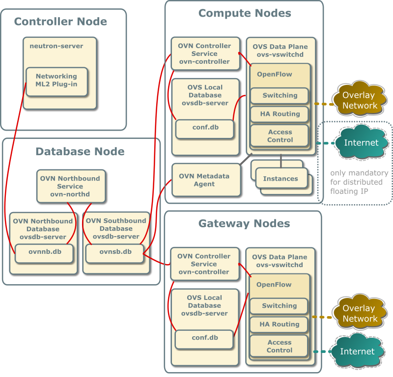

# Upstream OpenStack diagrams as a comparison reference

These unmodified images are from the OpenStack contributors' Neutron 2026.1
[OVN reference architecture](https://docs.openstack.org/neutron/2026.1/admin/ovn/refarch/refarch.html),
retrieved 2026-11-17. The documentation page declares
[Creative Commons Attribution 3.0](https://creativecommons.org/licenses/by/3.0/)
except where otherwise noted. Original image files are preserved unchanged;
their source URLs and hashes are recorded in
[provenance.json](upstream/provenance.json).

They illustrate the **generic upstream reference architecture**, not the
operator's Kubernetes-hosted OpenStack cluster. Do not infer its node counts,
physical interface arrangement, floating-IP mode or exact service placement
from these figures. The [matched qrab/OpenStack overview pair](diagrams.md)
uses the supplied deployment context instead.

## Upstream service layout

Read this for the control/database/controller/datapath ownership split. Then
use the [replacement map](replacement-map.md) to assign each required duty
to the target: the OVN-specific control/datapath pieces leave the qrab guest
path; Kubernetes, QEMU/KVM, Cilium, FRR/BGP and backing infrastructure retain
their respective work.

## Upstream OVN networking architecture

This figure is useful context for the separate OVN guest fabric. qrab's
corresponding path is a guest virtio interface, kernel TAP/vhost in a separate
NIC anchor namespace, Cilium endpoint policy/datapath and retained routing
infrastructure. The network responsibilities survive even though Neutron/OVN
are removed from the target.

## Presentation use

Keep the attribution and source link with any reused upstream image. Preserve
the distinction between "upstream reference" and "our deployment." For the
five-minute talk, use the simpler matched overview pair; use these originals
as the technical appendix when discussing the ownership being replaced.
