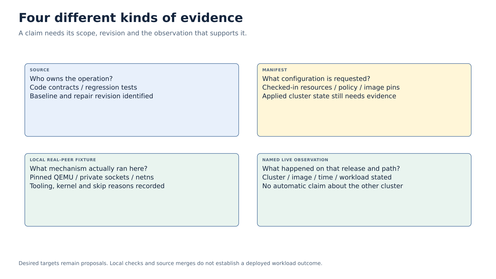
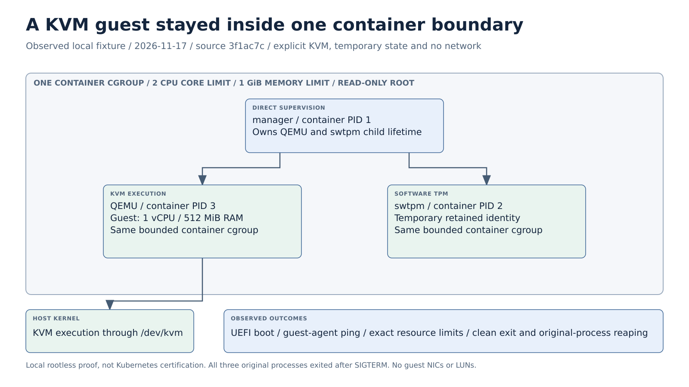

# What the presentation can prove

Use the strongest claim supported by the particular evidence collected. Code
review, a manifest and a real-peer fixture establish different things; adding
them together does not automatically establish a live workload outcome.



## Evidence gathered during this investigation

| Check | Actual scope | Useful presentation claim | Remaining limit |
| --- | --- | --- | --- |
| Default runtime check | Formatting, workspace tests, generated CRD/policy comparisons and strict Clippy | Repaired source passes the repository's normal local checks | No guest boot, cluster, ZFS/LIO or real Cilium datapath acceptance |
| Pinned QEMU image fixture | QEMU 11.1.3 qemu-img, benign local files, raw/standalone qcow2 and external dependency cases | The importer refuses extra image inputs before invoking QEMU | No production image publication or live import/export test |
| Real QMP smoke | Local pinned 11.1.3, machine none/TCG, private monitor sockets; compact/pretty and legacy/object monitor frontends | Generated schema/types and protocol behavior work against that real peer | No firmware, KVM, guest, disk, network or migration workload |
| Real QGA smoke | Local qemu-ga 11.1.3, private listener/temp files and explicit RPC allowlist | Sync, info/ping, a 2 MiB typed file read and allowed exec/status work against that peer | No in-guest agent rollout or application consistency proof |
| Real manager launcher | Current 11.1.3 PC build, TCG, pinned cached demo assets and temporary runtime | Actual guest boot marker, manager probes, SIGTERM/QMP shutdown and child reaping pass | No Kubernetes placement/cgroup admission or KVM proof |
| Real UEFI/vTPM lifecycle | Same local PC build, OVMF and swtpm 0.10.2, temporary retained state | Endorsement identity survives replacement; TPM death fails the VM; corrupt retained state is refused | No hardware TPM, Secure Boot enrollment, cluster state-PV or backup product proof |
| In-guest qrab agent | Direct-kernel demo with one explicit disposable ext4 fixture | Exactly one selected filesystem freezes/thaws, frozen update is refused, later fixed update hook succeeds | No multi-disk/application-consistent backup or arbitrary guest execution claim |
| Real two-manager migration | Pinned local image assets, current manager/test binaries, TCG, private fixture Workload APIs and no guest NICs | Guest resumes at target; source exits migrated; later target cold boot preserves the source TPM identity | No Cilium handoff, native guest LUNs, production SPIRE or cross-cluster/OpenStack migration |
| Local KVM/container containment | Disposable rootless container, explicit KVM, current manager binary and pinned image assets | Manager/QEMU/swtpm are direct parent/children in one constrained cgroup; guest boots and all original processes exit cleanly | No Kubernetes scheduling, device-plugin, namespace/tenant, Cilium/BGP or guest-LUN certification |
| Original socket-peer fixture | Private child process and Unix connection on a supporting local kernel | Peer authority does not become a replacement numeric process after exit | No live VM grant or node rollout |
| Kernel networking fixtures | Throwaway user/network namespaces, real TAP/FD transfer, routes, DHCP lease updates/bind failures and namespace replacement | The exercised local kernel mechanisms work in isolated fixtures | Dummy uplinks replace Cilium; the later T05 run also exercises WireGuard/NAT-PMP |
| Manager NIC fixture | Stand-in netd and QMP peers, actual manager reconciliation | Namespace token change causes ordered NIC-only detach/attach with the same MAC/root port | Guest hot-unplug and traffic continuity require their own acceptance |
| Private netd socket faults | Fragmented JSON, descriptor timing/count/truncation, malformed input, dribble and full listen queue | Frame bounds and descriptor cleanup are regression-tested without a node daemon | No production endpoint handoff or remote packet test |
| Limited native observation | netd host cgroup view, node kernel metadata and no-op status server dry-runs | The recorded prerequisites and API conditional-write semantics matched at that time | Not a fresh health audit or proof of every feature/image |
| OpenStack comparison baseline | The user's description plus primary upstream service documentation | The diagrams compare the supplied ownership model and general service duties | The other cluster's release, backend and workload behavior were not inspected |

The final combined runtime gate used `RUST_TEST_THREADS=4` on the busy local
host. The normal command and its assertions were unchanged. The audit records
the isolated timing rerun and the separately repaired provider setup.

Source/test links and upstream references are in [the evidence register](evidence.md).
The [audit](audit.md) identifies which repair each regression supports.

## Reproduce the explicit peer checks

The maintained [testing guide](../testing.md) supplies the full commands and
requirements. The essential protocol checks are:

```sh
QRAB_TEST_QEMU=/path/to/pinned/qemu-system-x86_64 \
  cargo test --locked -p qapi-protocol --test live_qemu -- --ignored --nocapture
QRAB_TEST_QGA=/path/to/pinned/qemu-ga \
  cargo test --locked -p qapi-protocol --test live_qga -- --ignored --nocapture
```

The binaries used here came from the locked local Gitea QEMU checkout,
canonical source preparation, verified dependency archives and the locked
local patch. Downloads were disabled during configuration. This audit did
not advance the QEMU source baseline.

### Explicit manager and guest checks

The maintained `pod_runtime`, `pod_uefi` and `pod_guest_agent` ignored tests
also ran against a local QEMU 11.1.3 build with PC devices, VNC and TPM enabled.
They used **TCG**, the default in those fixtures. Enabling KVM in a build is
not evidence that these tests exercised KVM.

Guest kernel/initramfs, boot disk and OVMF inputs were copied from the local
pinned manager image
`sha256:2f2ab6fad013a7c7635185668388603b50acbbcb657939c2295fe4dc0f6e79e9`
(source `490d988dda4e3cbbf91b5208cc8169aea8294afc`). The guest kernel was
`6.12.117+deb13-amd64`. No new image was built or published for these checks.
Input hashes and exact commands are in qrab towl under the architecture work.

The original guest-agent fixture passed while reporting zero frozen
filesystems, as the old guide allowed for a RAM-only demo. That result proved
the control/status path, rather than a real `FIFREEZE`. The strengthened test
formats only its private 64 MiB file on the host. An exact opt-in argument,
UUID, label, filesystem type and capacity guard a test-only guest mount before
agent startup. The test targets that mount and requires exactly one frozen
filesystem. It then verifies the frozen-operation gate, matching thaw count
and a successful fixed update hook. Ordinary guest disks are never formatted
by this fixture path.

The explicit local run replaced only the `init` record in the copied
initramfs with the checked source; the other 113 records and their metadata
were unchanged. It failed with the old zero-work fixture and passed with the
new mounted one. This is a stronger launcher/guest test, not a new application
backup guarantee. Reproduction requirements remain in
[the guest-agent guide](../guest-agent.md#tests).

The existing `pod_migration` fixture also passed in a disposable local
container using the pinned image's QEMU/guest/OVMF and current manager/test
binaries mounted read-only. It transferred a running guest between managers,
observed source completion and target guest-agent response, and deliberately
cold-booted the target afterward to verify the source endorsement identity
was persisted. Its service certificates came from private fixture Workload
APIs. The container had no external network and the VM had no guest NICs.
This tests the runtime state/identity transfer, rather than netd/Cilium route
handoff or backend storage fencing. One fixture's emitted downtime is not a
performance measurement or an SLA.

### Local KVM and container containment



A separate local fixture explicitly selected KVM. It ran the current manager
binary in a disposable rootless container with the pinned image's QEMU,
OVMF/swtpm and demo guest. The container had a read-only root, no external
network, no Linux capabilities, the caller's existing `/dev/kvm` access and
private temporary state. No cluster objects were created or changed.

The guest reported UEFI boot and its software-TPM endorsement identity, and
the manager's readiness and guest-agent ping succeeded. Host process records
showed manager as container PID 1 and QEMU/swtpm as its direct children, all
in the same container cgroup. The bounded resource API reported the imposed
two-core and 1 GiB container limits. These are limits in a small fixture,
rather than workload sizing or performance recommendations.

After SIGTERM the container exited with status zero. pidfds held before the
stop confirmed all three original processes had exited, avoiding a numeric
PID-reuse assumption. The owned container was removed afterward. The first
harness attempt queried the agent too early; the successful fresh-state run
used a bounded connection/ping wait. Manager readiness and guest-agent
connection remain separate observations.

This strengthens the source-derived process/cgroup comparison. A local
libpod cgroup is not a Kubernetes placement/device-plugin acceptance test,
and the VM had no guest NICs or native guest LUNs. The OpenStack side remains
the deployment model supplied by the user, rather than an inspected cluster.

The networking fixtures can run in throwaway user/network namespaces where
the kernel permits it. Read the emitted skip reasons: a test function that
returns early is not evidence that its privileged or optional path ran.
Earlier runs exercised four fixtures and skipped two VPN cases for missing
tooling. A later explicit run with temporary wireguard-tools 1.0.20260223
executed **all six** without skips: namespace selection/lifetime, TAP descriptor
transfer, forwarding routes, updated DHCP, WireGuard reachability/kill-switch
and tunnel-only NAT-PMP mapping. The provider and links were throwaway local
fixtures, not a real VPN subscription or Cilium/BGP path. Tool source/version
and checksums are recorded in qrab towl; no host tool installation or service
was required.

## Reject findings that fail the real contract

The audit initially suspected that `ingress: [{}]` in two CiliumNetworkPolicy
examples allowed all incoming traffic, by analogy with Kubernetes
NetworkPolicy. Tests of the exact examples through the local Cilium fork's
production policy repository denied unrelated ingress. Both examples were
preserved. Its auxiliary step-by-step simulator disagreed for those inputs,
so that simulator was not treated as the sole oracle.

This was a rejected finding, not a repaired production defect. The distinction
matters when replacing familiar OpenStack mechanisms: a similar field name
or diagram shape does not establish the same contract in another system.
Detailed source/reproduction notes are in qrab towl
`work/cilium-default-deny-ingress-policy`.

## Desired workload acceptance remains explicit

Before moving a real workload, prove its boot/firmware identity, required
management roles, network policy and route behavior, persistent disk recovery,
backup/restore and application consistency. Exercise the intended node-loss,
migration and deletion procedures using the chosen release/configuration.
Measure performance or cost before making a quantitative improvement claim.

Those are desired acceptance criteria. The local tests above make particular
implementation contracts reviewable; they do not turn unperformed acceptance
work into a completed result.
