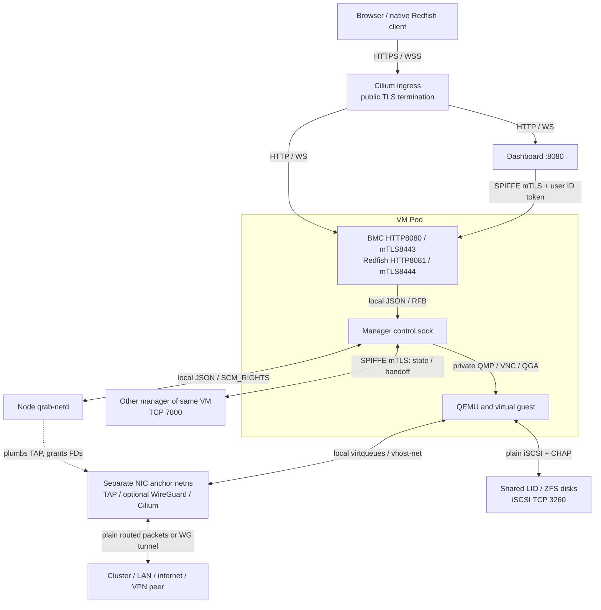

# Connection atlas

This is the connection inventory for the active qrab workspace, audited on
**2026-11-15 against `86a504d`** (including NAT-PMP port forwarding). It follows
the Rust source, generated QEMU arguments and checked-in Kubernetes manifests,
supplemented by
[dated read-only live configuration and external-source checks](connections/platform-evidence.md).
No packet captures were taken. Image digests in manifests can describe earlier
builds; source capability is not proof that a running image has it enabled.

**Subsequent source hardening:** netd conntrack peers (N9) now require node-bound
SPIFFE mTLS. The original platform snapshot predates this change; the
[separate node rollout and live handoff proof](connections/platform-evidence.md#netd-peer-mtls-rollout-2026-11-15-22022209-utc)
verify its subsequent deployment. Dashboard/BMC/Redfish management now has
container-scoped mTLS service identities (M6–M8), with
[separate rollout/live admission evidence](connections/platform-evidence.md#management-workload-mtls-rollout-2026-11-15-22562304-utc). See
[netd peer enrollment](networking.md#conntrack-peer-spiffe-enrollment).
Metrics, operator power reads and scoped Prometheus history now have
[workload mTLS](observability.md) (P6–P8/P15), with
[separate live rollout, migration and rotation evidence](connections/platform-evidence.md#observability-workload-mtls-rollout-2026-11-16).

Start here for endpoints, payloads and transport protection. Continue with:

- [Data paths and migration diagrams](connections/data-paths.md).
- [SPIFFE, SPIRE, OIDC and credential boundaries](connections/identity.md).
- [Capturing and correlating every class of stream](connections/capture.md).
- [Live platform evidence and external service contracts](connections/platform-evidence.md).

The scope includes VM, management, identity, storage, observability, node and
artifact flows. [Retired SVSM/attestation experiments](legacy.md) and old
passt/TCP NIC relays are historical, not additional active connections.
The maintained subsystem guides remain [networking](networking.md),
[migration](migration.md), [manager](manager.md), [protocol](protocol.md),
[BMC](bmc.md), [Redfish](redfish.md), [dashboard](dashboard.md),
[iSCSI](iscsi.md) and [guest agent](guest-agent.md).

## Reading the security status

**TLS** means encryption on the named connection, ending at the named TLS
endpoint. **mTLS** also authenticates the client certificate. **Plain** means
qrab adds no encryption to that hop. **Local** means a Unix socket, pipe,
shared memory, device or file; it is still unencrypted unless stated otherwise.
**External** means the relevant infrastructure configuration is outside this
repository and must be checked there.

OIDC JWT signatures, CHAP, Unix peer credentials, Kubernetes RBAC, Cilium
security groups and BGP routes are different controls. None makes a plain
connection encrypted. Independently configured Cilium WireGuard/IPsec or a host
tunnel could encrypt some physical links, but must be verified separately. The
[observed Cilium deployment](connections/platform-evidence.md#cilium-does-not-supply-encryption-here)
reported encryption disabled on all three nodes and mesh authentication disabled.
Do not infer encryption from Cilium being present or from a SPIFFE socket mount.

The application-level encrypted paths implemented in source are manager-to-manager migration
(TLS 1.3 mTLS), operator-to-exchange-shim (SPIFFE mTLS), operator-to-storage-ingress
(TLS 1.3 plus bearer), OIDC/Kanidm/Proton HTTPS, HTTPS event delivery, public
ingress TLS, netd conntrack peer TLS 1.3 mTLS, dashboard-to-VM and BMC-to-Redfish
workload mTLS, observability workload mTLS, and a VPN NIC's WireGuard outer tunnel. The operator enables the
management workload listeners; standalone mode must configure them explicitly. The other paths below
are either plain, local, or externally controlled.

The [ingress transport implementation](ingress.md) adds exact-URI SPIRE mTLS
for M2/M4/M5 and local exec probes for P11. Its Envoy enrollment, image rollout
and live verification are a separate pending deployment from the snapshots above.

## System map

Arrows show logical payload direction; most connections also carry replies.
The target manager initiates the migration connection even though bulk VM state
travels source to target. Node, CSI and identity services are shared platform
dependencies, not processes inside the guest.

Shared Kubernetes, SPIRE, OIDC, provisioning and monitoring dependencies are
expanded in the inventory and focused diagrams. The anchor has its **own**
network namespace and Cilium identity. It is not a
guest-facing listener in the VM Pod. Guest iSCSI is a QEMU backend on the VM
Pod's network, not a guest NIC flow. See the more focused diagrams below before
choosing a capture point.

## Management and console connections

`M` identifiers are stable references for the capture guide. Ports are defaults
or operator-rendered values; separate Pods can reuse a port for unrelated APIs.

| ID | Initiator → endpoint | Payload / protocol | Encryption and authentication |
| --- | --- | --- | --- |
| M1 | Browser → `vms.yapplesauce.com:443` ingress | Dashboard HTML/forms/assets, VM-scoped JSON, Redfish bridge, SSE and console WebSocket | TLS/WSS ends at ingress; application cookie and Origin/CSRF checks at dashboard. HTTP redirects to HTTPS. |
| M2 | Ingress → dashboard Pod `:8445` | Proxied HTTP requests and upgraded WS | **Source: SPIRE-issued TLS 1.3 mTLS**, exact dashboard URI, client ingress SVID; deployed migration from HTTP8080 pending the separate ingress rollout. Ordinary HTTP is loopback health-only in workload mode. |
| M3 | Browser → `qrab-demo.yapplesauce.com:443` ingress | Standalone per-VM BMC UI, OIDC callbacks, WS, browser `/bmc/redfish/*` | TLS/WSS ends at ingress. Example host routes to `qrab-redfish-poc`. New dashboard-launched VMs normally need no per-VM ingress. |
| M4 | Ingress → VM Pod BMC `:8443` | HTTP/WS for all routes except native `/redfish` | **Source: SPIRE-issued TLS 1.3 mTLS**, exact per-VM BMC URI and ingress client SVID, followed by normal user authentication. Separate rollout pending. |
| M5 | Native client → HTTPS ingress `/redfish` → VM Pod Redfish `:8444` | Redfish JSON/OData, actions, sessions, SSE | **Source: frontend HTTPS plus backend SPIRE-issued TLS 1.3 mTLS**, direct to Redfish with exact immutable VM UID. User credentials still required. Separate rollout pending. |
| M6 | Dashboard → selected VM Pod `:8444` | HTTPS Redfish reads, actions and VM-scoped browser bridge/SSE | **SPIFFE TLS 1.3 mTLS**, exact `/vm/<VM-UID>/redfish` service ID derived from trusted VM namespace/UID and controlled Pod IP. User ID-token bearer and roles remain separately verified. No HTTP fallback. |
| M7 | Dashboard → selected VM Pod `:8443/api/console` | `wss://` binary RFB stream; optional audio inside RFB | **SPIFFE TLS 1.3 mTLS**, exact `/vm/<VM-UID>/bmc` ID plus user bearer on upgrade, no browser cookie upstream. BMC separately checks admin access. No WS/HTTP fallback. |
| M8 | BMC → `https://127.0.0.1:8444/redfish/*` | Browser bridge strips `/bmc`, forwards JSON/SSE | **SPIFFE TLS 1.3 mTLS**: Redfish accepts this VM's BMC service ID; BMC verifies its own VM's Redfish ID. Session becomes stored ID-token bearer; explicit credentials remain explicit. Standalone legacy mode permits plain HTTP only to a literal loopback IP. |
| M9 | BMC / Redfish → `/run/qrab-control/manager/control.sock` | Newline JSON v1 request/reply, `follow` event stream; `console` switches to raw RFB after acknowledgement | **Local**, manager-created 0700 directory, 0600 socket and same-UID peer check. This grants management authority; sidecars enforce user roles before calling it. |
| M10 | Manager → private session `qmp.sock` | QMP greeting/capabilities, commands, replies and asynchronous events; SCM_RIGHTS for hotplug | **Local**, private 0700 session directory. No QMP TLS, password, OIDC or SPIFFE at this boundary. Manager is the production QMP owner. |
| M11 | Manager → private session `vnc.sock` | RFB framebuffer, keys, pointer, clipboard protocol and optional output audio | **Local** Unix VNC; RFB security type None. Protection is the private runtime directory and authenticated BMC/dashboard chain. No VNC TCP listener. |
| M12 | Manager → private session `qga.sock` → QEMU virtio-serial → guest agent | QGA sync nonce, JSON commands/replies, inventory, freeze/thaw, fixed update hook, boot/EFI operations | **Local** host socket plus virtual serial device, no protocol encryption or bearer. The guest daemon's fixed allowlist and host access boundary authorize operations. No guest network is required. |
| M13 | Dashboard / same-VM BMC → Redfish workload `:8444`; dashboard → BMC workload `:8443` | Existing app routers over workload TLS | **SPIFFE TLS 1.3 mTLS**, enabled by the updated operator with distinct container-scoped SVIDs and CSI socket mounts. Exact peer IDs **plus** normal app authorization. Standalone listeners remain opt-in. Ordinary ingress HTTP is separate and still tracked for protection; observability uses P6–P8. |

Source: [ingress and Service routing](../contrib/kubernetes/redfish-poc/console.yaml),
[dashboard ingress](../contrib/kubernetes/dashboard/ingress.yaml),
[dashboard Redfish client](../projects/dashboard/src/redfish.rs),
[console client](../projects/dashboard/src/bmc.rs),
[dashboard bridge](../projects/dashboard/src/bmc_page.rs),
[BMC routes](../projects/bmc/src/lib.rs),
[BMC proxy](../projects/bmc/src/proxy.rs),
[console admission/filter](../projects/bmc/src/console.rs),
[manager socket](../projects/manager/src/pod/socket.rs),
[QEMU arguments](../projects/manager/src/pod/config.rs) and
[optional Redfish TLS listener](../projects/redfish/src/workload.rs).

### What “QAPI access” means

`qapi`, `qapi-macros` and `qapi-codegen` define, serialize or generate protocol
types; they are **not network services**. `qapi-protocol` is the async client
transport used for QMP and QGA, over Unix sockets or supplied Unix streams.
QMP JSON uses `execute`/`arguments`/`id`, replies use `return` or `error`, and
events arrive independently. The initial QMP handshake negotiates capabilities;
QGA uses `guest-sync-delimited` with `0xFF` and a random nonce to align its stream.
These are protocol handshakes, not peer authentication or encryption.

Redfish and the manager control API expose a bounded set of operations. The
BMC exposes session, console and browser Redfish bridge routes; it is not a
general HTTP QAPI/QMP gateway. `execute_raw` is a Rust protocol-client facility,
not a remote unauthenticated endpoint. QMP `getfd` sends a kernel descriptor
with SCM_RIGHTS, not the packets carried by that descriptor.

See [protocol.md](protocol.md) and the clients in
[qapi-protocol](../projects/qapi-protocol/src/lib.rs). A custom standalone caller
can use this library directly; possession of the private socket then constitutes
management access. Mock servers and test socketpairs are not deployed listeners.

## Guest network and migration connections

| ID | Initiator / endpoints | Payload / protocol | Encryption and authentication |
| --- | --- | --- | --- |
| N1 | Manager → `/run/qrab-netd/netd.sock` | Bounded JSON request/reply: queues, anchor probe, handoff state, forwarding, conntrack pull result; TAP/vhost queue FDs with SCM_RIGHTS | **Local** Unix. Socket mode 0666; authorization is `SO_PEERCRED` PID → cgroup → Pod UID → watched VM ownership/NIC on this node. CDI mounts directory read-only; read-only does not prevent connecting. |
| N2 | Guest virtio-net ↔ kernel vhost-net ↔ TAP `qt<12 hex>` in NIC anchor | Ethernet frames via guest virtqueues and kernel descriptors handed to QEMU | **Local**, no added encryption. qrab-netd opens `/dev/net/tun` and `/dev/vhost-net`; manager/anchor do not. No userspace TCP NIC relay and no per-packet forwarding through netd's control socket. |
| N3 | Plain NIC TAP ↔ anchor routing/`eth0` ↔ Cilium ↔ other Pods/nodes/LAN/internet | Guest IPv4, TCP/UDP/ICMP and application protocols; stable /32 and security-group Cilium identity | **Plain at qrab layer**. Guest app TLS, if any, remains encrypted through TAP. Cilium policy and anti-spoof checks are packet authorization, not SPIFFE. Outside-host NAT/routing is external. |
| N4 | Guest ↔ `169.254.1.1` in anchor | Gateway ARP/ICMP; DHCP UDP client 68/server 67; plain NIC DNS UDP/TCP 53 redirected to anchor resolver | **Plain**, DHCP responder binds TAP and serves the configured guest MAC/address. VPN NIC DHCP supplies tunnel address/DNS/MTU instead. |
| N5 | VPN NIC TAP ↔ anchor `wg0` ↔ configured IPv4 VPN peer | Inner guest packets; outer WireGuard UDP from anchor `:51820`, provider port from config (Proton 51820) | **Encrypted only from anchor WireGuard to VPN peer**. Static WireGuard peer keys, optional PSK; no SPIFFE/OIDC on data channel. TAP and `wg0` show inner traffic; anchor `eth0` shows encrypted outer UDP. |
| N6 | Target manager → source manager Pod `:7800` | Hello/offer/ready JSON, then bidirectional QEMU migration byte stream, bulk state source → target | **SPIFFE TLS 1.3 mTLS** between managers; exact same per-VM SVID. Local QEMU ends are unencrypted Unix sockets. Standing deny guard plus temporary source/target policy restrict network reachability. |
| N7 | Target manager → source manager `:7800`, second connection for TAP handoff | JSON `channel: switchover`, activate/activated/abort/failure, delta conntrack request/result count | Same **SPIFFE mTLS** as N6, separate TCP connection. No raw conntrack entries in managers. Migration UID selects the waiting handoff slot. |
| N8 | Source QEMU → source manager `migrate-out.sock`; target manager → target QEMU `migrate-in.sock` | QEMU migration stream including RAM, device, swtpm state blobs and pflash RAM | **Local**, private session directories. Managers wrap/unwrap TLS for N6. Shared iSCSI disk blocks are not sent in this stream. |
| N9 | Target node netd → source node netd host `:7911` | One JSON line each way: NIC address request, hex-encoded Cilium conntrack map records and clock/truncation metadata | **SPIFFE TLS 1.3 mTLS**, exact per-node URI `/kubernetes/qrab-node/qrab-netd/<node>` resolved from current anchor host-IP/node metadata. Source retains on-link and same-VM/same-NIC authorization. Missing/mismatched SVID or ambiguous node mapping refuses exchange; no plaintext fallback. Enrollment/release required. |
| N10 | netd → `/var/run/cilium/cilium.sock` | HTTP/1.1 `PATCH /v1/endpoint/cep-name:.../handoff` with prepare/active/standby | **Local**, root/hostPath access; no TLS or user bearer. netd also uses local bpftool/BPF map access to export/import conntrack. |
| N11 | Node FRR ↔ BGP neighbors | TCP 179 route advertisements/withdrawals for guest /32s | **External configuration**. Operator writes `FRRConfiguration` via Kubernetes; it does not speak BGP. No BGP TLS or message-authentication guarantee is established here. BGP carries routes, not guest payloads. |
| N12 | Old node → new node during handoff | Temporarily routed guest packets over a host /32 forward route | **Plain at qrab layer**, separate from N6 migration TLS. Route installation is restricted to the caller's NIC /32 and an on-link next hop; withdrawn after the grace period. |
| N13 | netd renewal thread inside VPN anchor netns → tunnel gateway UDP `:5351` | NAT-PMP UDP/TCP mapping requests/replies, 60s leases, renewed every 40s (10s after failure); enabled by `# qrab: port-forwarding` | **Plain NAT-PMP inside the encrypted WireGuard tunnel**, no separate OIDC/SPIFFE/application credential. Local source `169.254.1.1:<ephemeral>` is SNATed to the guest's inner tunnel address only for gateway:5351 out `wg0`; replies return to netd via conntrack, not guest TAP. |

Source: [TAP launch](../projects/manager/src/pod/tap.rs),
[hot-attach](../projects/manager/src/pod/nics.rs),
[netd grant/authentication](../projects/qrab-netd/src/main.rs),
[netd authorization](../projects/qrab-netd/src/authz.rs),
[wire format and SCM_RIGHTS](../projects/qrab-netd/src/wire.rs),
[kernel plumbing](../projects/qrab-netd/src/sys.rs),
[VPN config/kill switch](../projects/qrab-netd/src/vpn.rs),
[NAT-PMP mapping](../projects/qrab-netd/src/natpmp.rs),
[migration transport](../projects/manager/src/pod/migration.rs),
[migration policies](../projects/operator/src/migration.rs),
[conntrack authorization](../projects/qrab-netd/src/peer.rs),
[conntrack mTLS](../projects/qrab-netd/src/peer_tls.rs),
[conntrack records](../projects/qrab-netd/src/ct.rs) and
[address/route controller](../projects/operator/src/address.rs).

NIC policies are per anchor, while the BMC/Redfish policies select
`component: vm`. An anchor with no enforcing policy is default-allow; the
operator does not create a default-deny guest security group. VPN groups govern
the **outer UDP tunnel**, not decrypted inner destinations. A VM with several
NICs can still use a plain NIC: a VPN NIC does not encrypt every VM connection.

## Storage, firmware and local device connections

| ID | Initiator → endpoint | Payload / protocol | Encryption and authentication |
| --- | --- | --- | --- |
| S1 | Operator → exchange shim `https://10.203.0.10:8444/exchange` | Policy `qrab-vm-disk-operator`; fresh short-lived bearer returned per storage RPC | **SPIFFE mTLS** with exact server ID `spiffe://yapplesauce.com/kanidm/exchange-shim`; HTTP/1.1. Operator identity is the authenticated workload, not a user login. |
| S2 | Operator → storage ingress `https://10.203.0.1:9477/v1/execute` | JSON request ID, fixed `vm-disk-*` verb; export also carries CHAP secret in request body | **TLS 1.3 server authentication**, pinned public host CA, **no client certificate**. Delegated Kanidm bearer supplies subject/actor/scope authority. |
| S3 | Storage ingress → root towl storage daemon → `qrab-iscsi-target` | External ingress/backend channel, then fixed executable argv, JSON/credential stdin, bounded output; configfs LIO/ZFS administration | External shim source fixes backend to **plain loopback HTTP `127.0.0.1:9476`**. Daemon forwards credentials on **local** wrapper stdin; local kernel/filesystem operations add no encryption. Host deployment/binary equivalence was not verified; see [external evidence](connections/platform-evidence.md#storage-ingress-and-exchange-shim-s1s3-a1). |
| S4 | QEMU libiscsi → LIO portal, normally `10.203.0.1:3260` | SCSI block reads/writes, login, capacity and flushes over TCP | **Plain iSCSI**, exact initiator IQN ACL and CHAP login. CHAP does not encrypt disk data or authenticate a SPIFFE workload; no iSCSI TLS/IPsec is configured by qrab. Target and source may both log in during migration. |
| S5 | Operator → Kubernetes Secret → kubelet → manager mount → QEMU secret object | CHAP password; nonsecret endpoint binding travels separately in config | API leg uses Kubernetes TLS/RBAC. Mounted password file is **local plaintext** at `/run/qrab-auth/<id>/password` (0440); QEMU loads it by file, not URL/argv value. No at-rest encryption guarantee follows from Secret base64. |
| S6 | QEMU ↔ retained `/var/lib/qrab/identity/OVMF_VARS.fd`; swtpm ↔ its state directory | EFI variable writes, TPM persistent state, VM UID/disk bindings and locks | **Local file I/O**, retained filesystem PVC, exclusive manager state lease. CSI backend transport and volume encryption are **external**; file permissions/retention are not encryption. |
| S7 | Guest TPM device ↔ QEMU ↔ swtpm `swtpm.sock` | TPM 2 commands; emulator control and state transfer | **Local virtual device/Unix socket**, socket and state files 0600 in private directories. No TPM TCP listener or SPIFFE identity on this hop. Software TPM trust includes node/QEMU/state-volume administrators. |
| S8 | QEMU ← bundled boot ESP/kernel/initramfs, local disk, NoCloud seed | Local block/file reads; cloud-init user/meta/network data in read-only seed medium | **Local**, no metadata HTTP service. Seed contents and VM config can contain user data; Secure Boot signatures provide boot integrity, not transport or storage confidentiality. |
| S9 | QEMU ← media/catalog mount; manager ↔ staged firmware/policy files; guest agent ↔ EFI variables | Approved local ISO reads, firmware CODE selection, signed AUTH2 updates via M12 | **Local** read-only catalog/media mounts and retained identity-bound records. No user-provided image URL fetch. Signed firmware/EFI updates authenticate content; they do not encrypt these streams. |
| S10 | `qrab-iscsi-target` → local raw file/ZFS zvol; `zfs send` → `zfs receive` | Administrative image import, hash check, sealing, clone/publication and retained disk data | **Local** file/pipe/kernel I/O. The publication pipe is not a remote replication channel. Encryption at rest requires checking the actual ZFS/CSI/guest disk settings outside this connection audit. |

Source: [operator storage client](../projects/operator/src/storage.rs),
[storage-client deployment](../contrib/kubernetes/operator/storage-api/deployment.patch.yaml),
[QEMU iSCSI arguments](../projects/manager/src/pod/iscsi.rs),
[target host operations](../projects/iscsi-target/src/host.rs),
[target CLI](../projects/iscsi-target/src/main.rs),
[TPM launcher](../projects/manager/src/pod/tpm.rs),
[persistent identity](../projects/manager/src/pod/persistent.rs),
[seed medium](../projects/manager/src/pod/seed.rs),
[media policy](../projects/manager/src/pod/media.rs) and
[firmware staging](../projects/manager/src/pod/firmware.rs).

## Identity and provider connections

The [identity guide](connections/identity.md) describes the trust and credential
sequence for each of these connections, including what is not enrolled.

| ID | Initiator → endpoint | Payload / protocol | Encryption and authentication |
| --- | --- | --- | --- |
| I1 | Browser ↔ Kanidm `https://idm.yaple.net` | Interactive login, authorization redirect, state, nonce, S256 PKCE challenge and callback code | **HTTPS**, Kanidm user authentication; callback code returns through M1 or M3, not a direct browser-to-Pod connection. |
| I2 | BMC/dashboard → issuer discovery, JWKS and token endpoint | Provider metadata, public keys, code + PKCE verifier, signed ID token and access-token response | **HTTPS**, CA server verification, redirects disabled. BMC is a public PKCE client; dashboard additionally uses `client_secret_basic` from a Secret file. |
| I3 | BMC/Redfish → configured bearer issuer discovery/JWKS | Public signing keys for per-request user ID-token verification | **HTTPS**, CA server verification. No per-request token introspection: signature/issuer/audience/expiry are checked locally, with bounded key refresh. |
| I4 | Dashboard → Kanidm `/v1/group/...` | Per-VM group creation, UUID lookup, membership/nesting and rollback | **HTTPS**, separate group-administration service-account bearer from file. This is not the user's ID token and not a SPIFFE token exchange. |
| I5 | Manager/operator; optionally Redfish → `unix:/run/spire/agent.sock` | SPIFFE Workload API gRPC stream: X509-SVID certificate/private key and trust-bundle updates | **Local**, CSI-mounted Unix socket and SPIRE workload attestation. Socket access alone does not grant every SVID. `qrab-spiffe` continuously uses the rotating source. |
| I6 | Platform SPIRE agents/controller ↔ SPIRE server / Kubernetes | Node/workload registration, attestation, SVID issuance/renewal, trust bundles | External deployment: controller uses Kubernetes HTTPS/ServiceAccount plus local server admin socket; CSI exposes local Unix sockets. Native agent→server attestation/renewal remains separately configured. Existing node TPM identity is different from guest identity; see [platform evidence](connections/platform-evidence.md#spire-controller-and-csi-local-socket-paths-i5i6). |
| I7 | Workstation `qrab-proton login/logout` → `https://vpn-api.proton.me:443` | Proton SRP proofs, optional TOTP, session tokens; human challenge may open `https://verify.proton.me` | **HTTPS**, Proton server trust plus verified SRP server proof and Proton-signed modulus. No Kanidm OIDC or SPIFFE here. Password/TOTP stay on workstation/API path. |
| I8 | Proton broker → same Proton API | Refresh rotation, VPN plan/catalog/loads, Ed25519 public-key certificate requests | **HTTPS**, Proton bearer and `x-pm-uid`. Session UID/refresh token and profile keys live in separately confined Kubernetes Secrets. Broker accepts no inbound service connections. |
| I9 | Broker → Kubernetes → VPN Secret → anchor mount → netd → `wg syncconf` | `vpn-<profile>/wg.conf` with X25519 key and selected peer; public catalog in `proton-catalog` | API legs use Kubernetes TLS/RBAC/admission. Anchor's root-only 0400 mount and netd's stdin pipe are **local plaintext**. Private key is not delivered to manager/guest or on `wg` argv. |
| I10 | Cilium Envoy → node SPIRE agent SDS Unix socket | Streaming Secret discovery: ingress SVID/private key and local bundle | **Local**, container-attested CSI socket. Private key delivered directly to Envoy memory. Exact image/Pod/UID registration; fixed bootstrap cluster, standard X509 local-bundle verification plus URI pinning; separate ingress rollout pending. |

Source: [BMC OIDC](../projects/bmc/src/auth.rs),
[dashboard OIDC](../projects/dashboard/src/auth.rs),
[shared bearer verifier](../projects/oidc-bearer/src/lib.rs),
[Kanidm group client](../projects/dashboard/src/kanidm.rs),
[SPIFFE helper](../projects/qrab-spiffe/src/lib.rs),
[operator SVID registration example](../contrib/kubernetes/operator/storage-api/clusterspiffeid.yaml),
[Proton API](../projects/proton/src/api.rs),
[workstation login](../projects/proton/src/login.rs),
[broker Kubernetes runner](../projects/proton/src/broker/runner.rs) and
[VPN anchor rendering](../projects/operator/src/nic.rs).

## Platform control and observability connections

| ID | Initiator → endpoint | Payload / protocol | Encryption and authentication |
| --- | --- | --- | --- |
| P1 | Operator → Kubernetes API | List/watch VM/Pod/ConfigMap/migration resources, CRUD/status/finalizers, PVCs, policies, pool/route and credential writes | In-cluster **HTTPS** using cluster CA and `qrab/qrab-operator` ServiceAccount. RBAC/admission further constrain writes. No user OIDC token is forwarded to Kubernetes. API port comes from client config, normally Service 443/backend 6443. |
| P2 | Dashboard → Kubernetes API and aggregated `metrics.k8s.io` | VM visibility data, Pod addresses, usage, base-image catalog, PVC/VM launch, deletion and limited running-state patch | **HTTPS** using dashboard ServiceAccount, then app role/creator checks plus admission policy. This is server-side access, not a browser Kubernetes credential. |
| P3 | netd → Kubernetes API | Node-local labelled Pod watch, cross-node anchor lookup for conntrack authorization, `nic-plumbed` and `vpn-port-forward` status conditions | **HTTPS** with explicit rotating projected Pod-bound token of `qrab-node/qrab-netd`. Admission confines these two condition writes to own node's anchors. |
| P4 | Proton broker / workstation login → Kubernetes API | `VpnProfile` and status, session/key/profile Secrets, catalog ConfigMap; broker lists NIC anchors and projects attachment/forwarded-port status | **HTTPS** using broker ServiceAccount or workstation kubeconfig. Broker Secret writes are confined by admission. Optional login `--print` emits a credential-bearing manifest locally instead. |
| P5 | Operator → API → kubelet projection → manager | VM ConfigMap updates and downward-API annotations for desired CPU/RAM, disk capacity; NIC config reconciled from projected config | API leg **TLS**; Pod file projection and manager polling **local**. No operator-to-manager TCP control API. QMP performs live growth/hotplug after projection. |
| P6 | Prometheus → Pod-local qrab adapter → VM Pod `:9181/metrics` | Counters/gauges: power, health, resource, block, guest NIC and event-drop data | **SPIFFE TLS 1.3 mTLS** on the VM hop. Exact per-VM Redfish SVID plus current API-owned Pod/IP binding; Redfish admits the exact telemetry SVID. The initial HTTP19993 leg is **local loopback** in the Prometheus Pod. Network policy remains additional confinement. |
| P7 | Operator → VM Pod `:9181/metrics` | Read-only current power-state gauge | **SPIFFE TLS 1.3 mTLS**, exact Redfish identity from controlled namespace/VM UID. Redfish admits the exact operator identity. No user login/token or plaintext fallback. |
| P8 | Redfish → `qrab-prometheus-history.monitoring.svc:9091` → Pod-local Prometheus 9090 | Fixed PromQL history templates scoped to own namespace/Pod, JSON results | **SPIFFE TLS 1.3 mTLS** on the network hop; exact telemetry server SVID, current exact VM client SVID and request-time certificate expiry. Gateway validates every template against that VM’s API-owned Pods. The last query_range HTTP leg is **local loopback**. VM egress to raw9090 is denied. |
| P9 | Client/browser → Redfish SSE over M5/M6/M8/M13 | Event records, telemetry and gap/drop notices, `Last-Event-ID` cursor | Inherits **each hop's** transport above, not a separate encrypted tunnel. Viewer/admin data redaction and credential expiry apply; streams are bounded histories, not complete packet or lifecycle journals. |
| P10 | Redfish → exact operator-allowed HTTPS event receiver | Push `Event.v1_10_0` JSON; context and redacted event data, retries/checkpoints | **HTTPS server authentication**, no client certificate, bearer or custom HTTP headers. Creator token is not sent/stored for delivery. Disabled without destinations; operator allows receiver port 443. |
| P11 | Kubelet → local exec → operator/dashboard/BMC/Redfish loopback health | Fixed GET `/healthz` or `/readyz` inside the container network namespace | **Source: local exec + literal loopback**, no network plaintext probe. Two-second total budget; workload mode hides all app routes on the ordinary listener. Manager retains its existing exec/file probes. Separate rollout pending. |
| P12 | KVM plugin → kubelet `kubelet.sock`; kubelet → `qrab-kvm.sock` | Device-plugin gRPC registration, ListAndWatch, Allocate; writes CDI JSON | **Local Unix gRPC**, root-owned host directories, no TLS/OIDC/SPIFFE. CDI gives requested container `/dev/kvm` and netd mount. QEMU then uses local KVM ioctl/mmap for VM/vCPU execution (TCG stays in process); no encrypted CPU/RAM boundary is promised. VM Pod has no API token. |
| P13 | Guest → QEMU serial → manager → container stdout; service logs → stderr | Serial text, bounded tail, structured lifecycle/identity/admission/error logs; later admin serial/diagnostic API reads | **Local** virtual serial/pipes/log files; cluster log collector transport/storage is **external**. Serial is separate from the graphical VNC console and may contain guest secrets. |
| P14 | Pod / guest resolver → cluster or VPN DNS | UDP/TCP 53 queries/replies used by OIDC/provider/event/Prometheus clients and guests | **Plain DNS** at these interfaces unless guest app uses its own encrypted resolver. VPN-provided DNS travels inside N5; ordinary Pod DNS does not become encrypted because the final request uses HTTPS. |

| P15 | qrab observability adapter → Kubernetes API | Read-only current VM UIDs and owned Pod/IP inventory | **HTTPS** using a rotating projected Pod-bound token of the existing monitoring Prometheus ServiceAccount. Namespaced RBAC grants only VM/Pod reads; discovery authority expires after 15s without a successful refresh. |

Source: [operator controller startup](../projects/operator/src/main.rs),
[dashboard Kubernetes client](../projects/dashboard/src/cluster.rs),
[netd RBAC/token projection](../contrib/kubernetes/netd/daemonset.yaml),
[netd write confinement](../contrib/kubernetes/netd/rbac.yaml),
[operator Pod/policy rendering](../projects/operator/src/resources.rs),
[operator power reader](../projects/operator/src/power.rs),
[PodMonitor](../contrib/kubernetes/monitoring/podmonitor.yaml),
[Prometheus history client](../projects/redfish/src/history.rs),
[push delivery](../projects/redfish/src/subscriptions.rs),
[KVM plugin](../projects/kvm-device-plugin/src/lib.rs),
[serial mirror](../projects/manager/src/pod/serial.rs) and
[dashboard network policy](../contrib/kubernetes/dashboard/network-policy.yaml).

### In-process and file-based control

In embedded `qrab-bmc --config` mode, BMC calls `manager::pod::Control` in the
same process instead of M9 Unix request transport. Bounded Tokio request,
oneshot and watch channels carry control, results, status and events in memory;
these are local shared-process authority, without TLS or a separate peer login.
Sidecar mode uses `Remote` with pooled Unix requests and a separate `follow`
connection. Manager also publishes `status.json` atomically, reads projected
limits/config and proc/cgroup resource files, and owns filesystem locks and
child-process signal/wait paths. These local reads/writes and SIGTERM/SIGKILL
lifecycle notifications have no packet stream and no independent cryptographic
protection. Their access boundary is process/UID/container/volume ownership.

## Images, enrollment and administrative artifact streams

These are lifecycle connections, not connections opened by a guest at boot.
They still move executable content or credentials and belong in a full inventory.

| ID | Initiator → endpoint | Data and protection |
| --- | --- | --- |
| A1 | Kubelet/container runtime → delegated image-pull identity services → Zot registry | Pod/ServiceAccount-bound pull authorization and OCI manifests/layers for digest-pinned images. Workload Pods need no registry password mount. Provider→shim SPIFFE mTLS, shim→Kubernetes TokenReview HTTPS and shim→Kanidm HTTPS are defined by [external source](connections/platform-evidence.md#storage-ingress-and-exchange-shim-s1s3-a1). Exact deployed policies/backend TLS still require platform evidence; `imagePullPolicy: Always` alone proves none of this. |
| A2 | Release workstation → `towl tokens mint --audience zot` → Podman registry login/push/pull | Fresh scoped credential on stdin; registry HTTPS carries OCI images/manifests. `publish.sh` checks source revision and immutable digest; `images.lock.json` records pins. This session did not build, publish or roll out images. |
| A3 | Image build stages → Debian APT HTTPS mirrors (signed package indices and build/runtime dependencies) | **Source: HTTPS** sources and certificate/hostname verification, with redirects disabled. Bootstrap CA store copied from immutable Rust image before the first fetch; APT signatures remain enabled. Updated images are built/published separately. |
| A4 | Admin staging tool → HTTPS OS image URL (HTTPS redirects), then local raw conversion/import and Kubernetes catalog | Upstream checksum then raw SHA-256 rechecked by root import. `qrab-base-images` holds metadata; dashboard does not download its `source_url`. Media/firmware are pre-provisioned catalog mounts, not remote Redfish upload/download streams. |
| A5 | Administrator `kubectl` → API → kubelet/CRI exec/log/port-forward | Kubernetes control/debug connection can reach processes, logs and private files when authorized. Client transport uses kubeconfig TLS/auth; API-to-node/CRI legs are **external**. Port-forward can expose an otherwise private listener and changes the observer's access boundary; it does not change that listener's application authentication. |

Build recipes invoke `apt-get`, Cargo and (for the guest agent) `rustup`; their
registry/mirror endpoints follow the base image and tool configuration. The
recipes do not force every package fetch onto HTTPS. An APT repository signature
or Cargo checksum verifies content and does not prove confidentiality; inspect
effective APT/Cargo/rustup configuration when capturing a build. noVNC assets
are copied from the repository at build time and served locally at runtime.

Source: [deployment ownership](../contrib/kubernetes/README.md),
[image publication](../contrib/images/publish.sh),
[image lock](../contrib/images/images.lock.json),
[QEMU source preparation](../contrib/images/prepare-source.py),
[manager image recipe](../contrib/images/Containerfile.manager),
[base-image staging](../contrib/images/stage-base-image.sh) and
[base-image catalog validation](../projects/dashboard/src/images.rs).

## Coverage limits and maintenance

This inventory accounts for every runtime crate in the workspace: operator,
manager, BMC, Redfish, dashboard, netd, Proton, guest agent, KVM plugin,
iscsi-target, qrab-spiffe, oidc-bearer and the QAPI/protocol/generation crates.
The guest's arbitrary applications add their own destinations/protocols; they
cannot be enumerated from the operator source. QGA update hooks are fixed local
executables; a custom image's hook can add network streams whose policy and
transport must be documented with that image. The bundled hook only reports.

Not implemented as additional active services here: guest SPIRE enrollment,
IPMI, a general HTTP QAPI proxy, browser USB device redirection, guest microphone,
SPICE, or a cloud metadata HTTP listener. NAT-PMP lease control is implemented
as N13, separately from the Proton HTTPS certificate feature request. See
[BMC feature limits](bmc.md#admin-bucket) and [guest identity foundation](spire-vm.md).

The [platform appendix](connections/platform-evidence.md) checks the external
storage loopback, shim exchange/pull validation and CSI/controller contracts,
and records live Cilium/SPIRE/Pod observations. Remaining unknowns include
IdP/registry internal backends, native SPIRE agent-server and host-listener
configuration, API-server-to-node traffic, BGP authentication, log shipping and
encryption at rest. These are explicit boundaries, not implicit “encrypted”
entries. Their owning configurations must be inspected before making an
end-to-end assurance claim.

When a connection changes, update its inventory row, relevant sequence/data-path
diagram and [capture mapping](connections/capture.md) together. Record the source
revision and whether the evidence is source, manifest, live configuration or an
actual capture. Keep follow-up bugs and operational evidence in the `qrab`
project in towl, separately from documentation changes.
