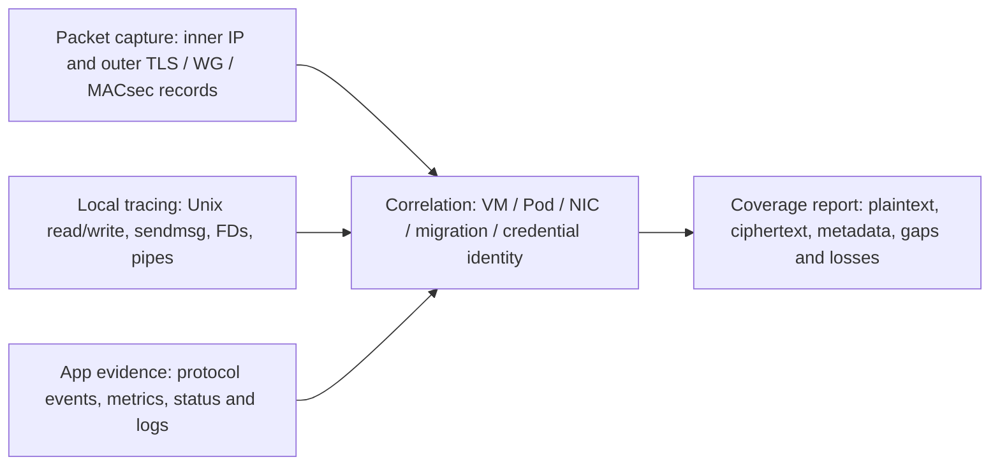

# Capturing and correlating connections

Part of the [connection atlas](../connections.md). This guide maps its stream
IDs to observation points. The initial 2026-11-15 audit made no packet captures,
process instrumentation or cluster changes. Later scoped rollout captures and
their losses are recorded in [dated platform evidence](platform-evidence.md).
Use the [data-path diagrams](data-paths.md) to choose the namespace and the
[identity guide](identity.md) to interpret what a credential proves.

## What a complete capture requires

A single node `tcpdump -i any` cannot capture every qrab stream. It misses
other nodes, Unix sockets, SCM_RIGHTS, guest virtqueues, pipes, files and bytes
inside TLS/WireGuard/MACsec. Capture by **boundary**, correlate by identity, and record
loss/coverage limits. “All streams” means every enabled inventory connection is
accounted for, including encrypted traffic and local channels; it does not mean
every connection has a decryptable packet capture.



Record the VM namespace/name/**UID**, manager Pod name/UID/node/IP, each NIC's
name/MAC/stable address/anchor Pod UID/Cilium endpoint identity, and the migration
UID/source/target Pod UIDs. Addresses and names can be reused. Record UTC start
and end times and clock offset on **both** nodes; host monotonic timestamps in
conntrack exports need rebasing and are not wall-clock times. Capture source
revision, actual image digests, effective config and whether the relevant
listener/policy is enabled. Do not collect Secret values to identify a flow.

Create capture files with restricted permissions. A plain HTTP trace may hold
user ID tokens, cookies, CSRF values or Basic/session credentials; an iSCSI trace
may hold disk contents; migration/QGA/VNC/serial/SVID traces can contain VM
memory, user input or private keys. Treat the capture as the underlying data,
not as harmless diagnostic metadata. Store an inventory of evidence files and
their hashes with the investigation; keep credential-bearing artifacts out of
Git and towl note bodies.

## Coverage matrix

Each inventory connection is assigned below, including local and externally
owned ones. Multiple rows may observe the same bytes at different boundaries.

| Inventory IDs | Capture / evidence point | What is visible and what is not |
| --- | --- | --- |
| M1, M3, public part of M5 | Browser network tools; ingress-facing interface | HTTPS/WSS records and connection metadata in pcap. Browser/application boundary can show decrypted HTTP or WS frames; IdP credentials belong to the separate browser/IdP leg. |
| M2, M4, backend of M5 | Ingress backend and destination Pod netns `eth0`, ports 8445/8443/8444 | TLS 1.3 mTLS records. Correlate Envoy SDS certificate metadata and exact backend URI with the VM UID. HTTP/WS, bearer/session and native Basic credentials require endpoint observation after decryption. Compare both sides when NAT changes the tuple. |
| M6, M7 | Dashboard egress and selected VM Pod `eth0` | TLS 1.3 on Redfish8444/BMC8443. HTTP bearer/WS/RFB data require endpoint tracing after TLS decryption. Include new Pod IP after replacement/migration and correlate exact service URI from namespace/VM UID. |
| M8 | VM Pod netns `lo`, port 8444 | Browser adapter's loopback mTLS records; HTTP/SSE and forwarded credential remain encrypted on this interface. Plain loopback HTTP8081 is only standalone compatibility, not the updated operator path. |
| M9 | BMC/Redfish and manager Unix-socket read/write boundary | Versioned JSON and events; after console acknowledgement, raw RFB. IP pcap sees nothing. Existing lifecycle logs are not a full socket transcript. |
| M10 | Manager's QMP Unix read/write and sendmsg/recvmsg boundary | Greeting, commands, replies and events; SCM_RIGHTS ancillary metadata for NIC FDs. This requires local process/Unix tracing, not another QMP connection. |
| M11 | Manager/QEMU VNC Unix boundary; corresponding WS frames | RFB frames/input/audio. No additional VNC encryption locally. WS message boundaries can split/coalesce RFB messages. |
| M12 | Manager QGA Unix boundary or guest virtio-serial daemon boundary | JSON, `0xFF` synchronization and replies. Guest agent has a fixed allowlist. A guest NIC pcap cannot see QGA. |
| M13 | Workload/client interface, BMC8443/Redfish8444 and app boundary | TLS 1.3 records, not plaintext Redfish. Decrypted access requires endpoint-side evidence/session traffic secrets if deliberately supported; ordinary 8081/8080 listeners are health-only loopback in workload mode; ingress and observability have their own peer allowlists. |
| N1 | netd and manager Unix sendmsg/recvmsg | Queue/grant/probe/handoff control and ancillary FD numbers/types. It does **not** contain guest Ethernet packets. |
| N2, N3, N4 | Anchor netns TAP and `eth0`; DHCP/DNS/gateway filters | Guest packets on TAP and routed traffic on `eth0`. ARP and DHCP stay near TAP; application TLS remains ciphertext. Capture all NIC anchors, not just the VM Pod. |
| N5 | VPN anchor TAP, `wg0` and `eth0`; provider if controlled | TAP/`wg0` show inner packets; `eth0` shows WireGuard UDP. Inner application TLS is still encrypted. Provider control API captures do not decrypt WireGuard packet traffic. |
| N6, N7 | Both manager Pod interfaces, TCP 7800 | Two TLS sessions with different TCP tuples. Bulk stream and JSON switchover cannot be decoded from the wire without TLS session secrets or endpoint observation. |
| N8 | Both manager/QEMU migration Unix boundaries | Decrypted QEMU stream, including sensitive RAM/TPM/EFI state. No IP pcap on this leg. Capture before/after manager TLS wrapping if a transcript is required. |
| N9 | **Host network namespace** on both migration nodes, TCP 7911 | TLS 1.3 records for node-to-node SPIFFE mTLS. VM Pod capture misses it. Decrypted endpoint evidence is needed for request/export JSON; correlate node SVID and anchor metadata. Entries are flow metadata/state, not packet payloads. The original audit snapshot predates enrollment/release. |
| N10 | netd ↔ Cilium Unix socket; local bpftool/BPF operations | HTTP handoff state and local map operations. No network packet stream; Cilium endpoint status/Hubble supplies complementary state/verdict evidence. |
| N11 | Node/FRR peer-facing upper `macsec0`, TCP 179 | Decrypted route updates/withdrawals; the native lower shows N15 MACsec. Verify external peer auth/config first; BGP packets do not contain guest app data. |
| N12 | Old/new node host interfaces and both anchors | Forwarded packets during route convergence, independently of migration TLS. Include both nodes and avoid double-counting retransmitted/duplicated observations. |
| N13 | VPN anchor `wg0`, netd UDP socket and provider gateway `:5351` | NAT-PMP requests/replies are plaintext inside WG. Observe before/after the narrow source NAT if checking the sender; the replies return to netd, not TAP. Anchor `eth0` shows only encrypted WG. Correlate lease port/lifetime/epoch with anchor condition and VpnProfile status. |
| N14 | Node `cilium_wg0` and `macsec0` UDP51871, correlated with I11 public keys | Inner Pod/guest packets are visible on `cilium_wg0`; `macsec0` shows outer WireGuard records and node metadata. The raw lower now shows N15. Historical pre-MACsec captures used `enp0s2`. Report filters, kernel drops, sampling and capture caps. |
| N15 | Native node lower `enp0s2` and gateway `br-kube`; compare upper `macsec0` | Lower carries MACsec `0x88e5` and MKA `0x888e`; upper exposes decrypted native IP, which may still contain application TLS or WireGuard. Record raw ingress/egress guard counters and kernel MACsec protection settings. The kit's filtered five-second capture rejects clear IPv4/IPv6, VLAN, metadata truncation and any capture loss; it counts no encrypted payload frames. A zero matched count is scoped to that filter/window. |
| N16 | Guest relay/virtio-serial device and manager's private `spire.sock` | Local multiplexing headers, connection IDs, credits and opaque SPIRE TLS bytes. This is a separate port/socket from QGA. Correlate relay session changes and each manager upstream TCP tuple across migration. |
| S1, S2 | Operator egress and exchange/storage frontend | Encrypted TLS records. Application-side transcript is needed for policy/verb/CHAP body; request IDs, redacted reports and daemon receipts can correlate outcomes without secrets. |
| S3 | Storage ingress backend, daemon/wrapper stdin/stdout and configfs | External shim source uses plain host-loopback HTTP `127.0.0.1:9476`, followed by local execution. Include host `lo` as well as :9477 TLS frontend; verify deployed host configuration against [source evidence](platform-evidence.md#storage-ingress-and-exchange-shim-s1s3-a1). |
| S4 | VM Pod `eth0`, storage host interface, TCP 3260 | iSCSI login/CHAP challenge-response and SCSI blocks. Password is not sent as a plaintext CHAP password, but authentication exchanges and disk data remain sensitive. |
| S5, I9 | API connection plus kubelet projection/file and process-input evidence | API leg ciphertext, local secret files/stdin plaintext. API audit metadata and mounts usually suffice; do not dump private keys/passwords as a routine trace. |
| S6–S10 | Manager/QEMU/swtpm file/device/Unix/pipe boundaries; CSI/backend logs | Local I/O and ownership/persistence events. Disk/pflash block I/O, TPM protocol and ZFS send/receive pipes are not TCP flows. CSI may add external storage connections. |
| S11 | Manager retained `identity/guest/`, identity-image build/read boundary and guest mount | Public certificates/bundle/config and TPM-bound sealed private blobs. No network capture on this local block/file leg. Treat raw identity disk contents as sensitive; certificate metadata and hashes usually provide sufficient correlation. |
| I1, I2, I3, I4 | Browser or BMC/dashboard/Redfish HTTPS clients; Kanidm frontend | Encrypted wire records; endpoint-side logs/HTTP observation for authorization, code exchange, JWKS and group operations. JWKS contains public keys; token response contains credentials. |
| I5 | SPIRE Workload API Unix client/server boundary | Local HTTP/2 gRPC credential/bundle stream. X509-SVID private keys make raw transcript collection especially sensitive. Server attestation/registration evidence often answers an identity question without collecting keys. |
| I6 | External SPIRE controller, agent/server and Kubernetes boundaries | Observe controller Kubernetes HTTPS and local SPIRE admin socket, kubelet/CSI Unix gRPC and native agent/server channels separately. [Platform evidence](platform-evidence.md#spire-controller-and-csi-local-socket-paths-i5i6) traces local mounts; native agent/server network was not revalidated. |
| I7, I8 | Workstation/broker HTTPS egress to Proton and challenge site | Encrypted SRP/token/catalog/certificate transactions. Provider APIs and raw user login data are separate from WG inner traffic. Broker logs/status should report result/reason without session/key material. |
| I10 | Envoy/SPIRE agent SDS Unix boundary, public certificate metadata and cluster references | Local credential delivery. Prefer public URI/serial/lifetime evidence; raw SDS transcripts include private keys. |
| I11 | API audit/watch metadata, `CiliumNode` public keys and `cilium-dbg encrypt status` | Node/key and allowed-prefix ownership. These records cannot decrypt N14; private key files and `wg ... dump` output belong outside evidence. |
| I12 | EAPOL on native lowers; safe MKA service/kernel metadata | Peer discovery and session lifecycle; MACsec headers/MKA metadata remain visible. Do not collect CAK/CKN profiles, key-debug logs or session-key material. Production key-server restart/rekey injection is separate from the isolated oracle. |
| I13 | Manager/issuer Pod interfaces, issuer8443, plus issuer request metadata | TLS 1.3 mTLS records; authenticated manager VM UID and EK/DevID certificate hashes at endpoints. Issuer CA private keys are outside capture scope. |
| I14 | Guest loopback8081, N16 local mux and manager egress to SPIRE8081 | The same end-to-end SPIRE TLS stream at several boundaries, not separate TLS terminations. Pair guest agent ID/VM UID with relay channel/session and upstream tuple. Guest workload credential delivery remains I5. |
| I15 | Operator egress/native-node8447; evictor admin receipt | SPIFFE TLS records and redacted VM UID/agent eviction outcome. Correlate finalizer state, entry deletion and stopped VM Pods. Do not infer server-side SPIRE admin policy merely from the client's exact peer pin. |
| P1–P4 | API client egress, Kubernetes audit logs and workload logs | TLS wire metadata; object identity/verb/result from audit policy. Request/response bodies are available only if deliberately logged; Secret bodies should not be assumed safe audit evidence. |
| P5 | API patches, projected ConfigMap/downward files and manager resize/NIC status | API TLS plus local file changes. Projection is asynchronous, so API write time and QMP action time differ. There is no hidden operator-to-manager TCP stream to capture. |
| P6, P7 | VM Pod `:9181`, adapter/operator interfaces; Prometheus Pod loopback19993 | TLS 1.3 records on the network. Only the Prometheus-to-adapter local leg exposes plain metrics. Identify caller SVID, VM UID and current owned Pod/IP. |
| P8 | Redfish egress and telemetry gateway `:9091`; Prometheus Pod loopback9090 | TLS 1.3 records on the network; plain query_range only on Pod-local loopback. Gateway binds exact client SVID to current VM-owned Pod templates. |
| P15 | Adapter interface → API443 | HTTPS list responses, correlated by current VM UID/owner references, Pod IP and refresh age. Capture files do not themselves expose API JSON. |
| P16 | Root watcher Netlink queries, private wpa control socket and unit journal | Kernel association state and fixed local rekey command/acknowledgement. Replies contain no keys. Record helper/tool hashes and recovery timing; profile/CAK files and key-debug logs stay private. A running supplicant is insufficient evidence of usable receive associations. |
| P9 | Redfish/BMC/dashboard HTTP and browser SSE boundary | Text event records and cursors at each plaintext/decrypted hop; public TLS pcap stays encrypted. Record gaps and epoch changes, not just events received. |
| P10 | Redfish egress to exact event receiver; receiver application | HTTPS records on wire, redacted Event JSON at endpoints. Creator token is not delivered to receiver. Events can replay after a crash; deduplicate by event ID. |
| P11 | Kubelet exec results; container loopback health; manager status files | Fixed local HTTP reads and process/file checks. No remote plaintext health connection is needed. Probe success remains separate from guest application correctness. |
| P12 | Kubelet/plugin Unix gRPC and CDI file | Local registration/health/allocation and CDI device/mount edits; QEMU KVM ioctl/mmap execution requires kernel/process evidence, not IP pcap. No TCP listener to sniff. |
| P13 | Container serial/stdout/stderr, retained serial tail, log collector | Text/local pipes, then externally configured log shipping. Container log rotation/backpressure and the manager's bounded tail mean logs are not an unlimited recording. |
| P14 | Relevant Pod/anchor resolver leg, UDP/TCP 53 | Local resolver/guest boundaries show DNS; cross-node Pod DNS is inside N14. For VPN DNS observe inside anchor WG. Capture resolution separately from final HTTPS. |
| A1, A2 | Node runtime/pull shim/registry or release workstation | OCI HTTPS records and external auth exchanges; runtime/registry logs and digest/pull receipts correlate layers. Include provider local stdin/stdout, node-SVID mTLS to shim, HTTPS TokenReview/Pod/Node reads and Kanidm HTTPS exchange; see [external source](platform-evidence.md). |
| A3, A4 | Build/staging workstation/container and local import boundary | Source/package/image downloads per fetch tool, checksums/digests, local conversion/pipe/import I/O. No live guest or dashboard download occurs merely because catalog metadata contains a URL. |
| A5 | Admin client/API/node runtime and invoked process | Kubeconfig TLS, then external API-to-node/CRI transport and local exec/log/forward stream. A port-forward trace alone does not document the normal ingress path. |
| A6 | Gateway coordinator, SSH connection metadata and root agent phase/capture receipts | SSH-encrypted deployment transfer. Private `profile.json`, MKA config and `before.json` backups may contain credentials; do not export them. Record immutable kit/source/tool hashes and selected state/phase fields instead. |

## Bounded packet-capture examples

These are templates to run **on an authorized node**, with root access to the
relevant namespaces and `tcpdump`, `timeout`, `nsenter` installed. Restricted
VM/anchor Pods do not have those privileges/tools; installing them or enabling
ptrace is a separate operational change. The examples observe existing streams
and do not open listeners, alter routes or initiate migrations.

First collect nonsecret placement/identity information from the workstation:

```sh
kubectl -n qrab get qvm VM -o json
kubectl -n qrab get pods -l app.kubernetes.io/instance=VM -o wide
kubectl -n qrab get qvmm -o wide
kubectl -n qrab get ciliumnetworkpolicies
```

Use Pod/container status and the node's CRI tooling/cgroup membership to resolve
the exact **live PID on that node**. Do not copy a PID from another node or a
prior Pod incarnation. Record `/proc/<pid>/ns/net` and the Pod UID as evidence.
netd's [identity helpers](../../projects/qrab-netd/src/sys.rs) use the same
PID→cgroup→Pod approach. A PID of either sidecar in the VM Pod identifies the
shared management netns; an anchor PID identifies a different netns.

```sh
# Replace PIDs, address and TAP with observed values on this node.
vm_pid=12345
anchor_pid=23456
tap_name=qt0123456789ab
source_ip=10.244.1.10
capture_dir="$PWD/qrab-capture"
umask 077
mkdir -p "$capture_dir"

# Management, Redfish bridges, metrics, migration, iSCSI, DNS and HTTPS.
# 'any' inside this netns includes loopback M8 as well as eth0.
sudo timeout --signal=INT 60s nsenter -t "$vm_pid" -n \
  tcpdump -i any -nn -s 0 -U -c 100000 -w "$capture_dir/vm.pcap" \
  'tcp port 8080 or tcp port 8081 or tcp port 8443 or tcp port 8444 or tcp port 9181 or tcp port 9091 or tcp port 7800 or tcp port 3260 or tcp port 443 or port 53'

# Unfiltered Ethernet on the TAP: all queues, ARP/DHCP/DNS and guest apps.
sudo timeout --signal=INT 60s nsenter -t "$anchor_pid" -n \
  tcpdump -i "$tap_name" -nn -s 0 -U -c 100000 \
  -w "$capture_dir/nic-tap.pcap"

# VPN outer packets; compare with a separate wg0 capture for inner packets.
sudo timeout --signal=INT 60s nsenter -t "$anchor_pid" -n \
  tcpdump -i eth0 -nn -s 0 -U -c 100000 \
  -w "$capture_dir/nic-outer.pcap" 'udp port 51820'

# Optional NAT-PMP mapping/renewal, inside the WireGuard tunnel.
sudo timeout --signal=INT 60s nsenter -t "$anchor_pid" -n \
  tcpdump -i wg0 -nn -s 0 -U -c 1000 \
  -w "$capture_dir/vpn-natpmp.pcap" 'udp port 5351'

# Host-only conntrack and route-control streams: run on BOTH nodes.
# This command assumes the shell is already in the node host netns.
sudo timeout --signal=INT 60s tcpdump -i any -nn -s 0 -U -c 100000 \
  -w "$capture_dir/node-control.pcap" 'tcp port 7911 or tcp port 179'

# Native MACsec boundary: node lower; use br-kube on the gateway.
# A short snap length retains L2 metadata instead of full encrypted payloads.
sudo timeout --signal=INT 30s tcpdump -i enp0s2 -nn -s 64 -U -c 100000 \
  -w "$capture_dir/native-outer.pcap" 'ether proto 0x88e5 or ether proto 0x888e'

# After native decryption: Pod WireGuard outer records, still encrypted.
sudo timeout --signal=INT 30s tcpdump -i macsec0 -nn -s 64 -U -c 100000 \
  -w "$capture_dir/pod-wg-outer.pcap" 'udp port 51871'

# To distinguish the two manager TLS connections, inspect their TCP tuples.
sudo nsenter -t "$vm_pid" -n ss -tnp dst "$source_ip:7800"
```

The example VM filter is scoped to the usual listeners; it is not all possible
traffic. Add the **configured** M13 port and every custom storage/API/provider
port when applicable, or use an unfiltered bounded pcap in each namespace for
an exhaustive interface sample. A VPN endpoint can use a different UDP port.
Also capture `wg0` for inner VPN traffic, each additional NIC, both migration
Pod netns, both host netns, and relevant provider/storage/ingress endpoints.
The manager/operator/BMC/Redfish may use the same port number in different
namespaces; classify by address/process and request path rather than port alone.
The MACsec-positive filter records encrypted traffic; it cannot detect a clear
packet excluded by that filter. Use the root kit's separate clear-IP/VLAN
negative oracle with recorded loss for that verdict. Its production five-second
windows and subsequent scoped checks are in the [rollout record](platform-evidence.md#native-macsec-rollout-2026-11-16).

`-s 0` keeps complete packet bytes, `-c` caps packets and the deadline caps time;
neither bounds total bytes independently. A size/count-limited ring (`-C`/`-W`)
can bound disk use but overwrites older evidence, so record that gap. Retain
tcpdump's received/dropped counters and the actual exit status (timeout may
report 124 after a planned stop). Offload/coalescing and `any` captures can
show large packets, apparent checksum errors or duplicate observations; do not
infer corruption or double the byte count without checking capture/offload
position. Do not change offloads merely to make a prettier trace.

## Local channels and encrypted traffic

Unix sockets and SCM_RIGHTS require endpoint-level observation. `ss -xnp`,
`/proc/<pid>/fd` and cgroup information establish which processes own sockets
and queue descriptors, but do not record payload bytes. Where authorized and
supported, Unix syscall/eBPF tracing can record read/write buffers and ancillary
`sendmsg`/`recvmsg` metadata. Track each process's FD lifetime: SCM_RIGHTS
duplicates a kernel file description and the receiving numeric FD can differ
from the sender's. After inheritance/hotplug, queue traffic is in the kernel
datapath, not repeated on the descriptor-grant socket.

A new client to QMP/QGA/VNC/control is an active protocol participant, not a
passive tap. Do not steal the manager's QMP/QGA connection or insert a proxy to
collect a transcript during a documentation audit. Embedded BMC `Control` uses in-process request/oneshot/watch channels instead
of M9 socket bytes. Projected files, `status.json`, resource reads, state locks
and child signals/waits likewise need process/file evidence rather than pcap.
Existing logs and typed events establish many operations without instrumenting a live process; raw
full-duplex transcripts require a separately planned endpoint tracing facility.
Tracing may affect timing and must report its own truncation/drop limits.

TLS 1.3 and WireGuard pcaps provide timing/size/endpoint/retransmission evidence,
not plaintext. A server certificate/private key alone does not decrypt a
forward-secret TLS 1.3 session. qrab's current production code provides no
general TLS-key-log or decrypted traffic recorder. Obtain permitted plaintext
at an endpoint boundary (for migration, N8; for public management, the existing
HTTP backend or endpoint application) or explicitly supported session-key
instrumentation in a separate investigation. Do not disable TLS, accept invalid
certificates, log SVID private keys, or widen allowlists to make capture easier.

An unencrypted local boundary can still contain encrypted **application** data:
TAP may carry guest HTTPS, and iSCSI may carry guest-encrypted filesystem blocks.
Conversely, host-overlay encryption does not protect a plaintext backend from
the processes/node namespaces where it has already been decrypted.

## Correlating streams without pretending logs are complete

| Protocol/evidence | Correlation key and limit |
| --- | --- |
| QMP | Connection-local request ID for replies; events are asynchronous. Handshake shows QEMU release/capabilities. Timeouts can leave an unknown remote outcome; do not replay actions merely to reproduce a trace. |
| Manager control | `v`, request `id`, operation; follow frames carry events/missed/drop counts. `console` changes framing to raw RFB. Pooled request connections and the dedicated follow connection are different streams. |
| QGA | Delimited sync nonce and sequential command/reply order; `0xFF` resets parser alignment. Some shutdown/suspend commands intentionally have no success response. |
| Events/SSE/push | Manager epoch plus sequence; `Last-Event-ID`, gap notices, QMP drops and subscription cursor/checkpoints. Manager history is 256 records; oversized payloads truncate, QMP can drop/rate-limit, reconnects can miss events and push may replay. This cannot prove lossless VM history. |
| Migration | Migration CR UID, source/target Pod UID, `state_id`, SVID URI, both 7800 TCP tuples, migrate-state/QMP events and manager termination reason. Handshake UID is correlation, not an operator-signed authorization ticket. |
| Conntrack | NIC /32, both host IPs, anchor owner UID/NIC, export monotonic clock and `truncated`; map records can omit entries by cap or filtering. Compare to flow tuples, not QMP event count. |
| Storage API | Random request ID, operation, VM UID, disk ID and generation; storage result/daemon receipt, Secret metadata, LIO ACL/session status. A CHAP login alone does not prove a storage fence or exclusive ownership. |
| HTTP/OIDC | Endpoint path, issuer/audience, redacted principal/role and session expiry; preserve result/status without reproducing bearer/cookie/password values in reports. Metadata-only captures cannot prove token claim validation. |
| WireGuard/Proton | Profile UID, public key fingerprint, selected provider peer, handshake/counter state and certificate expiry. Do not use private keys/refresh tokens as correlation values. |
| Kubernetes/platform | Object UID/resourceVersion, admission/audit result, node identity and image digest. An API watch is not an application packet recording; audit coverage depends on the platform's policy. |

Finish an investigation with an explicit list of enabled atlas IDs observed,
disabled IDs, externally unobserved boundaries, evidence file/hash/time ranges,
and capture/trace losses. Correlating records across these points gives a useful
end-to-end explanation without claiming that a missing event or encrypted pcap
proves no data moved.

For the [ingress implementation](../ingress.md), capture8445/8443/8444 as
backend TLS, the Envoy SDS Unix stream as credential delivery (I10), and the
local exec/loopback health boundary separately. Inspect only public certificate
metadata and cluster URI/SDS references; never export workload private keys from
SDS or a complete unredacted secret dump. The [live rollout record](platform-evidence.md#ingress-backend-mtls-and-https-build-rollout-2026-11-16)
supersedes the initial snapshot's plaintext backend status. No packet recording
was taken during that snapshot or the rollout tests.
