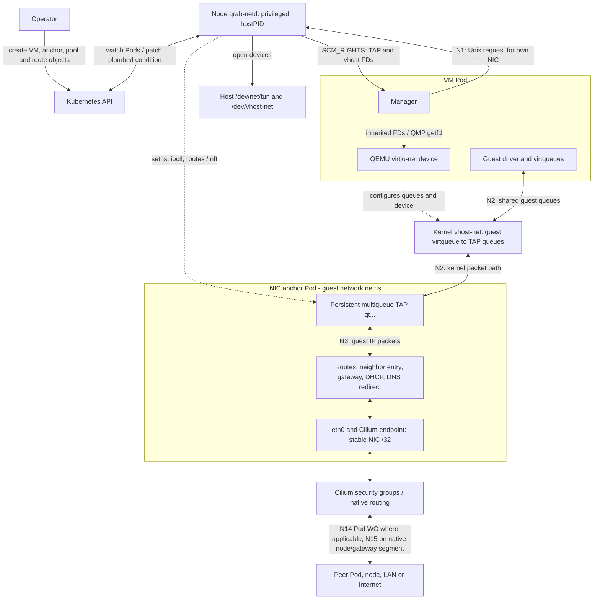
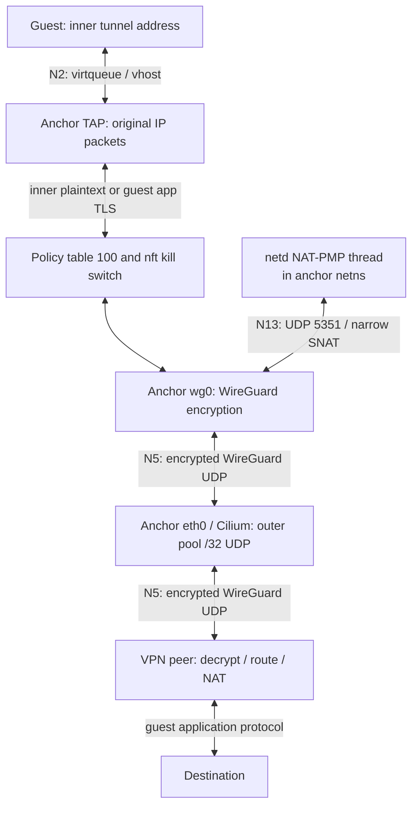
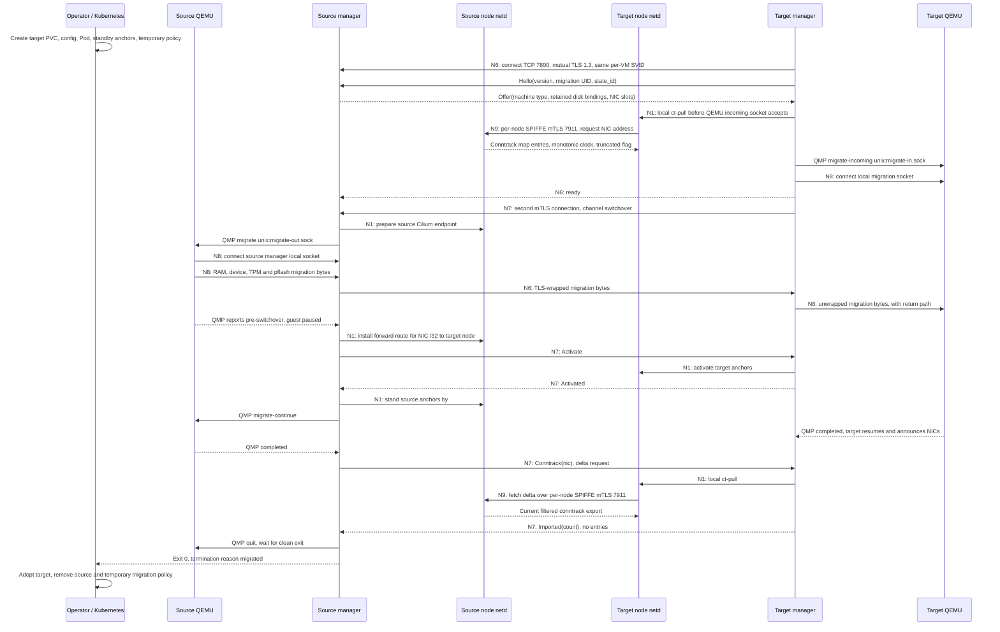
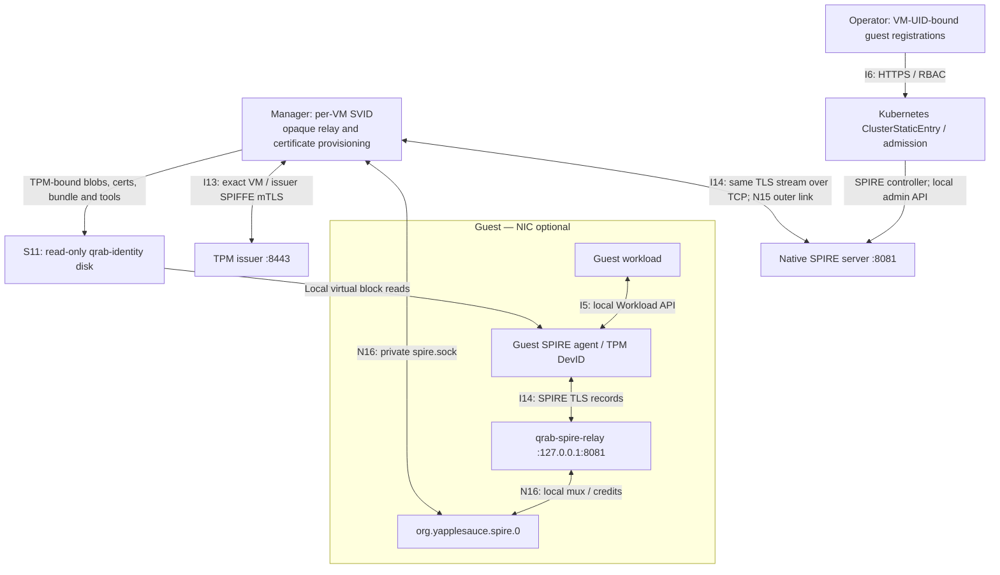
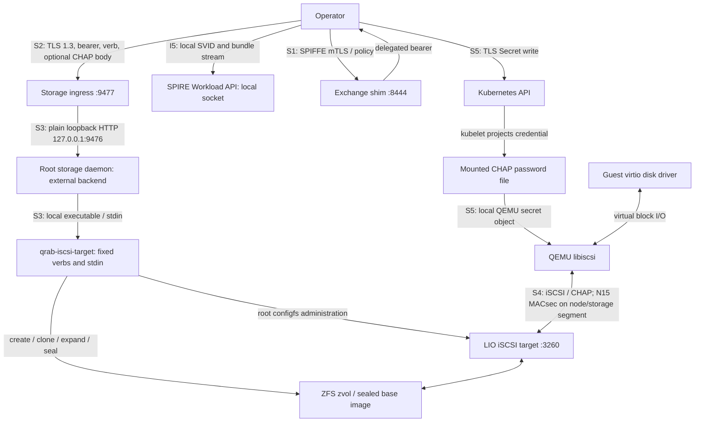

# Data paths and migration

Part of the [connection atlas](../connections.md). Connection IDs refer to its
inventory. These diagrams separate **setup/control** from the bytes moved once
the connection is established. All paths are bidirectional unless stated.

## Guest NIC: how TUN access reaches QEMU

There is one restricted NIC **anchor Pod** per NIC per participating node. Its
process only holds the Pod/network namespace alive. A privileged node daemon,
`qrab-netd`, enters that namespace, creates a persistent multiqueue TAP and
opens TAP/vhost-net descriptors. Neither the anchor nor the VM manager opens
`/dev/net/tun`. The device is opened in TAP mode: the data are Ethernet frames,
not a userspace IP-only TUN tunnel.

The descriptor setup sequence is:

1. Operator claims the stable address with a /32 `CiliumPodIPPool`, creates
   the VM config/NoCloud seed and co-located anchor, and publishes its labels.
2. netd watches its node's anchors through Kubernetes TLS. It maps an anchor
   Pod UID to a process cgroup and enters its network namespace to plumb it.
3. Manager connects to `/run/qrab-netd/netd.sock` (N1). The KVM device plugin's
   CDI spec provides this directory read-only along with `/dev/kvm`.
4. netd checks the requester's kernel peer PID, cgroup Pod UID and watched Pod
   labels. The requested anchor must belong to that VM's owner UID and NIC on
   this node. It also refuses an already-held TAP. This is Pod-level local
   authority, not OIDC or SPIFFE authentication of the process.
5. netd sends one TAP FD and one vhost FD per queue as SCM_RIGHTS, then closes
   its copies. Manager maps them into the QEMU child; a running NIC attach
   uses QMP `getfd` followed by `netdev_add`/`device_add` instead. Detach uses
   `device_del` and later backend cleanup once the guest releases the device.
6. QEMU configures vhost-net. Kernel queues move packets thereafter. netd's
   Unix socket does not relay the guest's packet data, and restarting netd
   does not close descriptors already owned by QEMU.

The queue count is one per vCPU, capped at eight. The operator permits at most
four NICs; the manager's internal slot/descriptor limits are separate. A future
capture must observe **all** queues through their common TAP interface rather
than treating one received FD as a copy of all network traffic.

For a plain NIC, the guest uses its stable /32, MAC-derived identity, gateway
`169.254.1.1` and DNS at that address. Gateway ARP and ICMP, DHCP and DNS (N4)
are separate streams from application data. netd supplies a static DHCP lease
for guests that ignore NoCloud network configuration. The anchor routes the
/32 to TAP and retains a placeholder link address on `eth0`; Cilium associates
the guest's address and security groups with the anchor endpoint.

The guest-to-anchor path remains local and unencrypted. Cross-node managed
Pod traffic uses N14 WireGuard, and the native node/gateway segment uses
[N15 MACsec](../node-link-encryption.md). Beyond those peers, HTTPS/SSH or
another guest application protocol supplies its own protection; VPN NICs use
the tunnel below. Security groups decide reachability at the
anchor; they do not authenticate the guest as a SPIFFE workload. Without an
enforcing policy, anchors are default-allow. Route distribution goes operator
→ Kubernetes `FRRConfiguration` → frr-k8s/FRR → BGP neighbors (N11), never
through QEMU.

Sources: [TAP descriptor acquisition](../../projects/manager/src/pod/tap.rs),
[live NIC reconciliation](../../projects/manager/src/pod/nics.rs),
[netd peer authorization](../../projects/qrab-netd/src/authz.rs),
[SCM_RIGHTS wire transport](../../projects/qrab-netd/src/wire.rs),
[kernel plumbing](../../projects/qrab-netd/src/sys.rs),
[CDI device/mount spec](../../projects/kvm-device-plugin/src/lib.rs), and
[networking guide](../networking.md#tap-datapath).

## VPN NIC: where encryption starts and stops

For `spec.nics[].vpn.secretName`, the operator mounts only `vpn-*/wg.conf`
into the anchor (0400, root). netd reads that file through the anchor's mount
namespace, parses a bounded one-peer configuration and feeds it to
`wg syncconf` over stdin. The anchor process, manager and guest receive no
private key. netd configures the kernel interface; no user process in the
anchor forwards each packet.

The anchor's stable pool /32 stays on `eth0` as the **outer** UDP identity;
the guest gets the tunnel's **inner** address, DNS and MTU through DHCP. netd
installs the kill switch before plumbing forwarding: TAP may forward only to
`wg0`, with a blackhole fallback if the tunnel is down. Allowed local traffic
from TAP is DHCP and gateway ping. VPN DNS is sent to the provider resolver
inside the tunnel rather than ordinary anchor DNS redirection. Cilium sees the
outer UDP tunnel, so VPN security-group rules must allow the endpoint's UDP
port and cannot filter decrypted guest destinations.

WireGuard encryption ends at the VPN peer. The provider can see unencrypted
inner application traffic; TLS within the guest remains protected to its
application server. The VM Pod's BMC, iSCSI and migration traffic do not use
this NIC. A second plain guest NIC can bypass the VPN according to guest
routing; the kill switch is scoped to this VPN anchor.

Proton is a control-plane provider for the WireGuard profile. HTTPS API
authentication/certification (I7/I8) and WireGuard packet encryption (N5) are
different connections and different identities. Current qrab renders
`10.2.0.2/32`, DNS `10.2.0.1` and provider port 51820 for Proton profiles.
The certificate is obtained for the profile's Ed25519 public key; its X25519
form is used for WireGuard. The certificate is not an OIDC token or SPIFFE SVID.

With `# qrab: port-forwarding` in the config, netd adds **N13**, an independent
NAT-PMP control flow to the tunnel gateway (first configured DNS, `10.2.0.1`
for Proton). A renewal thread enters the anchor netns and binds an ephemeral
UDP socket on `169.254.1.1`, requests both TCP/UDP mappings from gateway port
5351, asks for 60-second leases and renews every 40 seconds (10 seconds after
failure). The narrow nftables postrouting rule SNATs only these gateway-bound
`wg0` packets to the guest's inner tunnel address; conntrack returns replies
to netd. These control packets bypass the guest/TAP and are plaintext on `wg0`,
then encrypted on the outer WireGuard link. NAT-PMP itself adds no credential
or signature. The provider forwards the mapped public port to the guest's
inner address on the same port, so the guest must listen there.

netd publishes anchor condition `qrab.yapplesauce.com/vpn-port-forward`; the
broker lists anchors and copies attachment/port status into `VpnProfile`.
Those are Kubernetes HTTPS streams (P3/P4), not a guest metadata service or
another node-to-node port. A Secret server switch is detected by config digest
on the next 10-second netd tick after projection and triggers a fresh mapping.
A standby migration anchor's packet emission is fenced until activated.

Sources: [VPN parser and kill switch](../../projects/qrab-netd/src/vpn.rs),
[netd VPN setup](../../projects/qrab-netd/src/sys.rs),
[NAT-PMP client](../../projects/qrab-netd/src/natpmp.rs),
[Proton WG profile](../../projects/proton/src/wg.rs) and
[VPN networking guide](../networking.md#vpn-nics).

## Live migration: three cross-node streams, not one

The source and target managers tunnel QEMU migration over mTLS (N6). TAP
handoff adds a second manager mTLS connection (N7). Copying Cilium conntrack
adds a separate **per-node SPIFFE mTLS** connection between netds (N9). Established guest
application flows (N3/N5/N12) continue independently of all three.

Important boundaries:

- **Connection direction differs from bulk data direction.** Target dials
  source:7800, but RAM moves source QEMU → source manager → target manager →
  target QEMU. The same connection has a return path. The managers terminate
  TLS; the two QEMU processes never see the cluster TCP connection or an SVID.
- **Payload changes after ready.** Before ready, N6 is bounded JSON lines
  (64 KiB frames). After it, the stream is opaque QEMU migration bytes; the
  second N7 connection stays JSON. TLS 1.3 protects both across nodes, but the
  corresponding local N8 sockets expose decrypted VM state.
- **Same VM identity, not an independently authorized migration ticket.**
  Both managers accept only their own SVID's exact SPIFFE ID. The main hello
  checks protocol and `state_id`. Its migration UID is a logged correlation
  value, not a source-side comparison against an operator-approved UID. The
  switchover UID matches a waiting slot. The operator's source/target-labelled
  Cilium policy supplies the additional time/network restriction. Correct
  per-VM SPIRE registration is essential.
- **Policy is temporary; listener is longer-lived.** The source listener starts
  after QEMU first runs and survives in-place power cycles. The standing deny
  guard excludes other endpoints/entities; the temporary policy opens only
  target → source for the attempt. While powered off the source refuses
  migration instead of silently starting a cold copy.
- **Identity state moves; shared blocks do not.** swtpm state blobs and UEFI
  pflash RAM travel in QEMU's stream and are persisted by the target. iSCSI
  LUN data stays at the target; both QEMUs use the same endpoint/initiator/CHAP
  binding. The target gets a fresh state PVC and refuses a pre-existing
  retained identity. Media/firmware/Redfish claims mounted concurrently must
  support multi-node access. Retained management metadata/dynamic media can
  block migration; do not assume every local file is streamed.
- **Conntrack has its own TLS tunnel.** netds derive peer node names from
  current API-backed anchor host-IP/node metadata and require the exact URI
  `spiffe://<local-domain>/kubernetes/qrab-node/qrab-netd/<node>` over TLS 1.3.
  Each daemon verifies its own SVID has its configured node name. Source still
  checks the on-link peer and same-VM/same-NIC target anchor before exporting.
  Unknown/ambiguous node metadata and absent/invalid credentials fail closed;
  there is no plain-TCP compatibility mode. This identity is distinct from the
  managers' shared per-VM migration ID. Entries are flow tuples/state/counters,
  not packet bodies. Export/import validates/filter records, rebases lifetime
  clocks and caps each NIC at 384 entries; it remains best effort. A precopy
  happens before incoming QEMU accepts, with a delta after completion, rather
  than adding conntrack pull time to QEMU's final pause. Deploying the updated
  daemon requires [node SVID enrollment](../networking.md#conntrack-peer-spiffe-enrollment).
- **Guest forwarding is its own stream.** The source node temporarily routes
  the guest /32 to the target until BGP converges (N12). That traffic does not
  enter N6. Standby/active maps in the patched Cilium fence packet emission
  while both anchor endpoints temporarily hold the same /32.

Sources: [manager migration state machine](../../projects/manager/src/pod/migration.rs),
[operator migration/policies](../../projects/operator/src/migration.rs),
[netd peer protocol](../../projects/qrab-netd/src/peer.rs),
[conntrack filtering](../../projects/qrab-netd/src/ct.rs),
[Cilium/forwarding operations](../../projects/qrab-netd/src/sys.rs) and
[migration limits](../migration.md).

## Optional guest SPIRE identity

`spec.guestIdentity` enables a separate guest identity path. QGA retains its
fixed command allowlist and its own serial port. The guest SPIRE relay carries
opaque TLS, with local multiplexing headers and bounded credits:

The manager opens one fixed-upstream TCP connection per relay channel. The
default is at most eight connections, 64 KiB in flight per direction and a
300-second idle deadline. New manager/serial sessions close old relay channels,
so guest SPIRE reconnects after migration while its TPM identity persists.
The issuing CA keys remain in the TPM issuer's Secret; the guest receives
certificates and a vTPM-bound private blob. The native link tests did not repeat
guest enrollment or evictor deployment tests.

Source: [manager relay](../../projects/manager/src/pod/spire_relay.rs),
[guest mux](../../projects/qrab-spire-relay/src/lib.rs),
[identity provisioning](../../projects/manager/src/pod/identity.rs),
[issuer authorization](../../projects/tpm-issuer/src/lib.rs),
[guest registration/eviction](../../projects/operator/src/guest_identity.rs) and
[guest identity guide](../spire-vm.md).

## Storage: identity exchange and data I/O are different paths

The TLS storage API performs provisioning and fencing. It does not proxy disk
reads/writes. iSCSI authentication proves knowledge of the CHAP secret for an
initiator ACL; it does not encrypt block traffic. N15 MACsec now protects the
deployed node-to-LIO Ethernet segment, without changing IPs or storage fencing.
A packet capture in the VM Pod still sees disk blocks on TCP3260 even if the VM
has no guest NIC; the raw node lower sees MACsec records. Local stacks and
other portals outside that segment need separate protection.
Disk encryption performed by the guest can make block contents ciphertext,
but it is separate from iSCSI transport encryption and is not guaranteed here.

For automatic disks, the operator generates a credential, writes its VM-owned
Secret before export, and sends CHAP to the storage API only in the TLS request
body. External shim source forwards the bearer/body over plain loopback
HTTP to daemon :9476; the wrapper then receives the credential on stdin
([external evidence](platform-evidence.md#storage-ingress-and-exchange-shim-s1s3-a1)).
Endpoint/IQN/LUN/generation are public metadata; reports omit the password. Secret rotation requires a new QEMU, since
its loaded secret object is not hot-reloaded. TLS provisioning does not prove
encryption at rest for the Secret store, zvol, retained TPM state or CSI mount.

Sources: [storage RPC client](../../projects/operator/src/storage.rs),
[credential provisioning](../../projects/operator/src/provision.rs),
[libiscsi arguments](../../projects/manager/src/pod/iscsi.rs),
[storage wrapper](../../projects/iscsi-target/src/main.rs),
[target host operations](../../projects/iscsi-target/src/host.rs),
[iSCSI guide](../iscsi.md) and [root target runbook](../../contrib/storage/README.md).
