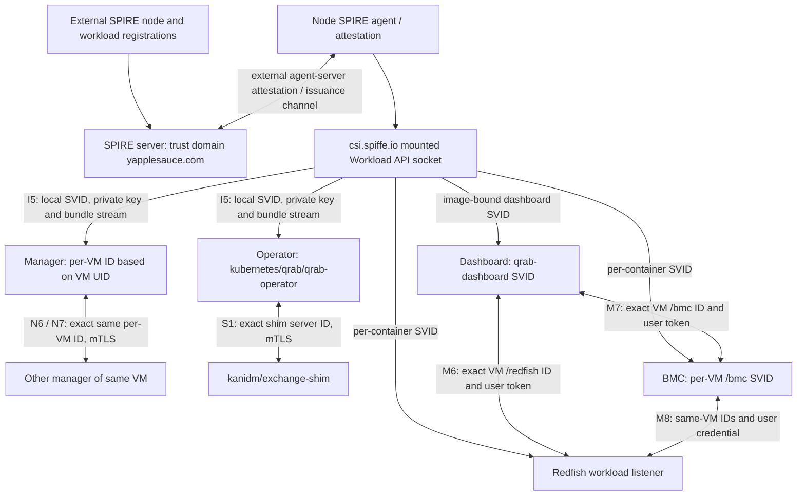
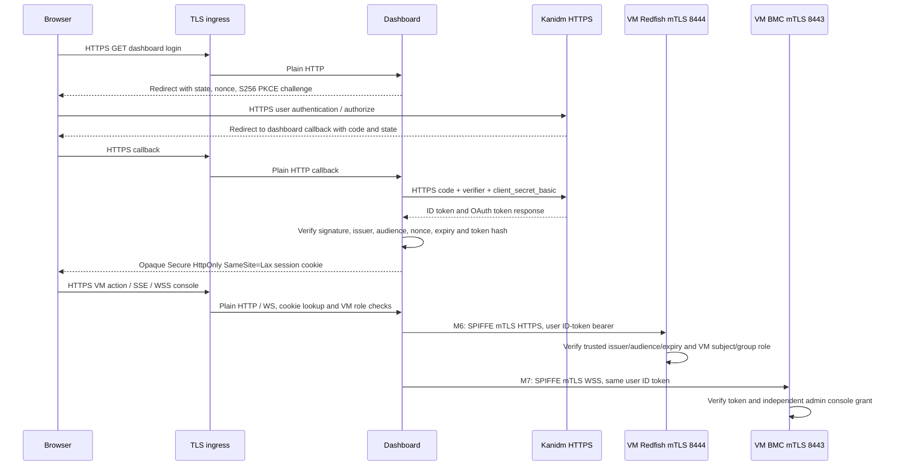

# SPIFFE, SPIRE, OIDC and credentials

Part of the [connection atlas](../connections.md). The identities in this guide
authorize different actors. A SPIFFE SVID is not a user OIDC token; a Kubernetes
ServiceAccount token is not a CHAP password; the guest's TPM identity is not the
manager Pod's workload identity.

## Which identity protects which connection

| Mechanism | Holder and issuer | What it authorizes | What it does not establish |
| --- | --- | --- | --- |
| SPIFFE X509-SVID | Manager/operator/dashboard/BMC/Redfish/netd; issued by SPIRE | Workload peer admission for migration, node conntrack exchange, management HTTP/WS and exchange shim | A human user role, guest attestation, guest packet encryption, or TLS on every Pod listener |
| Kanidm OIDC ID token | Signed-in user; audience is BMC/dashboard/Redfish client | User subject/group grants in BMC and Redfish; dashboard session identity | Transport secrecy: JWT signature is not encryption; claims can be decoded by anyone holding the token |
| Browser session cookie | Opaque server-store identifier in browser | Lookup of verified user/login data; Origin/CSRF rules protect ambient-cookie mutations | A transferable SPIFFE identity, or the user's raw ID token in the cookie |
| Redfish session `X-Auth-Token` | Native client; issued locally after permitted bootstrap | Revocable opaque session with the original local/OIDC principal and expiry | A new OAuth2 access token or a workload TLS identity |
| Delegated storage bearer | Operator obtains from exchange shim using its SVID | Fixed storage verbs under Kanidm subject, RFC 8693 actor and per-verb scopes | iSCSI disk-data encryption, an operator client certificate on the storage ingress, or a guest login |
| Kubernetes projected bearer | Operator/dashboard/netd/broker; Kubernetes issuer | ServiceAccount API operations under RBAC/admission; netd token also binds node/Pod | SPIFFE workload identity or an API token in the token-free VM/anchor Pods |
| CHAP credential + initiator IQN | QEMU and LIO ACL; generated/provisioned per disk | iSCSI login to the exact target export | Encryption of SCSI data, a one-writer fence, or host/guest SPIFFE identity |
| WireGuard key pair | Kernel VPN anchor; peer key configured or provider-selected | Encrypted authenticated WireGuard tunnel to VPN peer | OIDC authorization, the guest's identity, or protection after traffic leaves the VPN peer |
| Proton session/profile key | Workstation login then broker; Proton SRP/API | VPN account API and certification of each profile key | qrab user permissions or per-packet SPIFFE authentication |
| Guest TPM/UEFI state | swtpm and retained identity PVC | Stable guest identity material, measured-boot and firmware interfaces | Automatic guest SPIRE enrollment or hardware isolation from node/hypervisor administrators |

## SPIFFE Workload API and peer matching

The shared [qrab-spiffe library](../../projects/qrab-spiffe/src/lib.rs) consumes
X509-SVIDs and bundles through the Workload API at
`unix:/run/spire/agent.sock`, configurable with
`QRAB_SPIFFE_ENDPOINT_SOCKET`. It accepts only `unix:` endpoints, waits for the
initial identity and follows credential/bundle updates through `X509Source`.
These local streams carry **private keys** as well as public certificates;
they are credential-delivery streams, not just health checks.

Raw `Connector`/`Acceptor` streams require TLS 1.3, have a 15-second handshake
deadline and authorize exact peer SPIFFE IDs in the local trust domain. The
SPIFFE verifier uses the peer URI identity rather than DNS/IP identity; the
synthetic rustls server name `spiffe.invalid` is not a DNS request. Server session
resumption is disabled so a new connection re-verifies its peer. Rotation
supplies new handshakes with current material; it does not retroactively
re-handshake every already-established connection.

The deployment's intended manager identity is
`spiffe://yapplesauce.com/kubernetes/qrab/vm/<vm-uid>`. Source and target Pods
of **one** VM share this ID; another VM must have a different ID. The migration
code takes its current SVID's ID and authorizes that same exact ID on the
other end. It does not itself construct/enforce the `/vm/<uid>` URI template:
the external SPIRE registrations must bind the correct owner UID/Pod/container.
This is why a broad registration shared by all VMs would weaken isolation even
though the stream still uses valid mTLS.

Conntrack peers additionally use per-node netd identities, independent of
manager IDs: `spiffe://<local-domain>/kubernetes/qrab-node/qrab-netd/<node>`.
Source and target resolve the peer's node name from API-backed live anchors
and host IP, then authorize exactly that URI. netd refuses a local SVID naming
another node. The same-VM/same-NIC check still authorizes the requested export
only after TLS admission. No credential downgrade is supported. See
[node enrollment](../networking.md#conntrack-peer-spiffe-enrollment); the dated
live snapshot precedes this source hardening and does not prove its rollout.

The operator example registration is
`spiffe://yapplesauce.com/kubernetes/qrab/qrab-operator`, class
`kubernetes-tpm`, TTL 10m. It selects namespace, ServiceAccount, container name,
image digest and Unix UID 10001. Its exchange client accepts only
`spiffe://yapplesauce.com/kanidm/exchange-shim`. The example is in
[clusterspiffeid.yaml](../../contrib/kubernetes/operator/storage-api/clusterspiffeid.yaml).
Live node/VM registrations and image-pull enrollments live in kubernetes-gitops;
compare those with the actual image/Pod before diagnosing an unavailable SVID.
The SPIRE controller supplies Pod UID selectors; do not duplicate them in a
workload selector template.

Operator rendering mounts the CSI Workload API volume into the **manager**.
BMC and Redfish sidecars now also mount that CSI Workload API, with their
**own container-scoped registrations**, not the manager ID or private runtime.
Their IDs append `/bmc` or `/redfish` to the per-VM ID. Dashboard accepts exactly
the service ID derived from the controlled VM's namespace/UID; BMC accepts only
the dashboard, while Redfish admits dashboard and this VM's BMC. OIDC still
decides user roles after TLS. NIC anchors have no active SPIFFE packet relay
to enroll. The old NIC-relay mTLS plan was superseded by kernel TAP/vhost.

The [optional Redfish listener](../../projects/redfish/src/workload.rs) requires
`REDFISH_WORKLOAD_LISTEN`, exact `REDFISH_WORKLOAD_PEERS`, its own socket mount
and SPIRE registration, and separate routing/policy. It uses the same app router
as port 8081: successful mTLS with an allowed workload still needs an application
credential and role. The shared listener bounds 32 connections/eight concurrent handshakes and
retains permits through HTTP response, SSE and WebSocket IO lifetimes.
The ordinary HTTP API and metrics sockets remain distinct. The updated operator
enables Redfish on 8444 and BMC on 8443, mounts each
container's Workload API socket, and asserts `QRAB_EXPECTED_SPIFFE_ID` at startup.
Its examples require separate GitOps enrollments before rollout. Ordinary
ingress-facing HTTP and metrics remain distinct protection tasks.

## OIDC browser login and downstream user tokens

Dashboard OIDC is a confidential Kanidm client (`qrab-dashboard`); its client
secret is read from a mounted file. The standalone BMC browser flow is a
public PKCE client (`qrab-bmc`) without a client secret and returns to its own
`/auth/callback`. Both verify state, nonce, code-exchange PKCE, signature,
issuer/audience/expiry and `at_hash` when present. Production discovery,
authorization, token and JWKS endpoints use HTTPS with server certificate
validation; redirects from the server-side HTTP clients are disabled.

The dashboard stores the verified ID token in its server session and forwards
it to the selected VM's Redfish/BMC endpoints. The browser receives only its
opaque session cookie and CSRF value. VM-scoped browser management under
`/vms/{namespace}/{name}/bmc/redfish/...` goes dashboard → Redfish directly;
the full BMC page's HTML/assets can be served by the dashboard without fetching
the standalone BMC page. The graphical console still goes dashboard → BMC →
manager control socket → private VNC. TLS terminates at ingress; subsequent
M2 from the ingress to dashboard remains plain; M6/M7 use workload mTLS
with exact per-VM service IDs.

Standalone BMC browser management goes through `/bmc/redfish/*`. BMC validates
the ambient session and exact Origin/CSRF for mutations, strips `/bmc` and
sends the stored ID token over loopback SPIFFE mTLS to Redfish (M8) in
operator Pods. Standalone compatibility permits HTTP only to a literal loopback
IP; remote HTTP and an unpinned WebPKI proxy fallback are refused. Explicit native
credentials remain explicit and cannot fall back to a browser session on
failure. Native `/redfish` ingress requests bypass this adapter entirely.

Session mutation protection is separate from token validation. Cookie-based
mutations need the session CSRF value and exact public Origin. Cookie console
upgrades check Origin; bearer console upgrades have no ambient cookie and do
not require a browser Origin. The console is admin-only. Output audio is an
opt-in admin feature within the same RFB stream, not another user token or TLS
channel. USB redirection has admission plumbing but no active data transport.

Sources: [dashboard login](../../projects/dashboard/src/auth.rs),
[BMC login and principal](../../projects/bmc/src/auth.rs),
[VM-scoped bridge](../../projects/dashboard/src/bmc_page.rs),
[standalone bridge](../../projects/bmc/src/proxy.rs),
[console admission](../../projects/bmc/src/console.rs),
[RFB audio filter](../../projects/bmc/src/rfb_filter.rs) and
[Redfish credential validation](../../projects/redfish/src/auth.rs).

### Bearer verification, audiences, roles and revocation

[oidc-bearer](../../projects/oidc-bearer/src/lib.rs) verifies **OIDC ID tokens**
presented as bearer credentials, not generic OAuth2 access tokens. Accepted
signature algorithms are ES256/RS256; verification includes issuer, configured
audience (and authorized-party rules), signature and expiry. Only UUID entries
in the verified `groups` claim count, supplied by Kanidm's `groups_uuid` scope.
An unverified `iss` can select a configured verifier but does not establish
trust; the selected verifier still checks the entire token.

For Redfish, the primary `qrab-redfish` issuer/audience is supplemented by exact
`REDFISH_TRUSTED_TOKENS` issuer/audience pairs. The operator adds BMC browser
and configured dashboard pairs as appropriate. Trusting a token source does
not grant a role: VM subject/group lists decide viewer/admin. The operator
merges console grants into Redfish while BMC is enabled, but a Redfish-only VM
uses its own grants. The dashboard independently checks visibility and VM
permissions before forwarding. Kanidm group-administration API access uses a
separate service-account bearer; it is never inferred from a user's ID token.

Key refresh is bounded: keys older than 600 seconds are refreshed before use;
unknown-key/bad-signature refresh attempts are throttled to 30 seconds. Fetch
failure retains existing keys while tokens must still verify and be unexpired.
This is not introspection or immediate IdP logout/group-revocation notification.
Group membership remains the signed token's snapshot until a new login/token.
Browser sessions end by the earlier of token expiry or 15 minutes. Session
logout/revocation ends their active proxy/console streams through periodic
checks; a bearer stream ends at its admitted token expiry. Closing a stream
does not undo a previously dispatched manager/QGA action.

Redfish optionally supports bounded local accounts with Argon2id hashes, Basic
authentication, and standard opaque sessions via `X-Auth-Token`. It retains only
SHA-256 digests of session tokens, not the token plaintext. Sessions have a
600-second idle timeout; local sessions have a 24-hour ceiling, while an
OIDC-exchanged session cannot outlive its original ID token. Session owners
include issuer identity, so equal subjects from different issuers do not share
session ownership. Local accounts require a separately provisioned file and
are not enabled by the normal operator template. Basic's base64 and opaque
session tokens still require encrypted transport; the HTTP backend leg remains
plain even when the public URL is HTTPS. See [Redfish authentication](../redfish.md#authentication).

## Delegated storage and API identity

On S1 the operator's SVID authenticates a workload to the exchange shim. A
policy request returns a short-lived delegated **Kanidm access bearer**, freshly
requested per RPC. On S2 the operator uses that bearer with server-authenticated
TLS 1.3 pinned to the storage host's public CA; `with_no_client_auth` means S2
itself is not mTLS. The storage service is responsible for subject, actor and
verb-scope enforcement. The
[external shim source checks](platform-evidence.md#storage-ingress-and-exchange-shim-s1s3-a1)
show shim→Kanidm HTTPS and storage ingress→daemon **plain loopback HTTP :9476**.
The deployed native host configuration was not verified against those source
revisions; qrab's TLS client alone does not prove internal transport. See the
[storage diagram](data-paths.md#storage-identity-exchange-and-data-io-are-different-paths).

Kubernetes connections P1–P4 use ServiceAccount tokens and Kubernetes TLS,
not OIDC user forwarding or `qrab-spiffe`. VM and anchor Pods set
`automountServiceAccountToken: false`; manager has no Kubernetes client.
Operator publishes ConfigMaps/downward-API annotations, kubelet projects them,
and manager observes the files. netd also disables **automatic** token mounting,
but explicitly projects a one-hour rotating token with CA/namespace files for
its own ServiceAccount. This is a credential-bearing daemon despite the
`automount...: false` field. The KVM plugin uses local kubelet gRPC and mounts
no API token.

## Guest SPIRE and image-pull identities

The built-in guest agent is a QGA daemon, **not a SPIRE agent**. The VM's swtpm
and UEFI foundation can support guest TPM enrollment, but qrab does not install
an in-guest SPIRE agent, issue its DevID/EK certificates or register guest
workloads. Even a manager holding a valid SVID therefore does not prove guest
SPIRE enrollment or an approved PCR policy. Guest enrollment would add its own
agent-server renewal/attestation and guest Workload API streams; do not draw
them as currently active. See [spire-vm.md](../spire-vm.md) for prerequisites and
dated external-node deployment evidence.

Likewise, pod-bound delegated registry pulls identify the **node and Pod/pull
request**, not the guest OS. Registry credentials are issued to node/runtime
pull tooling outside the VM Pod. Operator/dashboard/netd/broker/manager image
pull enrollments are separate ServiceAccount bindings; creating one does not
automatically enroll the others. The [platform appendix](platform-evidence.md)
traces credential-provider
stdin/stdout, node-SVID mTLS to the shim, HTTPS TokenReview/Pod/Node validation
and the separate registry HTTPS leg. Exact deployed enrollments and registry
internal backends remain externally owned under kubernetes-gitops/towl.

Sources: [VM/sidecar/socket rendering](../../projects/operator/src/resources.rs),
[netd token projection](../../contrib/kubernetes/netd/daemonset.yaml),
[deployment ownership](../../contrib/kubernetes/README.md),
[Proton pull-identity requirements](../networking.md#protonvpn),
[storage client](../../projects/operator/src/storage.rs) and
[guest-agent contract](../guest-agent.md).
