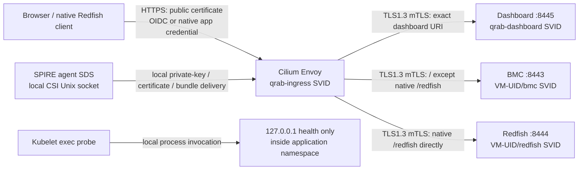

# Authenticated ingress backends

The public browser/native-client connection ends at Cilium Envoy. A separate
TLS 1.3 connection authenticates Envoy to the selected qrab application using
SPIRE-issued X509-SVIDs. Browser OIDC, cookies, Origin/CSRF and native Redfish
credentials keep their existing application checks.



The ingress identity is
`spiffe://yapplesauce.com/kubernetes/kube-system/qrab-ingress`. Enrollment binds
the actual Cilium Envoy container, its ServiceAccount, namespace, image, Pod UID
and Unix UID. It grants no user role. The dashboard accepts this ingress
identity; BMC and Redfish also retain their existing dashboard/same-VM peer
admission. Redfish metrics has its separate operator/telemetry allowlist.

The maintained Cilium fork adds `ingress.cilium.io/spiffe-backends`, a JSON map
from exact `Service:port-name-or-number` to the backend SPIFFE URI. The qrab
namespace requires this map. Missing, malformed, duplicate, partial, foreign
trust-domain/namespace or unused entries remove the routes rather than selecting
plaintext. The map is bounded to64 entries and16KiB. A shared Service/port
retains SPIFFE transport if referenced by another route; conflicting peer pins
make certificate matching fail for every peer. Other namespaces retain their
existing behavior unless explicitly opting in.

For example, the dashboard Service's `https` port uses:

```yaml
ingress.cilium.io/spiffe-backends: '{"qrab-dashboard:https":"spiffe://yapplesauce.com/kubernetes/qrab/qrab-dashboard"}'
```

Each backend cluster requires TLS1.3, a client SVID from the fixed
`qrab-spire-agent` bootstrap cluster, the local SPIRE bundle and an exact URI SAN
match. It uses HTTP/1.1 for qrab's HTTP, SSE and WebSocket backends. The bootstrap
cluster reaches only `/run/spire-workload/agent.sock` over local gRPC; annotations
cannot choose a credential source, proxy URL or remote SDS endpoint.

The installed Cilium Envoy image lacks the `envoy.tls.cert_validator.spiffe`
extension. Its standard X509 verifier therefore checks signature, chain,
certificate lifetime and purpose against the local SPIRE bundle, plus the exact
URI SAN. Per-Envoy node metadata asks SPIRE SDS to supply that standard validation
context. No public CA store, trust-any certificate mode or federated bundle is
used. This is SPIRE-issued X509-SVID mTLS with URI pinning; the specialized
SPIFFE profile validator is not present. SPIRE documents this
[SDS integration and per-node option](https://spiffe.io/docs/latest/deploying/spire_agent/#envoy-sds-support).

The Envoy process is a trusted TLS termination point: it sees decrypted frontend
requests in memory before encrypting the backend hop. Neither the ingress
controller nor Kubernetes Secret objects receive its workload private key;
SPIRE sends it directly to the attested Envoy process. Public ACME certificates
keep their separate existing Secret/SDS lifecycle.

## Native agent and image admission prerequisites

Use the runtime's **ContainerStatus.ImageID**, such as
`quay.io/cilium/cilium-envoy@sha256:…`, for the image selector. The Pod spec's
`tag@digest` string need not appear in the attested selectors. SPIRE derives
image selectors from ContainerStatus.Image/ImageID; its
[Kubernetes attestor reference](https://github.com/spiffe/spire/blob/main/doc/plugin_agent_workloadattestor_k8s.md#image-selector-limitations)
explains why digest-based identifiers are reliable. Keep the namespace,
ServiceAccount, container name, Unix UID and controller-added Pod UID constraints.

The native agents on kube01/02/03 also calculate executable hashes. The pinned
Envoy executable is 75,395,768 bytes, above this cluster's former 64 MiB limit.
The inline Unix attestor configuration in `/etc/spire/agent.conf` now uses:

```hcl
WorkloadAttestor "unix" {
    plugin_data {
        discover_workload_path = true
        workload_size_limit = 134217728
    }
}
```

The 128 MiB limit remains finite and executable hashing stays enabled. A binary
over the limit causes the Unix attestor to fail the entire attestation, even
when registration does not require a hash selector. See the
[Unix attestor contract](https://github.com/spiffe/spire/blob/main/doc/plugin_agent_workloadattestor_unix.md).
These native files are maintained on the nodes separately from Flux resources.

Validate a candidate with `spire-agent validate -config CANDIDATE`, keep a
root-only local backup, and restart one agent at a time. Check agent health,
SDS issuance and application traffic before continuing. The current inline
`plugin_data` requires restart; SPIRE's dynamic reload uses `SIGUSR1` with
`plugin_data_file`, as described in its
[configuration reference](https://spiffe.io/docs/latest/deploying/spire_agent/#reconfiguring-plugins-posix-only).
`RuntimeDirectoryPreserve=yes` keeps the CSI-mounted public socket directory's
inode stable across restart. That directory exposes only the public agent
socket; administrative sockets belong outside it.

## Health and standalone local access

Ordinary dashboard/BMC/Redfish HTTP binds literal loopback. In workload mode it
serves only exact health paths, without query strings. Application routes are on
the mTLS listeners. Kubelet probes execute `probe-health`/`probe-ready` in the
container and perform a fixed loopback read under a two-second total deadline;
they initialize no OIDC or Kubernetes client. The operator health listener is
also loopback with an exec probe. No remote plaintext health listener is needed.

Standalone development can retain its authenticated application router on
loopback when the workload listener is absent. This local kernel boundary is
not described as encrypted; it cannot be used for network ingress. No QMP, QGA
or VNC TCP listener is introduced.

## Public per-VM entrypoints

Native `/redfish` routes to Redfish :8444 directly. Other console paths route to
BMC :8443. The browser `/bmc/redfish` adapter remains a separate authenticated BMC
route; it still reaches its same-VM Redfish over mTLS.

The [console helper](../contrib/kubernetes/examples/qrab-demo/render-console.sh) renders
`console.yaml` only after an existing VM has an immutable UID. It binds the
Service selector and both expected peer IDs to that UID. It creates no VM or
identity claim. Replacing a VM resource requires an explicit new binding;
reusing its old public infrastructure cannot silently authorize a new UID.

## Release order

Verify the native attestor prerequisites, enroll the Envoy SVID and CSI mount,
and stage the fixed bootstrap SDS cluster
through kubernetes-gitops. Keep the bootstrap's existing Cilium clusters and
settings intact. Then activate the tested Cilium operator translation image
and the independently published qrab operator/dashboard/manager images with
their exact SVID image selectors. Apply the scoped qrab Deployments, Services,
Ingresses and policies; never recreate an inactive VM as a side effect.

Verify the public HTTPS response, actual URI/SDS configuration, wrong peers,
missing client certificates, untrusted issuers, closed ordinary Pod ports,
native Redfish routing and rotation on all Envoy nodes. Source tests and an
image pin alone do not establish a deployed backend's protection. Record final
digests and live observations in [platform evidence](connections/platform-evidence.md).
