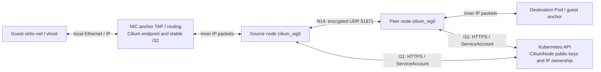

# Cluster Pod link encryption

Cilium WireGuard now encrypts traffic between managed IPv4 Pods on different
nodes, including qrab's stable guest NIC anchor addresses. Application
protocols remain unchanged. Service SPIFFE mTLS continues independently inside
that tunnel; a plain guest TCP application remains plain at its TAP and Pod
boundary and becomes ciphertext on the cross-node WireGuard link.



This host-namespace `cilium_wg0` is separate from a VPN NIC's anchor-namespace
`wg0`. The VPN tunnel terminates at its configured provider. The cluster tunnel
terminates at peer cluster nodes. Same-node traffic stays within the local
kernel boundary.

The deployed configuration enables strict ingress and egress encryption for
`10.244.0.0/16`, which includes the guest `10.244.128.0/17` range. A missing
encryption-key marker drops the packet. The live test confirmed this drop and
restored the exact original entry afterward. IPv6 is disabled on this cluster;
the strict egress CIDR is an IPv4 setting.

Node public keys are published through the authenticated Kubernetes API. Kernel
WireGuard peer prefixes follow Cilium's current IP-to-node ownership. The qrab
fork tracks both applied ownership and pending intent: moving a stable guest IP
A → B → A cannot reuse a stale peer cache, and a failed retry cannot reclaim an
IP after rollback. Unknown new peers retire the old binding until enrollment.
This preserves the guest address, ordinary protocols and existing policy identity.

The manager also keeps its QMP-backed heartbeat running throughout an
authenticated migration target's startup wait. Storage, swtpm and NIC preparation
can take longer than the five-second probe freshness limit. The limit remains
unchanged; healthy QMP responses now keep the source live during that wait.

[Live evidence](connections/platform-evidence.md#strict-pod-wireguard-rollout-2026-11-16)
records image digests, strict configuration, repeated moves, missing-key refusal,
DNS, capture hashes and capture losses. The persistent TCP oracle can use an
existing Python client Pod and a payload larger than the tunnel MTU:

```sh
CLIENT_POD=probe CLIENT_POD_NAMESPACE=default \
MIGRATION_TARGETS=kube02,kube03 STREAM_PADDING=4096 \
bash contrib/check-nic-ct-handoff.sh encrypted-ct
```

Keep the client on a third node. The guest's security group permits only TCP5000
in and no new egress, so the one server-push connection requires imported
conntrack state after every move. The script cleans up its disposable VM;
retained disk data keeps its normal storage semantics.

## Remaining node boundaries

Pure host traffic, native iSCSI, BGP and ordinary external traffic are outside
this Pod-to-Pod mode. Cilium also excludes world-origin traffic forwarded by an
intermediate node, including that origin's temporary handoff path. Those links
remain tracked separately. See the
[native link prototype and deployment requirements](node-link-encryption.md)
for the remaining Ethernet/storage boundary. All three nodes are control-plane nodes;
`nodeEncryption` stays false and its control-plane bootstrap exclusion remains
intact. Forcing encryption there can lock nodes out of the API needed to update
their keys. The [Cilium guide](https://docs.cilium.io/en/stable/security/network/encryption-wireguard/)
describes that boundary and bootstrap dependency.

Source: [verified agent ownership implementation](https://gitea.yapplesauce.com/forks/cilium/src/commit/b62a4ec4f00c17b37f411ebd2ed589be7b3bb222/pkg/wireguard/agent/agent.go),
[deployed configuration](https://gitea.yapplesauce.com/sam/kubernetes-gitops/src/commit/129ca324e9824105ef9363887f3bfe8853df8a04/infrastructure/controllers/cilium.yaml),
[manager supervision](../projects/manager/src/pod/supervisor.rs) and
[handoff oracle](../contrib/check-nic-ct-handoff.sh).
