# Native node and storage links

The deployed [Pod WireGuard boundary](node-encryption.md) leaves native node,
iSCSI, BGP and world-origin forwarding traffic outside its scope. The requested
policy preserves guest protocols and encrypts cluster/node links and VPN NICs.
The existing [VPN NIC](networking.md#vpn-nics) keeps its own WireGuard tunnel
and kill switch. Arbitrary guest protocols do not become SPIFFE TLS protocols.

## Isolated evidence — 2026-11-16

Native MACsec with standard MKA passed a three-endpoint namespace experiment
on kube01. It is a candidate for the Ethernet segment between the three nodes
and physical storage/gateway. **Production native links remain unchanged and
unencrypted at this layer.** No production address, route, interface, bridge or
service was modified. The BPF test runner's temporary tunnel sysctl was restored.

The [tool recipe and oracle](../contrib/network-encryption/README.md) use Debian
`wpasupplicant 2:2.11-7`, verified HTTPS retrieval and archive signatures. Each
test generates a CAK/CKN in a root-only `/run` directory and removes its private
namespaces/configurations afterward. Bundled libraries replace no host package.

- IPv4/IPv6 UDP and 8 KiB TCP echo on ports 179/3260 preserved source addresses.
  These are synthetic port checks, not actual BGP/iSCSI implementation tests.
- Wrong CAKs and plaintext injection were refused. Replaying a valid encrypted
  frame increased the receiver's kernel replay-rejection counter.
- MKA automatically rekeyed after the disposable transmit packet number was
  advanced near exhaustion, with no reset or packet-number/key reuse.
- Restarting the key server recovered connectivity with a fresh session key.
- A short lower-link capture counted 36 MACsec frames, six MKA frames and zero
  clear IP frames. This is not a production or performance capture.

[Machine-readable evidence](../contrib/network-encryption/prototype-evidence.json)
records hashes, versions, scope and limitations.

The [immutable tool bundle](../contrib/network-encryption/tools.ref) was pulled
back by digest and staged under `/var/tmp` on all three nodes. Its binary hash
and version were checked on each node. It installs no service or native package
and contains no CAK/configuration. Staging tools is separate from activation.

## Proposed transport

```mermaid
flowchart LR
    subgraph node["Node — proposed"]
        ip["Unchanged guest / host IP protocols"]
        upper["MACsec upper: Cilium IP policy"]
        lower["Physical lower: no production IP"]
        ip <--> upper
        upper <-->|"Kernel encrypt / authenticate"| lower
    end
    subgraph gateway["Physical storage / gateway — proposed"]
        bridge["br-kube lower: EAPOL forwarding"]
        hostupper["MACsec upper: existing gateway IP"]
        services["iSCSI, DHCP, routing, BGP"]
        bridge <-->|"Kernel authenticate / decrypt"| hostupper
        hostupper <--> services
    end
    lower <-->|"Encrypted MACsec data; authenticated MKA control"| bridge
```

MKA authenticates possession of a CAK and negotiates fresh session keys.
Ethernet addresses, MACsec headers and MKA metadata remain visible. The tested
CAK model authenticates link-group membership; it does not assign per-frame
SPIFFE identities. SPIFFE mTLS remains the separate qrab application boundary.
Native bootstrap must work without fetching keys through the Kubernetes API
that the link itself carries. Key distribution/rotation must preserve this.

MACsec would protect node-to-node and gateway-to-node traffic, including iSCSI,
BGP and migration forwarding. Encryption ends at the peer. Beyond the gateway,
traffic retains its application protocol or VPN protection. TAP/QEMU/shared
memory and Unix sockets remain local boundaries in the [atlas](connections.md).

## Cilium integration and deployment

The deployed Cilium host firewall drops MACsec/MKA traffic. A tested fork
change adds `macsec-underlay-devices`, empty by default. Only named external
lower devices pass EtherTypes `0x88e5` and `0x888e` to the kernel. MACsec uppers
and internal host devices receive no exception. Other traffic retains policy.
Tests of the actual compiled host entry points passed 24 cases, including
IPv4/IPv6 ingress/egress deny policy with the exception enabled.

Select both devices, for example `devices: [enp0s2, macsec0]`, and attach normal
IP policy/routing to the upper before moving addresses. These tests do not
verify production upper-device attachment. The option is not deployed/enabled.

Source: [maintained Cilium integration and tests](https://gitea.yapplesauce.com/forks/cilium/src/commit/517c5fe834e26db4f3fb10465c77cf957a5bc526/contrib/qrab-macsec-underlay.md).

Observed configuration uses systemd-networkd on all four hosts. Physical
`br-kube` owns `10.203.0.1/24` and the nodes' DHCP leases. Node `enp0s2` receives
its primary address through DHCP and carries the default route, API VIP/VRRP
and BGP next hops. Preserving those addresses preserves storage contracts.

Prepare and verify these changes together before native activation:

1. Stage the immutable tools, root-only MKA configuration, restartable systemd
   service and networkd upper configuration before kubelet/API-dependent
   services. Require encryption, strict validation and replay protection.
2. Forward EAPOL on the private bridge (group-forwarding bit 3). Test MKA on
   auxiliary addresses while production addresses/routes remain in place.
3. Publish/enroll Cilium separately; select the upper/lower, verify decrypted
   IP policy, and adjust direct routing, masquerade selection and tunnel MTUs.
4. Prepare coordinated networkd changes moving node/gateway addresses, DHCP,
   routes and VIP/VRRP to the upper, leaving no clear-IP lower fallback.
   Stage a native timed rollback on every host before the coordinated cutover.
5. Verify actual API/identity bootstrap, DHCP, BGP, iSCSI sessions/fencing,
   boot, repeated migration and VPN kill switches. Capture lower links with
   recorded losses. Exercise rekey, restart, reboot and rollback.

Physical-gateway root access remains unresolved: local noninteractive sudo
requires a password and the available SSH keys were rejected. Activation
depends on that access and the checks above. No completed production rollout
is claimed by this prototype.
