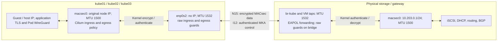
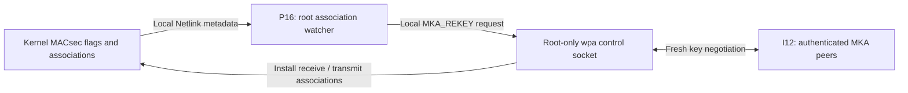

# Native node and storage links

Native MACsec now protects the private Ethernet segment joining the physical
gateway/storage host and kube01–kube03. The operator committed deployment
`68ffad993b6652e9b42cc8a1` on **2026-11-16**, using root kit `d338124`.
Its four-host receipt reports zero clear IPv4/IPv6 frames and zero capture drops.
[Dated deployment evidence](connections/platform-evidence.md#native-macsec-rollout-2026-11-16)
separates that receipt from subsequent runtime and guest checks.

This covers native node traffic, iSCSI, BGP and world-origin forwarding across
that segment. [Pod WireGuard](node-encryption.md) and application SPIFFE mTLS
continue inside it. A [VPN NIC](networking.md#vpn-nics) retains its separate
WireGuard tunnel and kill switch. Guest application protocols are preserved;
their protection beyond the gateway or VPN peer depends on those protocols.

## Isolated evidence — 2026-11-16

Native MACsec with standard MKA passed a three-endpoint namespace experiment
on kube01 before production deployment. That experiment changed no production
address, route, interface, bridge or service. The BPF test runner's temporary
tunnel sysctl was restored. These isolated results remain distinct from the
production rollout recorded above.

The [tool recipe and oracle](../contrib/network-encryption/README.md) use Debian
`wpasupplicant 2:2.11-7`, verified HTTPS retrieval and archive signatures. Each
test generates a CAK/CKN in a root-only `/run` directory and removes its private
namespaces/configurations afterward. Bundled libraries replace no host package.

- IPv4/IPv6 UDP and 8 KiB TCP echo on ports 179/3260 preserved source addresses.
  These are synthetic port checks, not actual BGP/iSCSI implementation tests.
- Wrong CAKs and plaintext injection were refused. Replaying a valid encrypted
  frame increased the receiver's kernel replay-rejection counter.
- MKA automatically rekeyed after the disposable transmit packet number was
  advanced near exhaustion, with no reset or packet-number/key reuse.
- Restarting the key server recovered connectivity with a fresh session key.
- A short lower-link capture counted 36 MACsec frames, six MKA frames and zero
  clear IP frames. This is not a production or performance capture.

[Machine-readable evidence](../contrib/network-encryption/prototype-evidence.json)
records hashes, versions, scope and limitations.

The [immutable tool bundle](../contrib/network-encryption/tools.ref) was pulled
back by digest and staged under `/var/tmp` on all three nodes. Its binary hash
and version were checked on each node. It installs no service or native package
and contains no CAK/configuration. Staging tools is separate from activation.

## Deployed transport

MKA authenticates possession of a CAK and negotiates fresh session keys.
Ethernet addresses, MACsec headers and MKA metadata remain visible. The tested
CAK model authenticates link-group membership; it does not assign per-frame
SPIFFE identities. SPIFFE mTLS remains the separate qrab application boundary.
The root coordinator distributes the CAK/CKN over host-key-verified SSH (A6),
with root-only state/configuration on each peer. Native startup uses those local
files and standard MKA without a Kubernetes API dependency. Session rekey is
automatic; changing the shared CAK is a separate coordinated operation. The kit
does not implement SPIRE-based CAK distribution or automatic CAK rotation.

MACsec protects node-to-node and gateway-to-node traffic, including iSCSI,
BGP and migration forwarding. Encryption ends at the peer. Beyond the gateway,
traffic retains its application protocol or VPN protection. TAP/QEMU/shared
memory and Unix sockets remain local boundaries in the [atlas](connections.md).

## Cilium integration and deployment

The [root deployment coordinator](../contrib/network-encryption/DEPLOYMENT.md)
packages native preflight, cutover, verification and rollback. Its Cilium
prerequisite was published and rolled out separately before the operator ran
the offline kit as root on the gateway.

The prepared Cilium agent is
`sha256:9f5fa41a6224621f32cc19555f92fdee7a90e066d75ddb7713973971c603fd3e`,
source `517c5fe834`, deployed through
[GitOps PR 485](https://gitea.yapplesauce.com/sam/kubernetes-gitops/pulls/485).
The subsequent production inspection confirmed both real TCX hooks on each
node's actual `macsec0`, with host firewall devices `enp0s2` and `macsec0`.
Strict validation, encryption and replay protection are enabled, using
`GCM-AES-128` with a zero replay window.

The deployment fixture additionally disables reverse-path filtering and keeps
clear primary IPs during staging. A forged unencrypted packet reached the
application when the receiver guard was deliberately removed; restoring the
guard blocked it. The kit therefore enforces both raw ingress and egress
independently of address placement or reverse-path filtering.

The original Cilium host firewall dropped MACsec/MKA traffic. The prepared fork
adds `macsec-underlay-devices`, empty by default. Only named external
lower devices pass EtherTypes `0x88e5` and `0x888e` to the kernel. MACsec uppers
and internal host devices receive no exception. Other traffic retains policy.
Tests of the actual compiled host entry points passed 24 cases, including
IPv4/IPv6 ingress/egress deny policy with the exception enabled.

Select both devices, for example `devices: [enp0s2, macsec0]`, and attach normal
IP policy/routing to the upper before moving addresses. The prerequisite image
alone creates no MACsec interface. The root cutover created the actual uppers,
moved the addresses and installed persistent configuration and raw guards.

Source: [maintained Cilium integration and tests](https://gitea.yapplesauce.com/forks/cilium/src/commit/517c5fe834e26db4f3fb10465c77cf957a5bc526/contrib/qrab-macsec-underlay.md).

All four hosts use systemd-networkd. Their original addresses now live on
`macsec0`; node addresses are static at their existing reservations. Gateway
DHCP configuration moved to its upper. The API VIP remains `10.203.0.10`,
on a node upper; default routes and BGP next hops retain their original IPs.
Raw lowers have no IP addresses. Private lowers/taps use MTU 1532, uppers 1500,
and node `cilium_wg0` interfaces remain MTU 1405. WAN interfaces are unchanged.

The kit stages a native rollback timer on every peer before touching networking.
It tests every directional auxiliary peer path before cutover, then API TLS,
routes, BGP/iSCSI session preservation, raw guards and bounded captures before
commit. Successful commit removes the uncommitted tokens and disables those
timers. Persistent guard/MKA services start before network-dependent control
services; the [runbook](../contrib/network-encryption/DEPLOYMENT.md) describes
recovery and the boundary between rollback and intentional operation.

Post-cutover kube02 reboot checks confirmed native persistence and exposed a
Netplan wait still bound to the raw lower. The corrected node drop-in now
waits for the upper's routable IPv4/DNS, is journaled on all three nodes and
passed a further real reboot. Historical kit `d284d28` contains that fix; the
current recovery kit below includes it as well.

## Association recovery

Further reboot checks found a multiparty MKA failure: a peer can retain an
active receive channel with no receive association. The supplicant remains
running, and other peers can still work. On kube03 this blocked peer ARP/etcd
while its gateway association and gateway SSH worked. The original commit's
bounded captures do not prove recovery after later membership changes.

The isolated four-peer test reproduced this state on clients and the key
server. Restarting the supplicant can reproduce it again. Source `6535a29`
adds a root-only local `MKA_REKEY` control request to Debian `2:2.11-7`.
The key server uses its existing SAK generation/distribution state machine;
a client selects a fresh MKA member identifier while retaining its receive
channels. The control reply contains no keys. MKA wire authentication,
key derivation, strict validation and replay window zero stay enforced.

The watcher checks protection, the encoding transmit association and active
receive channels. An absent peer alone does not trigger repair. Persistent
fault thresholds are staggered from 10 to 25 seconds, with a 90-second startup
allowance and a 60-second cooldown preserved across watcher restarts. Its
systemd unit permits Unix and Netlink sockets. Recovery retains the interfaces,
addresses and Cilium hooks.

The [kernel fixture](../contrib/network-encryption/tests/check-association-health.py)
checks every directional path, server/client association loss, key-server and
member rejoins, old-association retirement, fresh transmit-key identifiers,
wrong-CAK refusal and retained raw guards. It also exercises the actual tool
installer with a private process adapter for systemd, including an idempotent
rerun and preservation of the original profile, MKA configuration and agent.

The patched [tool release](../contrib/network-encryption/deployment-release.json)
is published and the verified offline kit is
`/home/bob/operations/qrab-native-link-dc7b94f`. Existing deployments use the
[separate health upgrade](../contrib/network-encryption/DEPLOYMENT.md#upgrade-association-recovery)
to install it. Publication and isolated tests are distinct from the operator's
root execution and subsequent production proof recorded in the dated evidence.

The [2026-11-17 runtime proof](connections/platform-evidence.md#native-health-upgrade-verification-2026-11-17)
confirmed the patched binary and active watcher on all four hosts, twelve
directed peer paths and zero-loss/no-clear-IP captures. The original upgrade
receipt lost two SSH acknowledgements; its partial result was reconciled with
the running state. Future node activation survives its SSH session and is
checked through the read-only `health-status` operation.

Production evidence has a defined observation window. It does not turn the
isolated replay/wrong-key/rekey tests into production fault-injection tests,
prove encryption at rest, or prove a physical gateway reboot. See the dated
record for the actual guest, VPN and node restart checks and remaining limits.
