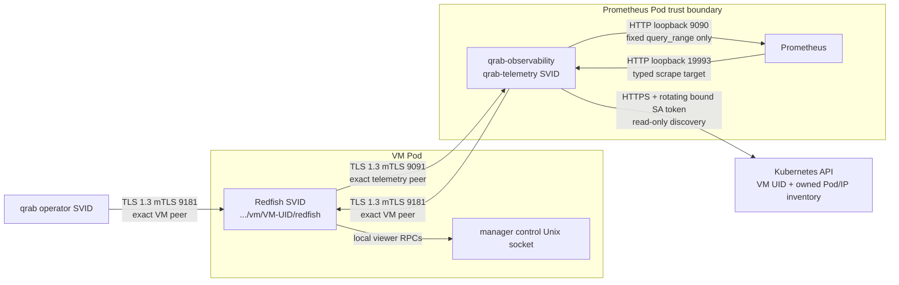

# Workload-authenticated VM observability

VM metrics and history use the Redfish container's SVID, independent of user
OIDC sessions. Prometheus does not receive user credentials. Its dedicated
`qrab-observability` sidecar has the exact identity
`spiffe://yapplesauce.com/kubernetes/monitoring/qrab-telemetry`.
This is separate from the existing native `spiffe-telemetry` adapter and SVID.

`/metrics` on port 9181 accepts exactly the operator and qrab telemetry
identities. It serves the existing sanitized viewer-level export, with the
same coalescing, manager deadlines and network policy. It cannot serve
Redfish actions. The operator derives the expected Redfish identity from the
VM namespace and immutable UID. The Pod IP selects an address, never authority.
Plain HTTP is not accepted on this network listener. Without workload
configuration, standalone Redfish can expose metrics only on literal loopback;
its default is `127.0.0.1:9181`.

Prometheus's PodMonitor sends scrapes to `127.0.0.1:19993`, supplying namespace,
VM UID and Pod IP from discovery metadata. The adapter accepts only a current
VM-owned, nonterminating Pod with a native, restartable Redfish init container
at that address. It fixes the remote port
to 9181, path to `/metrics` and expected SVID to that VM's `/redfish` role.
No URL, proxy destination or certificate identity comes from the caller.

For history, Redfish verifies the exact telemetry SVID on
`https://qrab-prometheus-history.monitoring.svc:9091`. The adapter's TLS policy
admits only exact Redfish identities in its current API-derived inventory.
Every request rechecks identity membership and certificate expiry, including
keep-alive connections. The only allowed route is `GET /api/v1/query_range`.
The query must exactly match one of Redfish's six fixed metric templates for a
Pod owned by that certificate's VM. Both source and target Pods can be present
during migration. Other VMs, arbitrary PromQL, admin routes, extra/duplicate
parameters, excessive ranges and oversized answers are refused. VM egress to
the raw Prometheus port 9090 is explicitly denied.

The adapter refreshes discovery every five seconds. It limits inventory to
512 VMs/Pods, refuses partial paginated results and expires all discovery
authority after 15 seconds without a successful refresh. Removed VM identities
lose access after the next refresh; an API outage cannot retain access
indefinitely. The shared TLS listener bounds 32 connections, including eight
concurrent handshakes. At most 16 adapter upstream reads run concurrently,
with an eight-second total deadline and a 1 MiB response limit. Redfish keeps
its tighter two-second history budget and caches. SVIDs rotate through the
Workload API without copying keys into files or restarting the Pod.

The two loopback HTTP legs are local to one Pod's network namespace. The
Prometheus process and its telemetry adapters are a common trust boundary;
localhost is not described as encrypted. Only the qrab adapter mounts its
container-attested Workload API socket and a rotating projected Kubernetes
token for discovery. No Kubernetes token is mounted into VM Pods. Existing
Prometheus, Grafana and native telemetry transports outside these qrab paths
keep their own contracts.

## Release and verification

Build/publish the operator image (which includes `qrab-observability`) and
manager image from a clean source revision. Stage the telemetry identity,
namespaced read RBAC, history Service, private-image-pull enrollment and
operator identity pin in kubernetes-gitops first. The telemetry SVID selects the
monitoring namespace, existing Prometheus ServiceAccount, `qrab-telemetry`
container, immutable image and Unix UID. Native pull policy must bind that
ServiceAccount's existing UID to the operator repository on all nodes before
activating the new sidecar.

Then activate the monitoring sidecar through GitOps, retaining the Prometheus
TSDB claim and existing native adapter. Roll the operator and manager images
and apply the updated PodMonitor. Check scrape targets, VM `status.powerState`,
scoped history and cross-node migration. Test wrong/missing certificates and
plaintext rejection; do not infer a successful rollout from a source test.
Record deployed digests and observations in [platform evidence](connections/platform-evidence.md).

Source: [adapter](../projects/qrab-observability/src/lib.rs),
[metrics/policies](../projects/operator/src/resources.rs),
[power reader](../projects/operator/src/power.rs),
[history client](../projects/redfish/src/history.rs),
[PodMonitor](../contrib/kubernetes/monitoring/podmonitor.yaml).

The read-only [workload probe](../projects/qrab-observability/examples/workload_probe.rs)
can verify the deployed network paths without a human login or exporting SVID
keys. Build with `cargo build --locked -p qrab-observability --example workload_probe`.
Run `workload_probe metrics qrab VM-UID POD-IP` inside an attested telemetry
container, and `workload_probe history qrab VM-UID POD-NAME` inside that VM's
Redfish container. It prints only identity, HTTP status, body size and series
count. Using another VM's Pod name tests the gateway's scope rejection.
Use `bash contrib/probe-observability.sh POD-NAMESPACE POD CONTAINER metrics|history VM-NAMESPACE VM-UID POD-IP|POD-NAME`
for the current x86_64 Linux cluster. The wrapper strips the local diagnostic
build, bounds it to32MiB and executes it from an anonymous memfd inside the
attested container. It uses the runtime's existing Perl and normal kernel/
seccomp policy; refusal fails the diagnostic, without a disk or plaintext
fallback. The VM's bounded1MiB control volume is never a staging area.
This tests workload transport and history scope, without an exported key or
token; it does not substitute for browser OIDC testing.
